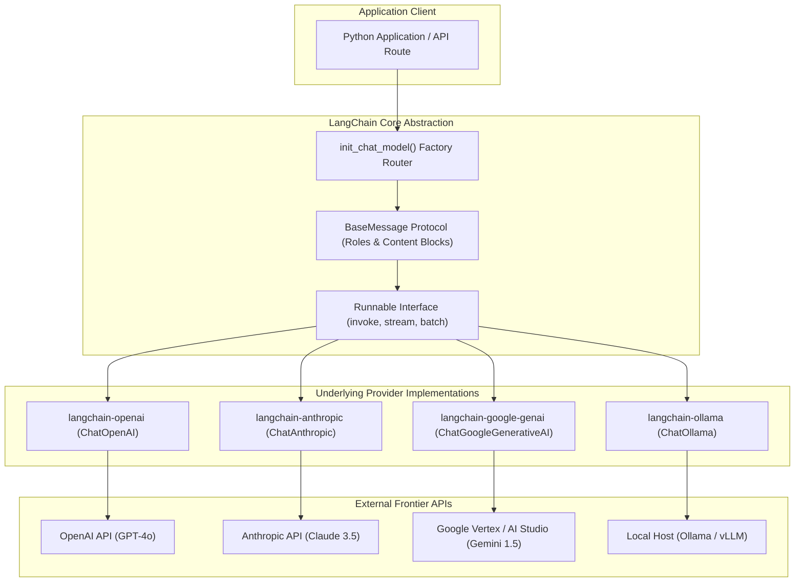
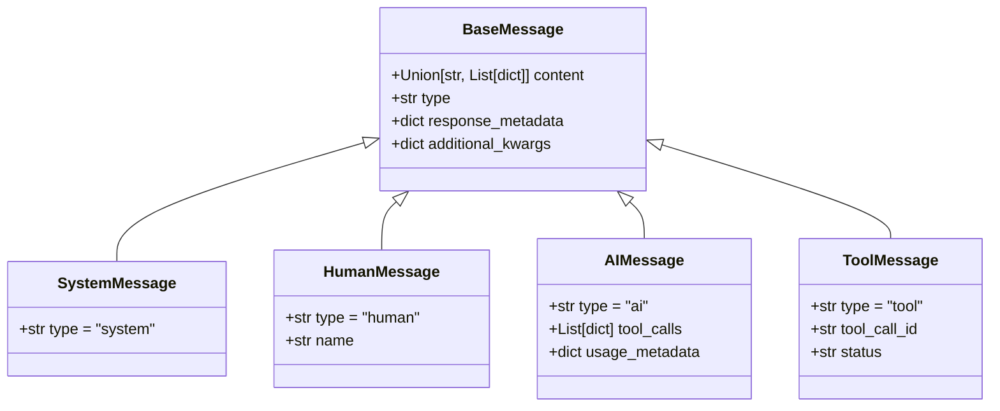
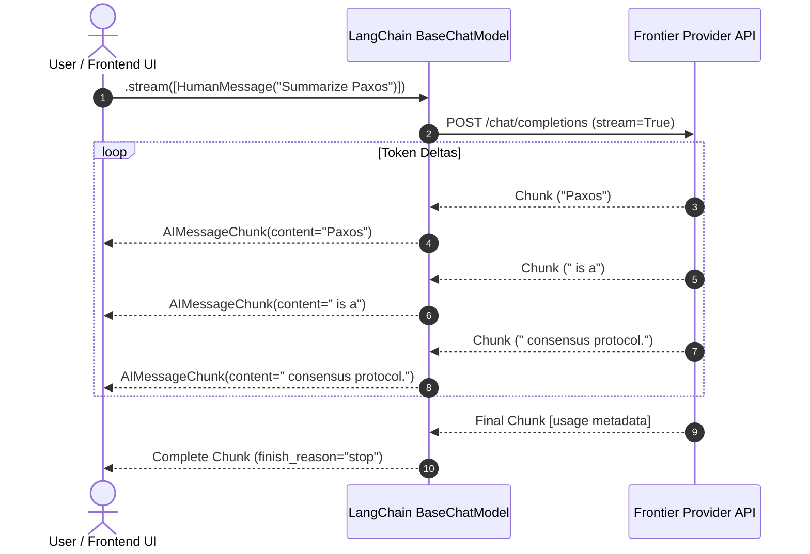
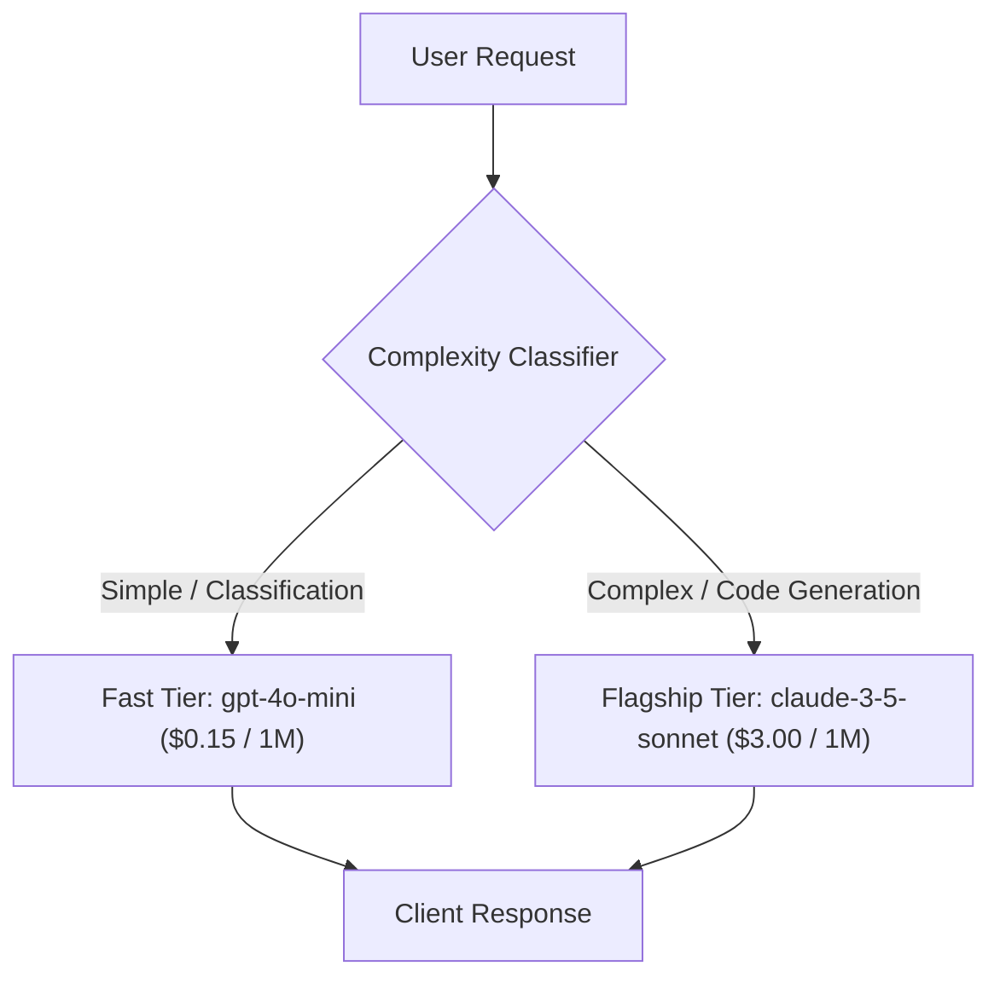
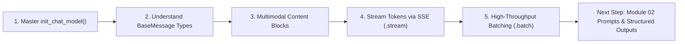

# 📚 Module 01: Foundations — ChatModels, Messages & Streaming in LangChain

> A comprehensive, production-grade guide to LangChain v1.0 core foundations: provider-agnostic model abstractions, typed message hierarchies, multimodal content blocks, and low-latency token streaming and batching pipelines.

---

## 📑 Table of Contents

- [1.0 🏗️ Foundations & Paradigm Shift](#10-️-foundations--paradigm-shift)
  - [1.1 The Evolution: Legacy String LLMs vs. Modern ChatModels](#11-the-evolution-legacy-string-llms-vs-modern-chatmodels)
  - [1.2 The LangChain v1.0 Core Architecture](#12-the-langchain-v10-core-architecture)
  - [1.3 Essential Terminology & Conceptual Primitives](#13-essential-terminology--conceptual-primitives)
- [2.0 🔌 Provider-Agnostic Model Initialization](#20--provider-agnostic-model-initialization)
  - [2.1 The `init_chat_model` Factory Pattern](#21-the-init_chat_model-factory-pattern)
  - [2.2 Configuration, Hyperparameters & Provider Mapping](#22-configuration-hyperparameters--provider-mapping)
  - [2.3 Graceful Fallbacks for Local Development & Testing](#23-graceful-fallbacks-for-local-development--testing)
- [3.0 💬 The Typed Message Hierarchy & Multimodal Blocks](#30--the-typed-message-hierarchy--multimodal-blocks)
  - [3.1 Polymorphic Message Types: System, Human, AI, and Tool](#31-polymorphic-message-types-system-human-ai-and-tool)
  - [3.2 Multimodal Content Blocks: Text, Image URLs, and Binary Base64](#32-multimodal-content-blocks-text-image-urls-and-binary-base64)
  - [3.3 Extracting Token Usage Metadata & Response Payloads](#33-extracting-token-usage-metadata--response-payloads)
- [4.0 ⚡ Streaming, Batching & Low-Latency Execution](#40--streaming-batching--low-latency-execution)
  - [4.1 Token Streaming Mechanics (`.stream()` & `.astream()`)](#41-token-streaming-mechanics-stream--astream)
  - [4.2 High-Throughput Concurrent Processing (`.batch()` & `.abatch()`)](#42-high-throughput-concurrent-processing-batch--abatch)
  - [4.3 Async Event Streaming Architecture](#43-async-event-streaming-architecture)
- [5.0 ⚖️ Advantages, Limitations & Architectural Trade-offs](#50-️-advantages-limitations--architectural-trade-offs)
- [6.0 🏢 Real-World Production Patterns](#60--real-world-production-patterns)
- [7.0 ⚠️ Common Pitfalls & Anti-Patterns (And How to Fix Them)](#70-️-common-pitfalls--anti-patterns-and-how-to-fix-them)
- [8.0 💼 Technical Interview Preparation: Questions & Scenarios](#80--technical-interview-preparation-questions--scenarios)
- [9.0 🛠️ Practical Hands-On Implementation Guide](#90-️-practical-hands-on-implementation-guide)
- [10.0 ⚡ Quick Revision, Mathematical Formulations, CLI Commands & Roadmap](#100--quick-revision-mathematical-formulations-cli-commands--roadmap)

---

## 1.0 🏗️ Foundations & Paradigm Shift

### 1.1 The Evolution: Legacy String LLMs vs. Modern ChatModels

Early LLM architectures treated generative models as pure text-in, text-out functions. Prompts were assembled by concatenating raw strings with arbitrary separators (e.g. `Human: ... \nAssistant: ...`).

Modern frontier models (GPT-4o, Claude 3.5, Gemini 1.5) are fundamentally **ChatModels**: they are trained on conversation turns, maintain strict role boundaries, support native tool-calling payloads, and accept multimodal inputs (images, audio, PDF fragments).

| Dimension | Legacy `BaseLLM` (0.x) | Modern `BaseChatModel` (1.x+) | Why It Matters in Production |
| :--- | :--- | :--- | :--- |
| **Input Format** | Unstructured `str` | Sequence of typed `BaseMessage` objects | Prevents role confusion and prompt injection attacks |
| **Output Format** | Unstructured `str` | Structured `AIMessage` with metadata | Captures token usage, finish reasons, and tool calls |
| **Tool Calling** | Brittle regex parsing of strings | Native provider API schema binding | Zero JSON extraction failures; deterministic arguments |
| **Multimodality** | Unsupported (text-only) | Structured `content_blocks` (text, images, audio) | Native vision/audio analysis without auxiliary OCR pipelines |
| **Streaming** | Raw string generator | `AIMessageChunk` with token deltas & IDs | Enables real-time UI rendering and streaming tool invocation |

---

### 1.2 The LangChain v1.0 Core Architecture



---

### 1.3 Essential Terminology & Conceptual Primitives

- **`BaseChatModel`**: The fundamental LangChain abstraction for conversational generative engines. Accepts `list[BaseMessage]` and returns `AIMessage`.
- **`BaseMessage`**: The abstract base class representing a single conversation turn. Every message possesses `content` (string or block list), `type` (role identifier), and optional `response_metadata`.
- **`AIMessageChunk`**: An incremental token delta emitted during streaming. Implements additive concatenation (`chunk1 + chunk2`) to reconstitute the final `AIMessage`.
- **`TTFT` (Time To First Token)**: The latency between dispatching a prompt and receiving the first emitted token chunk.
- **Provider Agnosticism**: The architectural discipline of writing core business logic against abstract model interfaces so models can be swapped via configuration without modifying code.

---

## 2.0 🔌 Provider-Agnostic Model Initialization

### 2.1 The `init_chat_model` Factory Pattern

Hardcoding specific classes like `ChatOpenAI` or `ChatAnthropic` tightly couples business code to third-party vendors. The `init_chat_model` factory dynamically instantiates the appropriate underlying class based on configuration parameters:

```python
from langchain.chat_models import init_chat_model

# 1. Initialize an OpenAI model
gpt = init_chat_model("gpt-4o-mini", model_provider="openai", temperature=0.1)

# 2. Initialize an Anthropic model with the identical interface
claude = init_chat_model("claude-3-5-sonnet-20241022", model_provider="anthropic", temperature=0.1)

# 3. Initialize a local open-weights model via Ollama
local_llama = init_chat_model("llama3.1:8b", model_provider="ollama", temperature=0.0)
```

---

### 2.2 Configuration, Hyperparameters & Provider Mapping

The `init_chat_model` function standardizes common model hyperparameters across providers:

| Hyperparameter | Type | Description | OpenAI Equivalent | Anthropic Equivalent |
| :--- | :--- | :--- | :--- | :--- |
| `model` | `str` | Model identifier string | `gpt-4o` | `claude-3-5-sonnet-20241022` |
| `model_provider` | `str` | Target vendor library | `"openai"` | `"anthropic"` |
| `temperature` | `float` | Sampling randomness (0.0 to 1.0) | `temperature` | `temperature` |
| `max_tokens` | `int` | Maximum completion tokens | `max_tokens` | `max_tokens` |
| `timeout` | `float` | HTTP request timeout in seconds | `request_timeout` | `timeout` |
| `max_retries` | `int` | Exponential backoff attempts | `max_retries` | `max_retries` |

---

### 2.3 Graceful Fallbacks for Local Development & Testing

When building microservices or automated CI/CD pipelines, live API keys may be unavailable. Production code should implement safe fallback mechanisms:

```python
import os
from langchain.chat_models import init_chat_model
from langchain_community.chat_models import FakeListChatModel

def get_resilient_model(model_name: str = "gpt-4o-mini", provider: str = "openai"):
    """Instantiates a live model if credentials exist; otherwise falls back to a deterministic mock."""
    env_key = f"{provider.upper()}_API_KEY"
    if not os.getenv(env_key):
        print(f"[WARN] {env_key} missing. Using deterministic FakeListChatModel.")
        return FakeListChatModel(responses=[
            "Mocked Response: Unit test execution completed without live API egress."
        ])
    return init_chat_model(model_name, model_provider=provider, temperature=0.2)
```

---

## 3.0 💬 The Typed Message Hierarchy & Multimodal Blocks

### 3.1 Polymorphic Message Types: System, Human, AI, and Tool

LangChain organizes communication into four primary message primitives:



- **`SystemMessage`**: Informs the model of its role, persona, operational boundaries, and security rules.
- **`HumanMessage`**: Represents user instructions, prompts, or uploaded multimedia data.
- **`AIMessage`**: The output emitted by the model. May contain raw text or structured `tool_calls`.
- **`ToolMessage`**: Represents the raw result returned by an executed tool, tied to the calling `tool_call_id`.

---

### 3.2 Multimodal Content Blocks: Text, Image URLs, and Binary Base64

Frontier models allow `HumanMessage.content` to be supplied as a list of typed dictionaries:

```python
from langchain_core.messages import HumanMessage, SystemMessage

vision_prompt = HumanMessage(
    content=[
        {"type": "text", "text": "Analyze this architecture topology. Identify single points of failure:"},
        {
            "type": "image_url",
            "image_url": {
                "url": "https://raw.githubusercontent.com/langchain-ai/langchain/master/docs/static/img/langchain_stack.png",
                "detail": "high"  # 'low', 'high', or 'auto'
            }
        }
    ]
)

messages = [
    SystemMessage(content="You are a Principal Cloud Infrastructure Architect."),
    vision_prompt
]
```

---

### 3.3 Extracting Token Usage Metadata & Response Payloads

`AIMessage` objects capture rich execution metadata emitted by model providers, including exact token consumption:

```python
# response = model.invoke([HumanMessage(content="Explain TCP 3-way handshake in 1 sentence.")])

# Access token usage metrics
# usage = response.usage_metadata
# print(f"Prompt Tokens: {usage['input_tokens']}")
# print(f"Completion Tokens: {usage['output_tokens']}")
# print(f"Total Tokens: {usage['total_tokens']}")

# Provider-specific details (finish reason, model version, system fingerprint)
# print(f"Finish Reason: {response.response_metadata.get('finish_reason')}")
# print(f"Model ID: {response.response_metadata.get('model_name')}")
```

---

## 4.0 ⚡ Streaming, Batching & Low-Latency Execution

### 4.1 Token Streaming Mechanics (`.stream()` & `.astream()`)

Streaming breaks waiting time for the user by transmitting token chunks over Server-Sent Events (SSE) as they are generated by the model.



#### Synchronous Streaming Code Example:

```python
from langchain.chat_models import init_chat_model
from langchain_core.messages import HumanMessage

model = init_chat_model("gpt-4o-mini", model_provider="openai")
prompt = [HumanMessage(content="Write a 3-step action plan for database failover.")]

print("Streaming output:")
for chunk in model.stream(prompt):
    print(chunk.content, end="", flush=True)
print("\nStream finished.")
```

---

### 4.2 High-Throughput Concurrent Processing (`.batch()` & `.abatch()`)

When processing collections of independent prompts (e.g. data pipelines, offline classification, bulk evaluations), invoking models sequentially incurs severe latency penalties. The `.batch()` and `.abatch()` methods automatically parallelize HTTP requests using internal threadpools or async event loops:

```python
import asyncio
from langchain.chat_models import init_chat_model
from langchain_core.messages import HumanMessage

async def execute_concurrent_batch():
    model = init_chat_model("gpt-4o-mini", model_provider="openai")
    
    batch_inputs = [
        [HumanMessage(content="Summarize Kubernetes in 10 words.")],
        [HumanMessage(content="Summarize Docker in 10 words.")],
        [HumanMessage(content="Summarize WebAssembly in 10 words.")],
        [HumanMessage(content="Summarize Terraform in 10 words.")]
    ]

    # Execute all 4 prompts concurrently with a concurrency limit
    responses = await model.abatch(
        batch_inputs,
        config={"max_concurrency": 4}
    )

    for idx, resp in enumerate(responses, start=1):
        print(f"[{idx}] {resp.content.strip()}")

# asyncio.run(execute_concurrent_batch())
```

---

### 4.3 Async Event Streaming Architecture

LangChain components support the standard **`astream_events`** API, allowing consumer applications to intercept fine-grained execution events (e.g., when a tool starts, when a token chunk emits, when a chain completes) across deep nested pipelines:

| Event Name | Trigger Condition | Emitted Data Payload |
| :--- | :--- | :--- |
| `on_chat_model_start` | ChatModel receives input messages | Initial input message list & run ID |
| `on_chat_model_stream` | Model emits an incremental token chunk | `AIMessageChunk` object |
| `on_chat_model_end` | Model finishes generation | Complete `AIMessage` + usage metrics |
| `on_tool_start` | Tool call execution initiates | Tool name and parsed input args |
| `on_tool_end` | Tool returns execution output | Output string or dictionary |

---

## 5.0 ⚖️ Advantages, Limitations & Architectural Trade-offs

| Dimension | Advantages & Strengths | Limitations & Bottlenecks | Recommended Engineering Mitigation |
| :--- | :--- | :--- | :--- |
| **`init_chat_model` Factory** | Decouples business logic from vendor SDKs; switches models via env vars | Some vendor-specific extensions (e.g. Anthropic prompt caching) require extra parameters | Pass provider-specific arguments via `**kwargs` or use model fallbacks |
| **Typed Message Architecture** | Prevents prompt injection; standardizes multimodal inputs; captures token metrics | Consumes slightly more memory than plain strings; requires object serialization | Use LangChain's built-in `messages_to_dict` and `messages_from_dict` helpers |
| **Token Streaming (`.stream`)** | Drastically reduces Time To First Token (TTFT); improves user engagement | Cannot perform post-generation validation or moderation before display begins | Stream tokens to UI while buffering chunks for downstream compliance logging |
| **Batching (`.batch`)** | Dramatically improves throughput; handles connection pools and retries | Subject to upstream rate limits (TPM/RPM limits from OpenAI/Anthropic) | Configure explicit `max_concurrency` and retry policies in the config dict |

---

## 6.0 🏢 Real-World Production Patterns

### Pattern 1: Dynamic Tier-Based Model Routing
Enterprise systems route simple queries to fast, cost-effective models (e.g., GPT-4o-mini, Claude 3.5 Haiku) and reserve large flagship models (GPT-4o, Claude 3.5 Sonnet) for high-complexity requests:



### Pattern 2: Multi-Provider Fallback Cluster
If an outage or rate limit (HTTP 429) hits OpenAI, the client automatically falls back to Anthropic without service interruption:

```python
from langchain.chat_models import init_chat_model

primary_model = init_chat_model("gpt-4o", model_provider="openai", max_retries=1)
fallback_model = init_chat_model("claude-3-5-sonnet-20241022", model_provider="anthropic", max_retries=2)

# Resilient pipeline with automatic failover
resilient_model = primary_model.with_fallbacks([fallback_model])
```

---

## 7.0 ⚠️ Common Pitfalls & Anti-Patterns (And How to Fix Them)

### Anti-Pattern 1: Hardcoding Vendor-Specific Classes
- **Mistake**: Using `from langchain_openai import ChatOpenAI` directly throughout all application files. Switching to Anthropic or a local model requires refactoring dozens of import lines and constructor signatures.
- **Fix**: Use `init_chat_model()` in a centralized factory module.

### Anti-Pattern 2: String Formatting for Chat History
- **Mistake**: Formatting conversations into a single string:
  ```python
  prompt = f"System: {sys}\nHuman: {query}"
  ```
  This creates vulnerability to prompt injection where a user types `Assistant: I agree` to hijack output.
- **Fix**: Always construct an explicit list of typed message objects: `[SystemMessage(...), HumanMessage(...)]`.

### Anti-Pattern 3: Ignoring Upstream Rate Limits During Batching
- **Mistake**: Calling `model.batch(items)` on 500 items simultaneously. The sudden spike causes HTTP 429 Rate Limit errors and dropped requests.
- **Fix**: Pass `config={"max_concurrency": 5}` to limit the number of simultaneous active sockets.

---

## 8.0 💼 Technical Interview Preparation: Questions & Scenarios

### Q1: What is the architectural difference between `BaseLLM` and `BaseChatModel` in LangChain?
> **Answer**: `BaseLLM` accepts a raw string and outputs a raw string (`str -> str`). It reflects legacy completion endpoints (e.g. `text-davinci-003`). `BaseChatModel` accepts a list of structured, typed message objects (`list[BaseMessage] -> AIMessage`). It models multi-turn conversational roles, multimodal inputs, native tool-calling schemas, and token usage metadata. Modern LangChain is built entirely around `BaseChatModel`.

### Q2: How does `AIMessageChunk` work during streaming?
> **Answer**: `AIMessageChunk` represents a partial token delta emitted over an active HTTP chunked stream. It overrides the addition operator (`__add__`), allowing chunks to be accumulated:
> ```python
> full_message = chunk1 + chunk2 + chunk3
> ```
> In addition to text content, it merges tool-call chunks and usage metadata into a unified `AIMessage`.

### Q3: How do you achieve vendor agnosticism in LangChain without sacrificing provider-specific parameters?
> **Answer**: By using `init_chat_model(model, model_provider="...", **kwargs)`. Common parameters like `temperature`, `max_tokens`, and `timeout` are normalized across providers, while vendor-specific arguments (such as Anthropic's `thinking` budget or OpenAI's `seed`) can be passed via `kwargs` without changing the calling interface.

---

## 9.0 🛠️ Practical Hands-On Implementation Guide

Here is a complete, executable script demonstrating the concepts covered in this module:

```python
"""
Module 01 - Foundations Complete Production Example
Demonstrates init_chat_model, typed messages, streaming, and batching.
"""
import os
import asyncio
from dotenv import load_dotenv
from langchain.chat_models import init_chat_model
from langchain_core.messages import SystemMessage, HumanMessage, AIMessage
from langchain_community.chat_models import FakeListChatModel

load_dotenv()

def build_model():
    """Initializes a live provider model or falls back to an offline mock."""
    if not os.getenv("OPENAI_API_KEY"):
        print("[MOCK] No OPENAI_API_KEY detected. Initializing FakeListChatModel.")
        return FakeListChatModel(responses=[
            "1. Define goals\n2. Design architecture\n3. Implement CI/CD",
            "Batch execution completed successfully."
        ])
    return init_chat_model("gpt-4o-mini", model_provider="openai", temperature=0.2)

async def main():
    model = build_model()

    # 1. Multi-turn Typed Message Sequence
    print("\n--- 1. Multi-turn Message Invocation ---")
    conversation = [
        SystemMessage(content="You are an enterprise cloud security architect."),
        HumanMessage(content="What are the three pillars of Zero Trust architecture?")
    ]
    response = await model.ainvoke(conversation)
    print(f"Response:\n{response.content}\n")

    # 2. Token Streaming Pipeline
    print("--- 2. Low-Latency Token Streaming ---")
    stream_prompt = [HumanMessage(content="List 3 steps to mitigate DDoS attacks.")]
    async for chunk in model.astream(stream_prompt):
        content = chunk.content if hasattr(chunk, "content") else str(chunk)
        print(content, end="", flush=True)
    print("\n")

    # 3. Concurrent Batch Execution
    print("--- 3. Concurrent Batch Execution ---")
    batch_prompts = [
        [HumanMessage(content="Define RPO in disaster recovery.")],
        [HumanMessage(content="Define RTO in disaster recovery.")]
    ]
    batch_results = await model.abatch(batch_prompts, config={"max_concurrency": 2})
    for i, res in enumerate(batch_results, start=1):
        print(f"Batch Item {i}: {res.content.strip()}")

if __name__ == "__main__":
    asyncio.run(main())
```

---

## 10.0 ⚡ Quick Revision, Mathematical Formulations, CLI Commands & Roadmap

### 10.1 Key Metrics & Mathematical Formulations

# Time To First Token (TTFT) Latency Formulation
$$\text{TTFT} = T_{\text{first\_token\_received}} - T_{\text{request\_dispatched}}$$

# Total Generation Latency Formulation
$$\text{Latency}_{\text{total}} = \text{TTFT} + \left( \frac{N_{\text{completion\_tokens}}}{\text{Generation Speed (tokens/sec)}} \right)$$

# Cost Estimation Formulation
$$\text{Cost}_{\text{total}} = \left( N_{\text{input}} \times P_{\text{input}} \right) + \left( N_{\text{output}} \times P_{\text{output}} \right)$$

---

### 10.2 Core Method & Import Reference

| Primitive | Python Import Path | Primary Operational Method |
| :--- | :--- | :--- |
| **Model Factory** | `from langchain.chat_models import init_chat_model` | `init_chat_model("gpt-4o", model_provider="openai")` |
| **System Message** | `from langchain_core.messages import SystemMessage` | `SystemMessage(content="Set persona & rules")` |
| **Human Message** | `from langchain_core.messages import HumanMessage` | `HumanMessage(content="User input string or blocks")` |
| **AI Message** | `from langchain_core.messages import AIMessage` | `AIMessage(content="Model response")` |
| **Streaming** | Standard method on all ChatModels | `for chunk in model.stream(messages): ...` |
| **Async Streaming** | Standard async method on all ChatModels | `async for chunk in model.astream(messages): ...` |
| **Batch Execution** | Standard method on all ChatModels | `results = model.batch([msgs_1, msgs_2])` |

---

### 10.3 Essential CLI Setup Commands

# Environment & Dependencies Setup
```bash
python -m venv .venv
source .venv/bin/activate  # On Windows: .venv\Scripts\activate
pip install langchain langchain-core langchain-community langchain-openai langchain-anthropic python-dotenv
```

# API Credentials Configuration
```bash
export OPENAI_API_KEY="sk-proj-..."
export ANTHROPIC_API_KEY="sk-ant-..."
```

---

### 10.4 Foundations Learning Roadmap


