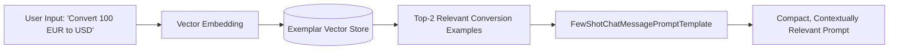
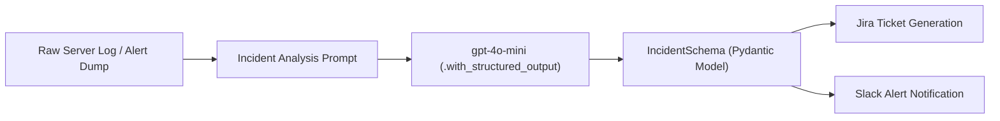
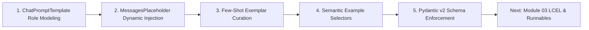

# 📚 Module 02: Prompts and Structured Output in LangChain

> A comprehensive, production-grade guide to prompt engineering, dynamic few-shot selection, and schema-enforced structured data extraction using Pydantic v2 and typed model interfaces in LangChain v1.0.

---

## 📑 Table of Contents

- [1.0 🏗️ Core Architecture & Fundamentals](#10-️-core-architecture--fundamentals)
  - [1.1 Modern Prompt Composition: Beyond String Formatting](#11-modern-prompt-composition-beyond-string-formatting)
  - [1.2 The Evolution of Structured Outputs: Regex vs. Function Calling](#12-the-evolution-of-structured-outputs-regex-vs-function-calling)
  - [1.3 Core Primitives & Terminology](#13-core-primitives--terminology)
- [2.0 🎯 Prompt Templates & Dynamic Injection](#20--prompt-templates--dynamic-injection)
  - [2.1 `ChatPromptTemplate` Multi-Turn Role Structuring](#21-chatprompttemplate-multi-turn-role-structuring)
  - [2.2 Dynamic History Injection with `MessagesPlaceholder`](#22-dynamic-history-injection-with-messagesplaceholder)
  - [2.3 Partial Variables & Template Formatting](#23-partial-variables--template-formatting)
- [3.0 💡 Few-Shot Prompting with Semantic Example Selection](#30--few-shot-prompting-with-semantic-example-selection)
  - [3.1 The Value of Exemplar Conditioning](#31-the-value-of-exemplar-conditioning)
  - [3.2 Dynamic Retrieval with `SemanticSimilarityExampleSelector`](#32-dynamic-retrieval-with-semanticsimilarityexampleselector)
  - [3.3 Token Budget Management for Few-Shot Prompts](#33-token-budget-management-for-few-shot-prompts)
- [4.0 🛡️ Native Structured Outputs (`.with_structured_output`)](#40-️-native-structured-outputs-with_structured_output)
  - [4.1 Pydantic v2 Schema Modeling & Field Validation](#41-pydantic-v2-schema-modeling--field-validation)
  - [4.2 TypedDict Lightweight Alternatives](#42-typeddict-lightweight-alternatives)
  - [4.3 Provider Modes: Function Calling vs. JSON Mode](#43-provider-modes-function-calling-vs-json-mode)
- [5.0 🧩 Classical & LCEL Output Parsers](#50--classical--lcel-output-parsers)
  - [5.1 StrOutputParser & CommaSeparatedListOutputParser](#51-stroutputparser--commaseparatedlistoutputparser)
  - [5.2 JsonOutputParser & PydanticOutputParser](#52-jsonoutputparser--pydanticoutputparser)
  - [5.3 Format Instructions Injection](#53-format-instructions-injection)
- [5.0 ⚖️ Advantages, Limitations & Architecture Trade-offs](#50-️-advantages-limitations--architecture-trade-offs)
- [6.0 🏢 Real-World Production Patterns](#60--real-world-production-patterns)
- [7.0 ⚠️ Common Pitfalls & Anti-Patterns (And How to Fix Them)](#70-️-common-pitfalls--anti-patterns-and-how-to-fix-them)
- [8.0 💼 Technical Interview Preparation: Questions & Scenarios](#80--technical-interview-preparation-questions--scenarios)
- [9.0 🛠️ Practical Hands-On Implementation Guide](#90-️-practical-hands-on-implementation-guide)
- [10.0 ⚡ Quick Revision, Mathematical Formulations, CLI Commands & Roadmap](#100--quick-revision-mathematical-formulations-cli-commands--roadmap)

---

## 1.0 🏗️ Core Architecture & Fundamentals

### 1.1 Modern Prompt Composition: Beyond String Formatting

In legacy applications, prompts were constructed by assembling raw strings with Python format strings (`f"..."`). This approach caused multiple production vulnerabilities:
- **Role Boundary Confusion**: Attackers could inject fake dialogue turns (`\nAssistant: Here are the instructions`).
- **Escaping Failures**: Curly braces in code or JSON payloads collided with template syntax.
- **Lost Metadata**: String prompts could not preserve message identifiers, names, or multimodal content blocks.

Modern LangChain treats prompts as structured data pipelines through `ChatPromptTemplate`.

---

### 1.2 The Evolution of Structured Outputs: Regex vs. Function Calling

```mermaid
flowchart TD
    subgraph Legacy_Approach["Legacy Approach (Fragile)"]
        P1["Prompt: 'Respond strictly in JSON'"] --> M1["LLM Generation"]
        M1 --> Output1["Markdown-wrapped String: '```json {...} ```'"]
        Output1 --> R1["Regex Parser (PydanticOutputParser)"]
        R1 -- "JSONDecodeError / Hallucinated Keys" --> Fail["Application Crash / Retry Loop"]
    end

    subgraph Modern_Approach["Modern LangChain Approach (Deterministic)"]
        P2["Pydantic Schema / TypedDict"] --> B2[".with_structured_output(Schema)"]
        B2 --> M2["LLM Tool Calling API (JSON Schema Enforced)"]
        M2 --> Output2["Native JSON Arguments"]
        Output2 --> V2["Type-Validated Pydantic Instance"]
    end
```



| Dimension | Legacy Prompt-Based Parsing | Modern `.with_structured_output()` |
| :--- | :--- | :--- |
| **Mechanism** | Instruction prompts + output regex parsing | Provider-native tool calling & JSON schema validation |
| **Failure Rate** | High (5-15% markdown formatting deviations) | Near zero (enforced by LLM decoding constraints) |
| **Type Safety** | Post-generation string coercion | Direct instantiation into typed Pydantic models |
| **Token Overhead** | Requires long system prompts describing JSON schemas | Schemas are passed in API definition fields, keeping system prompts clean |

---

### 1.3 Core Primitives & Terminology

- **`ChatPromptTemplate`**: A container of message prompt templates representing a conversational sequence.
- **`MessagesPlaceholder`**: A dynamic slot in a prompt template where an arbitrary list of message objects can be injected at runtime (e.g. conversational memory).
- **`FewShotChatMessagePromptTemplate`**: A template that formats a list of exemplar conversation pairs into message format.
- **`.with_structured_output(schema)`**: A method on `BaseChatModel` that binds a Pydantic class or TypedDict schema, ensuring the model returns an instantiated object matching the schema.

---

## 2.0 🎯 Prompt Templates & Dynamic Injection

### 2.1 `ChatPromptTemplate` Multi-Turn Role Structuring

`ChatPromptTemplate.from_messages` accepts role tuples `(role, template)`:

```python
from langchain_core.prompts import ChatPromptTemplate

template = ChatPromptTemplate.from_messages([
    ("system", "You are an enterprise database architect specializing in {engine}."),
    ("human", "Optimize the following slow query for read throughput:\n{query}")
])

prompt_val = template.invoke({
    "engine": "PostgreSQL 16",
    "query": "SELECT * FROM orders WHERE customer_id IN (SELECT id FROM customers);"
})

# prompt_val.to_messages() returns:
# [SystemMessage(content='You are an enterprise database architect specializing in PostgreSQL 16.'),
#  HumanMessage(content='Optimize the following slow query for read throughput:\nSELECT * FROM ...')]
```

---

### 2.2 Dynamic History Injection with `MessagesPlaceholder`

When building chatbots or stateful agents, conversational history varies in length. `MessagesPlaceholder` allows inserting dynamic message sequences without hardcoding list length:

```python
from langchain_core.prompts import ChatPromptTemplate, MessagesPlaceholder
from langchain_core.messages import HumanMessage, AIMessage

chat_template = ChatPromptTemplate.from_messages([
    ("system", "You are a customer support agent. Help the user solve their billing issue."),
    MessagesPlaceholder(variable_name="chat_history"),
    ("human", "{user_input}")
])

conversation_history = [
    HumanMessage(content="I was charged twice for subscription #9941."),
    AIMessage(content="I apologize for the inconvenience. Let me check transaction #9941 for you.")
]

final_prompt = chat_template.invoke({
    "chat_history": conversation_history,
    "user_input": "How long will the refund take?"
})
```

---

### 2.3 Partial Variables & Template Formatting

Partial formatting allows variables to be bound to a prompt template before runtime (e.g. static environment variables, timestamps, user tenant IDs):

```python
from datetime import datetime
from langchain_core.prompts import ChatPromptTemplate

def get_current_date():
    return datetime.utcnow().strftime("%Y-%m-%d")

template = ChatPromptTemplate.from_messages([
    ("system", "Current System Date: {current_date}\nOrganization: {tenant_id}"),
    ("human", "{request}")
]).partial(current_date=get_current_date, tenant_id="Acme-Corp")

# Only 'request' is required at invocation time:
# prompt = template.invoke({"request": "Calculate annual compliance renewal."})
```

---

## 3.0 💡 Few-Shot Prompting with Semantic Example Selection

### 3.1 The Value of Exemplar Conditioning

Providing exemplars (demonstrations of inputs paired with ideal outputs) guides foundation models on stylistic nuances, edge case handling, and domain-specific terminology without fine-tuning weights.

---

### 3.2 Dynamic Retrieval with `SemanticSimilarityExampleSelector`

Hardcoding all exemplars into prompts exhausts context window limits. Dynamic example selectors embed candidate examples into a vector store and retrieve only the top-$K$ most semantically relevant exemplars for the specific user input:



```python
from langchain_core.prompts import FewShotChatMessagePromptTemplate, ChatPromptTemplate
from langchain_core.example_selectors import SemanticSimilarityExampleSelector
from langchain_community.vectorstores import FAISS
from langchain_openai import OpenAIEmbeddings

# 1. Pool of exemplars
examples = [
    {"input": "Fetch active users from DB", "output": "SELECT * FROM users WHERE status = 'ACTIVE';"},
    {"input": "Find total sales for 2024", "output": "SELECT SUM(amount) FROM sales WHERE EXTRACT(YEAR FROM date) = 2024;"},
    {"input": "Count orders per customer", "output": "SELECT customer_id, COUNT(*) FROM orders GROUP BY customer_id;"}
]

# 2. Vector-based Dynamic Selector
# selector = SemanticSimilarityExampleSelector.from_examples(
#     examples,
#     OpenAIEmbeddings(),
#     FAISS,
#     k=2
# )

# 3. Few-shot template
# few_shot_prompt = FewShotChatMessagePromptTemplate(
#     example_selector=selector,
#     example_prompt=ChatPromptTemplate.from_messages([("human", "{input}"), ("ai", "{output}")])
# )
```

---

## 4.0 🛡️ Native Structured Outputs (`.with_structured_output`)

### 4.1 Pydantic v2 Schema Modeling & Field Validation

`.with_structured_output()` binds directly to the provider's function calling schema. It parses and validates the returned payload into an immutable, type-checked Pydantic v2 model:

```python
from typing import List, Literal
from pydantic import BaseModel, Field
from langchain.chat_models import init_chat_model

class CloudResourceSpec(BaseModel):
    resource_type: Literal["VPC", "EC2_INSTANCE", "S3_BUCKET", "RDS_DATABASE"] = Field(
        description="The target cloud resource classification."
    )
    name: str = Field(description="Unique infrastructure resource identifier.")
    tags: List[str] = Field(default_factory=list, description="Environment and cost-center tags.")
    is_public: bool = Field(default=False, description="Whether the resource is reachable from the public internet.")

model = init_chat_model("gpt-4o-mini", model_provider="openai")
structured_model = model.with_structured_output(CloudResourceSpec)

# result: CloudResourceSpec = structured_model.invoke(
#     "Deploy a private PostgreSQL database named 'billing-db-prod' tagged with 'production' and 'finance'."
# )
# print(result.resource_type) # "RDS_DATABASE"
# print(result.is_public)     # False
```

---

### 4.2 TypedDict Lightweight Alternatives

When Pydantic validation overhead is undesirable or pure dictionary manipulation is preferred, `TypedDict` can be passed as the schema:

```python
from typing_extensions import TypedDict
from typing import List

class UserProfile(TypedDict):
    name: str
    roles: List[str]
    is_active: bool

# dict_model = model.with_structured_output(UserProfile)
# profile: dict = dict_model.invoke("User Alice Smith is an active developer and admin.")
```

---

### 4.3 Provider Modes: Function Calling vs. JSON Mode

| Mode | Configuration Flag | Operational Characteristic |
| :--- | :--- | :--- |
| **Tool / Function Calling** | `method="function_calling"` (Default) | Injects schema into provider tool definition; model produces structured function arguments. Highest adherence. |
| **JSON Mode** | `method="json_mode"` | Forces the model to emit valid raw JSON tokens in the body; requires prompting the model to produce JSON. |

---

## 5.0 ⚖️ Advantages, Limitations & Architecture Trade-offs

| Dimension | Advantages & Strengths | Limitations & Bottlenecks | Recommended Engineering Mitigation |
| :--- | :--- | :--- | :--- |
| **`ChatPromptTemplate`** | Enforces conversational roles; safe variable escaping; supports dynamic memory | Minor syntax learning curve compared to f-strings | Standardize template definitions across modules |
| **Few-Shot Prompting** | Guides models without fine-tuning; handles domain formatting constraints | Consumes input context tokens; static examples can bias model answers | Use dynamic `SemanticSimilarityExampleSelector` with top-$K$ limits |
| **Structured Output** | Eliminates JSON parsing errors; gives guaranteed typed Python instances | May fail on models lacking native tool-calling (small open-weights models) | Fall back to `OutputFixingParser` or Pydantic JSON mode for non-frontier models |

---

## 6.0 🏢 Real-World Production Patterns

### Pattern: Automated Incident Report Extraction
Raw system logs are processed through a structured pipeline that extracts severity, affected infrastructure, and mitigation playbooks for automated alert creation in PagerDuty or Jira:



---

## 7.0 ⚠️ Common Pitfalls & Anti-Patterns (And How to Fix Them)

### Anti-Pattern 1: Underspecified Schema Descriptions
- **Mistake**: Defining Pydantic models with bare types:
  ```python
  class Ticket(BaseModel):
      priority: str
  ```
  The LLM will hallucinate arbitrary strings like `"urgent"`, `"high"`, `"ASAP"`, `"p1"`.
- **Fix**: Use `Literal` types and clear `Field(description="...")` annotations to constrain choices:
  ```python
  priority: Literal["P1", "P2", "P3", "P4"] = Field(description="Strict SLA incident priority tier.")
  ```

### Anti-Pattern 2: Mixing F-Strings with Dynamic Prompt Variables
- **Mistake**: Combining Python f-strings with LangChain template syntax:
  ```python
  ChatPromptTemplate.from_template(f"Analyze {user_query} for {system_type}")
  ```
  This creates double-formatting hazards and breaks partial injection.
- **Fix**: Use LangChain's template placeholders exclusively, and pass values at invoke time.

---

## 8.0 💼 Technical Interview Preparation: Questions & Scenarios

### Q1: How does `.with_structured_output()` guarantee schema compliance under the hood?
> **Answer**: It leverages provider-native function calling or JSON Schema constraints (such as OpenAI's Structured Outputs with grammar-guided decoding). Rather than relying on post-generation string extraction, the model's token sampling probabilities are masked at decoding time to ensure that generated tokens can only form valid JSON compliant with the specified JSON Schema.

### Q2: What is the primary difference between `PromptTemplate` and `ChatPromptTemplate`?
> **Answer**: `PromptTemplate` produces a single raw string, primarily used for legacy completion models. `ChatPromptTemplate` produces a structured list of typed `BaseMessage` objects (`SystemMessage`, `HumanMessage`, `AIMessage`), preserving conversational role boundaries essential for modern chat APIs.

---

## 9.0 🛠️ Practical Hands-On Implementation Guide

```python
"""
Module 02 - Prompts and Structured Output Complete Example
"""
from typing import List, Literal
from pydantic import BaseModel, Field
from langchain_core.prompts import ChatPromptTemplate
from langchain.chat_models import init_chat_model

# 1. Define Typed Schema
class ArchitectureReview(BaseModel):
    decision: Literal["APPROVE", "REJECT", "NEEDS_REVISION"] = Field(
        description="Gate decision on system architecture."
    )
    risk_factors: List[str] = Field(description="Identified bottlenecks or security risks.")
    estimated_complexity_score: int = Field(ge=1, le=10, description="Complexity from 1 to 10.")

# 2. Build ChatPromptTemplate
review_prompt = ChatPromptTemplate.from_messages([
    ("system", "You are an enterprise software architecture review board member."),
    ("human", "Evaluate this proposed change:\n{proposal}")
])

# 3. Model with Structured Output
model = init_chat_model("gpt-4o-mini", model_provider="openai")
structured_chain = review_prompt | model.with_structured_output(ArchitectureReview)

# 4. Invoke
# result: ArchitectureReview = structured_chain.invoke({
#     "proposal": "Migrate monolithic PostgreSQL to 15 microservices with distributed 2-phase commits."
# })
# print(result.decision)      # "NEEDS_REVISION"
# print(result.risk_factors)  # ["Distributed transaction latency", "Network partitioning risk"]
```

---

## 10.0 ⚡ Quick Revision, Mathematical Formulations, CLI Commands & Roadmap

### 10.1 Mathematical Formulations in Prompt Engineering

# Semantic Similarity in Exemplar Selection (Cosine Metric)
$$\text{Sim}(q, e) = \frac{E(q) \cdot E(e)}{\|E(q)\|_2 \|E(e)\|_2}$$

# Total Prompt Token Budget Allocation
$$T_{\text{total\_prompt}} = T_{\text{system}} + \sum_{i=1}^K T_{\text{exemplar}_i} + T_{\text{history}} + T_{\text{query}}$$

---

### 10.2 Core Method & Import Reference

| Primitive | Python Import Path | Primary Operational Method |
| :--- | :--- | :--- |
| **ChatPromptTemplate** | `from langchain_core.prompts import ChatPromptTemplate` | `ChatPromptTemplate.from_messages([...])` |
| **MessagesPlaceholder** | `from langchain_core.prompts import MessagesPlaceholder` | `MessagesPlaceholder(variable_name="history")` |
| **Structured Output** | Native method on all `BaseChatModel` instances | `model.with_structured_output(PydanticModel)` |
| **Pydantic Model** | `from pydantic import BaseModel, Field` | `class MySchema(BaseModel): ...` |

---

### 10.3 Essential CLI Setup Commands

```bash
pip install langchain langchain-core pydantic langchain-openai
```

---

### 10.4 Prompts & Structured Outputs Learning Roadmap


