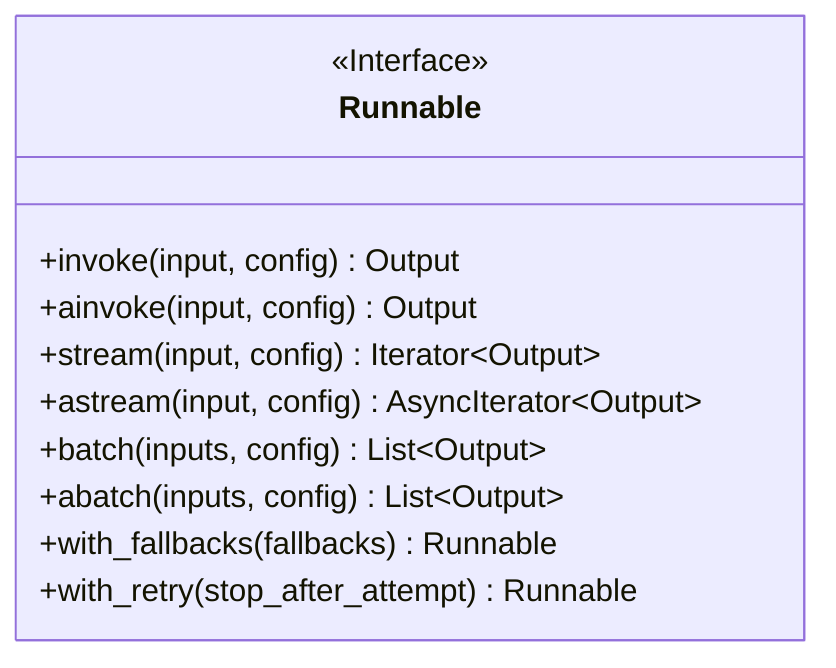
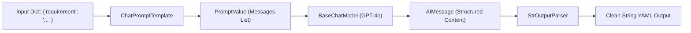
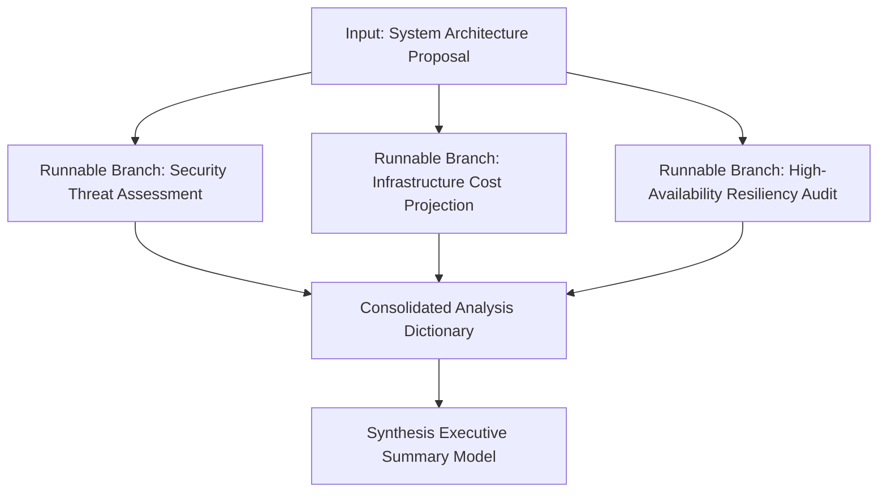
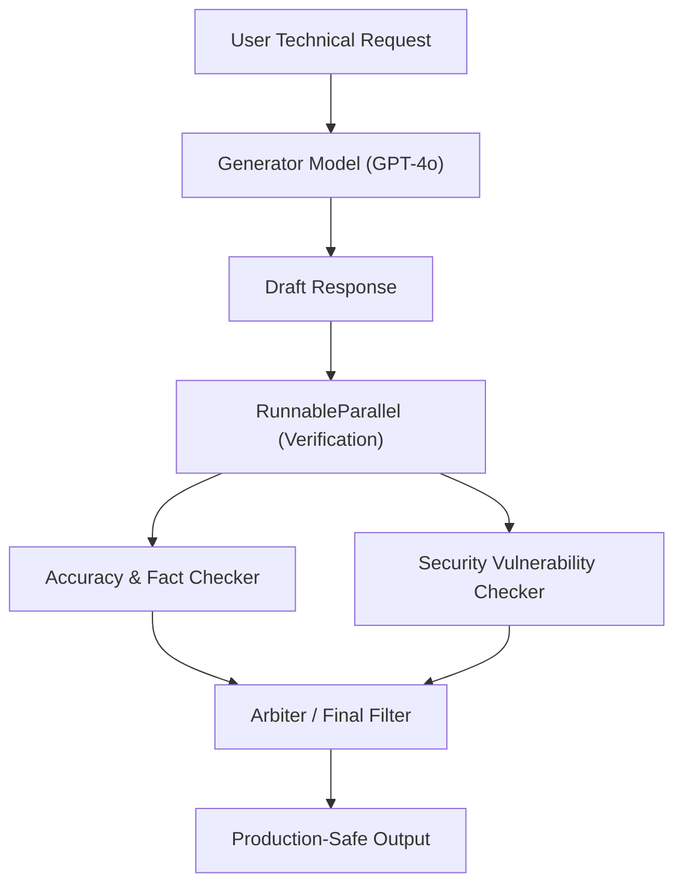

# 📚 Module 03: LCEL and Runnables in LangChain

> A comprehensive, production-grade guide to the LangChain Expression Language (LCEL), the Runnable protocol, declarative chain composition via the pipe operator (`|`), parallel fan-out, dynamic routing, and resilient fallback strategies.

---

## 📑 Table of Contents

- [1.0 🏗️ Core Architecture & The Runnable Protocol](#10-️-core-architecture--the-runnable-protocol)
  - [1.1 Why LCEL Replaced Legacy Chains](#11-why-lcel-replaced-legacy-chains)
  - [1.2 The Standard Runnable Interface](#12-the-standard-runnable-interface)
  - [1.3 Core Primitives & Terminology](#13-core-primitives--terminology)
- [2.0 🔗 Sequential Chaining with the Pipe Operator (`|`)](#20--sequential-chaining-with-the-pipe-operator-)
  - [2.1 Pipe Operator Composition Syntax](#21-pipe-operator-composition-syntax)
  - [2.2 Data Propagation & Transformation Between Steps](#22-data-propagation--transformation-between-steps)
  - [2.3 Custom Functional Logic with `RunnableLambda`](#23-custom-functional-logic-with-runnablelambda)
- [3.0 ⚡ Parallel Execution with `RunnableParallel`](#30--parallel-execution-with-runnableparallel)
  - [3.1 Concurrent Branching Architecture](#31-concurrent-branching-architecture)
  - [3.2 Propagating Unmodified Inputs with `RunnablePassthrough`](#32-propagating-unmodified-inputs-with-runnablepassthrough)
  - [3.3 Reducing Latency via Parallel Fan-Out](#33-reducing-latency-via-parallel-fan-out)
- [4.0 🔀 Dynamic Routing, Conditional Branching & Fallbacks](#40--dynamic-routing-conditional-branching--fallbacks)
  - [4.1 Semantic and Custom Dynamic Routing](#41-semantic-and-custom-dynamic-routing)
  - [4.2 Fault-Tolerant High Availability with `.with_fallbacks()`](#42-fault-tolerant-high-availability-with-with_fallbacks)
  - [4.3 Configurable Fields and Runtime Swapping](#43-configurable-fields-and-runtime-swapping)
- [5.0 ⚖️ Advantages, Limitations & Architecture Trade-offs](#50-️-advantages-limitations--architecture-trade-offs)
- [6.0 🏢 Real-World Production Patterns](#60--real-world-production-patterns)
- [7.0 ⚠️ Common Pitfalls & Anti-Patterns (And How to Fix Them)](#70-️-common-pitfalls--anti-patterns-and-how-to-fix-them)
- [8.0 💼 Technical Interview Preparation: Questions & Scenarios](#80--technical-interview-preparation-questions--scenarios)
- [9.0 🛠️ Practical Hands-On Implementation Guide](#90-️-practical-hands-on-implementation-guide)
- [10.0 ⚡ Quick Revision, Mathematical Formulations, CLI Commands & Roadmap](#100--quick-revision-mathematical-formulations-cli-commands--roadmap)

---

## 1.0 🏗️ Core Architecture & The Runnable Protocol

### 1.1 Why LCEL Replaced Legacy Chains

Early versions of LangChain used classes like `LLMChain`, `SimpleSequentialChain`, and `TransformChain`. These suffered from:
- Inconsistent APIs (some used `.run()`, others `.predict()`, `.apply()`, or `.__call__()`).
- Brittle streaming support (adding streaming to a sequential chain required monkey-patching callbacks).
- Inability to execute parallel steps without manual Python `threading` or `asyncio.gather` code.

The **LangChain Expression Language (LCEL)** provides a declarative, functional programming model built on top of a single unified protocol: the **`Runnable`**.

---

### 1.2 The Standard Runnable Interface

Every component in LCEL implements the `Runnable` protocol, guaranteeing support for synchronous, asynchronous, streaming, and batch operations out of the box:



| Method | Execution Model | Streaming Capability | Primary Production Use Case |
| :--- | :--- | :--- | :--- |
| **`.invoke()`** | Synchronous | No | CLI utilities, synchronous background scripts |
| **`.ainvoke()`** | Asynchronous | No | Async REST API endpoints (e.g. FastAPI routes) |
| **`.stream()`** | Synchronous | Yes (Token deltas) | Desktop or terminal streaming interfaces |
| **`.astream()`** | Asynchronous | Yes (Token deltas) | Production web sockets and Server-Sent Events (SSE) |
| **`.batch()`** | Synchronous | No (List of outputs) | Bulk offline dataset generation |
| **`.abatch()`** | Asynchronous | No (List of outputs) | High-throughput concurrent microservice pipelines |

---

### 1.3 Core Primitives & Terminology

- **Pipe Operator (`|`)**: Overloaded Python operator that binds two runnables into a `RunnableSequence`.
- **`RunnableParallel`**: A runnable that takes an input and passes it concurrently to a dictionary of independent runnables.
- **`RunnablePassthrough`**: Forwards the input unchanged, or adds computed keys to an input dictionary.
- **`RunnableLambda`**: Converts an arbitrary Python function into a full-fledged `Runnable`.
- **`RunnableSequence`**: The composite runnable created by piping components together.

---

## 2.0 🔗 Sequential Chaining with the Pipe Operator (`|`)

### 2.1 Pipe Operator Composition Syntax

The pipe operator links components so that the output of one step becomes the input of the next:

```python
from langchain_core.prompts import ChatPromptTemplate
from langchain_core.output_parsers import StrOutputParser
from langchain.chat_models import init_chat_model

prompt = ChatPromptTemplate.from_template("Translate the following system architecture requirement to a Kubernetes Deployment YAML:\n{requirement}")
model = init_chat_model("gpt-4o-mini", model_provider="openai")
parser = StrOutputParser()

# Functional sequential pipeline
k8s_generator = prompt | model | parser

# yaml_output = k8s_generator.invoke({"requirement": "Deploy 3 replicas of an Nginx ingress with 256MB memory limit."})
```

---

### 2.2 Data Propagation & Transformation Between Steps



---

### 2.3 Custom Functional Logic with `RunnableLambda`

Custom Python functions are converted into Runnables using `RunnableLambda`:

```python
from langchain_core.runnables import RunnableLambda

def extract_code_block(text: str) -> str:
    """Strips markdown code fences from LLM output."""
    if "```yaml" in text:
        return text.split("```yaml")[1].split("```")[0].strip()
    return text.strip()

cleaner_step = RunnableLambda(extract_code_block)

# Insert custom Python logic directly into the pipeline
production_k8s_chain = prompt | model | parser | cleaner_step
```

---

## 3.0 ⚡ Parallel Execution with `RunnableParallel`

### 3.1 Concurrent Branching Architecture

When multiple independent operations need to run on the same input (such as generating multiple perspectives or running parallel evaluations), `RunnableParallel` coordinates execution concurrently:



---

### 3.2 Propagating Unmodified Inputs with `RunnablePassthrough`

`RunnablePassthrough` allows original inputs to flow forward into subsequent steps alongside transformed data:

```python
from langchain_core.runnables import RunnableParallel, RunnablePassthrough
from langchain_core.prompts import ChatPromptTemplate
from langchain_core.output_parsers import StrOutputParser
from langchain.chat_models import init_chat_model

model = init_chat_model("gpt-4o-mini", model_provider="openai")
parser = StrOutputParser()

security_prompt = ChatPromptTemplate.from_template("Perform a threat model on:\n{architecture}")
cost_prompt = ChatPromptTemplate.from_template("Estimate cloud infrastructure cost risks for:\n{architecture}")

# Fan-out execution
parallel_audits = RunnableParallel({
    "security": security_prompt | model | parser,
    "cost": cost_prompt | model | parser,
    "original_proposal": RunnablePassthrough()  # Preserves raw input
})

synthesis_prompt = ChatPromptTemplate.from_template("""
Synthesize the architectural findings below:
PROPOSAL: {original_proposal}
SECURITY: {security}
COST: {cost}
""")

full_audit_pipeline = parallel_audits | synthesis_prompt | model | parser
```

---

### 3.3 Reducing Latency via Parallel Fan-Out

Sequential execution latency equals the sum of all individual step latencies:

$$\text{Latency}_{\text{sequential}} = \sum_{i=1}^N t_i$$

With `RunnableParallel`, branches execute concurrently, bound only by the slowest step:

$$\text{Latency}_{\text{parallel}} = \max_{i=1 \dots N} (t_i) + \epsilon_{\text{overhead}}$$

---

## 4.0 🔀 Dynamic Routing, Conditional Branching & Fallbacks

### 4.1 Semantic and Custom Dynamic Routing

Dynamic routing directs user queries to specialized chains based on input classification:

```python
from langchain_core.runnables import RunnableLambda

def route_request(input_dict: dict):
    query = input_dict["query"].lower()
    if "sql" in query or "database" in query:
        return sql_specialist_chain
    elif "kubernetes" in query or "k8s" in query:
        return devops_specialist_chain
    return general_assistant_chain

router = RunnableLambda(route_request)
```

---

### 4.2 Fault-Tolerant High Availability with `.with_fallbacks()`

When working with external LLM APIs, rate limits (HTTP 429), provider outages (HTTP 503), and network timeouts occur. `.with_fallbacks()` adds immediate failover to alternative models or providers:

```python
from langchain.chat_models import init_chat_model

# Primary high-performance model
primary = init_chat_model("gpt-4o", model_provider="openai", max_retries=1)

# Failover models
backup_claude = init_chat_model("claude-3-5-sonnet-20241022", model_provider="anthropic", max_retries=2)
backup_mini = init_chat_model("gpt-4o-mini", model_provider="openai", max_retries=2)

# Resilient Model with tiered failover strategy
ha_model = primary.with_fallbacks([backup_claude, backup_mini])
```

---

## 5.0 ⚖️ Advantages, Limitations & Architecture Trade-offs

| Dimension | Advantages & Strengths | Limitations & Bottlenecks | Recommended Engineering Mitigation |
| :--- | :--- | :--- | :--- |
| **LCEL Pipe (`\|`)** | Declarative; automatically supports streaming, batching, and async | Deep pipelines can produce complex tracebacks on failure | Instrument applications with LangSmith to inspect intermediate data payloads |
| **`RunnableParallel`** | Drastically reduces total pipeline latency; cleans up multi-agent fan-out | Upstream rate limits can trigger if concurrency is not capped | Pass `config={"max_concurrency": N}` to control concurrent requests |
| **`.with_fallbacks()`** | High availability; shields users from provider downtimes and rate limits | Secondary providers may format outputs or handle tools slightly differently | Standardize system prompts and enforce strict Pydantic structured output schemas |

---

## 6.0 🏢 Real-World Production Patterns

### Pattern: Multi-Model Verification Gate
Critical applications use a secondary model to independently verify and critique the first model's output before delivering it to end users:



---

## 7.0 ⚠️ Common Pitfalls & Anti-Patterns (And How to Fix Them)

### Anti-Pattern 1: Mutating Inputs Inside `RunnableLambda`
- **Mistake**: Writing custom lambdas that alter dictionaries in-place:
  ```python
  def bad_step(d):
      d["count"] += 1
      return d
  ```
  This creates concurrency race conditions when branching across parallel runnables.
- **Fix**: Always return a new dictionary:
  ```python
  def good_step(d):
      return {**d, "count": d["count"] + 1}
  ```

### Anti-Pattern 2: Forgetting Output Parsers in Chained Steps
- **Mistake**: Feeding `BaseChatModel` output directly into a prompt template without parsing. `AIMessage` objects may not format cleanly into string slots.
- **Fix**: Insert `StrOutputParser()` or a custom extractor between the model and downstream prompts.

---

## 8.0 💼 Technical Interview Preparation: Questions & Scenarios

### Q1: How does LCEL handle streaming across composite chains?
> **Answer**: Every runnable in an LCEL sequence implements a generator interface. When `.stream()` or `.astream()` is called on a composite chain, token chunks stream continuously through the pipeline: the prompt yields a stream of messages, the model yields a stream of `AIMessageChunk` objects, and the output parser transforms and yields string chunks to the client in real time without buffering.

### Q2: What is the operational difference between `RunnableParallel` and `asyncio.gather()`?
> **Answer**: While `asyncio.gather()` requires manual task wrapping and error coordination in async functions, `RunnableParallel` seamlessly works in both synchronous (`.invoke()`) and asynchronous (`.ainvoke()`) modes, propagates tracing metadata to LangSmith, supports streaming token deltas from multiple branches, and respects concurrency limits passed via execution configs.

---

## 9.0 🛠️ Practical Hands-On Implementation Guide

```python
"""
Module 03 - LCEL and Runnables Complete Example
"""
import asyncio
from langchain_core.prompts import ChatPromptTemplate
from langchain_core.output_parsers import StrOutputParser
from langchain_core.runnables import RunnableParallel, RunnablePassthrough, RunnableLambda
from langchain.chat_models import init_chat_model

model = init_chat_model("gpt-4o-mini", model_provider="openai", temperature=0.2)
parser = StrOutputParser()

# 1. Define Components
summary_prompt = ChatPromptTemplate.from_template("Summarize in 1 sentence:\n{text}")
sentiment_prompt = ChatPromptTemplate.from_template("Classify sentiment (POSITIVE, NEGATIVE, NEUTRAL):\n{text}")

# 2. Parallel Fan-Out
analyzer_chain = RunnableParallel({
    "summary": summary_prompt | model | parser,
    "sentiment": sentiment_prompt | model | parser,
    "original": RunnablePassthrough()
})

# 3. Aggregation & Formatting
final_formatter = RunnableLambda(lambda res: (
    f"--- ANALYSIS REPORT ---\n"
    f"Summary: {res['summary']}\n"
    f"Sentiment: {res['sentiment']}\n"
    f"Input Length: {len(res['original']['text'])} chars"
))

full_pipeline = analyzer_chain | final_formatter

# if __name__ == "__main__":
#     sample_text = "The database cluster migration completed with zero downtime and 15% lower latencies."
#     print(full_pipeline.invoke({"text": sample_text}))
```

---

## 10.0 ⚡ Quick Revision, Mathematical Formulations, CLI Commands & Roadmap

### 10.1 Key Formulations in Pipeline Concurrency

# Parallel Latency Lower Bound
$$\text{Latency}_{\text{parallel}} = \max_{k \in \{1 \dots K\}} (t_k) + \delta_{\text{runtime\_overhead}}$$

# Pipeline Throughput (Batch Mode)
$$\text{Throughput} = \frac{N_{\text{total\_requests}}}{\text{Total Wall-Clock Time}} \quad [\text{req/sec}]$$

---

### 10.2 Core Method & Import Reference

| Primitive | Python Import Path | Primary Operational Method |
| :--- | :--- | :--- |
| **Pipe Operator** | Built-in Python syntax (`\|`) | `chain = prompt \| model \| parser` |
| **RunnableParallel** | `from langchain_core.runnables import RunnableParallel` | `RunnableParallel({"k1": c1, "k2": c2})` |
| **RunnablePassthrough**| `from langchain_core.runnables import RunnablePassthrough` | `RunnablePassthrough()` |
| **RunnableLambda** | `from langchain_core.runnables import RunnableLambda` | `RunnableLambda(my_func)` |
| **StrOutputParser** | `from langchain_core.output_parsers import StrOutputParser` | `parser = StrOutputParser()` |
| **Fallbacks** | Method on any `Runnable` instance | `model.with_fallbacks([backup_model])` |

---

### 10.3 Essential CLI Setup Commands

```bash
pip install langchain langchain-core langchain-openai
```

---

### 10.4 LCEL Mastery Roadmap


