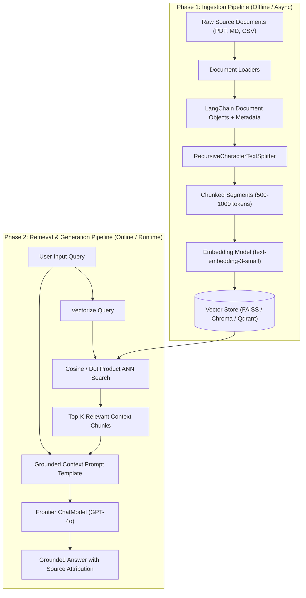
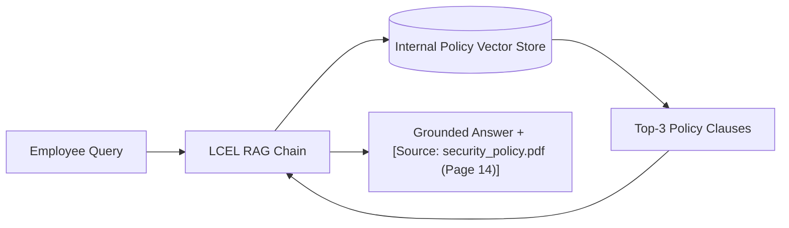

# 📚 Module 05: RAG Fundamentals in LangChain

> A comprehensive, production-grade guide to Retrieval-Augmented Generation (RAG): document ingestion, chunking algorithms, vector embeddings, vector stores (FAISS, Chroma), and grounded LCEL generation chains.

> 💡 **Dedicated Deep-Dive RAG Engineering Reference**:  
> For in-depth specialized RAG implementations, evaluation benchmarks, multi-modal ingestion, and advanced production retrieval pipelines, refer to our dedicated companion repository:  
> 🔗 [**swapnil3104 / RAG-Engineering**](https://github.com/swapnil3104/RAG-Engineering)

---

## 📑 Table of Contents

- [1.0 🏗️ Core Architecture & Fundamentals](#10-️-core-architecture--fundamentals)
  - [1.1 Why RAG: Parametric vs. Non-Parametric Memory](#11-why-rag-parametric-vs-non-parametric-memory)
  - [1.2 The Two-Phase RAG Architecture: Ingestion & Retrieval](#12-the-two-phase-rag-architecture-ingestion--retrieval)
  - [1.3 Core Primitives & Terminology](#13-core-primitives--terminology)
- [2.0 📥 Document Ingestion & Loaders](#20--document-ingestion--loaders)
  - [2.1 Structured and Unstructured File Ingestion](#21-structured-and-unstructured-file-ingestion)
  - [2.2 Metadata Preservation & Extraction](#22-metadata-preservation--extraction)
  - [2.3 Loader Implementations (TextLoader, CSVLoader, PyPDFLoader)](#23-loader-implementations-textloader-csvloader-pypdfloader)
- [3.0 ✂️ Semantic Text Chunking Strategies](#30-️-semantic-text-chunking-strategies)
  - [3.1 The Granularity Dilemma: Small vs. Large Chunks](#31-the-granularity-dilemma-small-vs-large-chunks)
  - [3.2 The `RecursiveCharacterTextSplitter` Algorithm](#32-the-recursivecharactertextsplitter-algorithm)
  - [3.3 Chunk Overlap Dynamics & Boundary Context Preservation](#33-chunk-overlap-dynamics--boundary-context-preservation)
- [4.0 🔢 Vector Embeddings & Vector Stores](#40--vector-embeddings--vector-stores)
  - [4.1 Embedding Space Topology & Dense Semantic Representation](#41-embedding-space-topology--dense-semantic-representation)
  - [4.2 Vector Database Implementations (FAISS vs. Chroma vs. Qdrant)](#42-vector-database-implementations-faiss-vs-chroma-vs-qdrant)
  - [4.3 Approximate Nearest Neighbor (ANN) Retrieval](#43-approximate-nearest-neighbor-ann-retrieval)
- [5.0 🔗 Building the Grounded LCEL RAG Pipeline](#50--building-the-grounded-lcel-rag-pipeline)
  - [5.1 Retriever Conversion & Configuration](#51-retriever-conversion--configuration)
  - [5.2 Prompt Grounding & Anti-Hallucination Guardrails](#52-prompt-grounding--anti-hallucination-guardrails)
  - [5.3 End-to-End Declarative Composition](#53-end-to-end-declarative-composition)
- [6.0 ⚖️ Advantages, Limitations & Architecture Trade-offs](#60-️-advantages-limitations--architecture-trade-offs)
- [7.0 🏢 Real-World Production Patterns](#70--real-world-production-patterns)
- [8.0 ⚠️ Common Pitfalls & Anti-Patterns (And How to Fix Them)](#80-️-common-pitfalls--anti-patterns-and-how-to-fix-them)
- [9.0 💼 Technical Interview Preparation: Questions & Scenarios](#90--technical-interview-preparation-questions--scenarios)
- [10.0 🛠️ Practical Hands-On Implementation Guide](#100-️-practical-hands-on-implementation-guide)
- [11.0 ⚡ Quick Revision, Mathematical Formulations, CLI Commands & Roadmap](#110--quick-revision-mathematical-formulations-cli-commands--roadmap)

---

## 1.0 🏗️ Core Architecture & Fundamentals

### 1.1 Why RAG: Parametric vs. Non-Parametric Memory

Generative models rely on **parametric memory** (weights fixed during pretraining). This creates three operational challenges:
1. **Knowledge Cutoff**: The model cannot know about events after its training cutoff date.
2. **Hallucination Risk**: When uncertain, models generate plausible-sounding falsehoods.
3. **Private Data Isolation**: Models cannot access internal enterprise repositories, databases, or documents.

**Retrieval-Augmented Generation (RAG)** introduces **non-parametric memory**: real-time document search provides grounded source passages as context in the prompt payload.

---

### 1.2 The Two-Phase RAG Architecture: Ingestion & Retrieval



---

### 1.3 Core Primitives & Terminology

- **`Document`**: The atomic unit of text in LangChain. Contains `page_content` (`str`) and `metadata` (`dict`).
- **`BaseDocumentLoader`**: Standard interface for parsing files, databases, or APIs into `list[Document]`.
- **`RecursiveCharacterTextSplitter`**: Semantic chunker that divides documents along natural paragraph and sentence boundaries.
- **`Embeddings`**: Converts text strings into dense floating-point vector representations.
- **`VectorStore`**: Storage engine indexing vectors for fast Approximate Nearest Neighbor (ANN) search.
- **`Retriever`**: A standard `Runnable` interface wrapping vector stores or keyword indices to return relevant documents for a string query.

---

## 2.0 📥 Document Ingestion & Loaders

### 2.1 Structured and Unstructured File Ingestion

LangChain provides loaders for diverse file formats:

| Loader Class | Supported Format | Ingestion Characteristic |
| :--- | :--- | :--- |
| **`TextLoader`** | `.txt`, `.md`, `.log` | Direct UTF-8 textual ingestion into a single document |
| **`CSVLoader`** | `.csv`, `.tsv` | Parses each row as an individual document; sets columns as metadata |
| **`PyPDFLoader`** | `.pdf` | Extracts text page-by-page, retaining page number metadata |
| **`UnstructuredMarkdownLoader`**| `.md` | Parses headers, bullet points, and code fences into distinct sections |

---

### 2.2 Metadata Preservation & Extraction

Metadata (source file path, creation date, author, page number, access permissions) must be preserved during ingestion to enable filtered search and accurate source attribution:

```python
from langchain_community.document_loaders import TextLoader, CSVLoader
from pathlib import Path

# Ingest Markdown with file source metadata
md_loader = TextLoader("data/security_policy.md", encoding="utf-8")
md_docs = md_loader.load()
# md_docs[0].metadata -> {'source': 'data/security_policy.md'}

# Ingest CSV where each row is a document, keyed by a specific column
csv_loader = CSVLoader("data/service_catalog.csv", source_column="service_name")
csv_docs = csv_loader.load()
# csv_docs[0].metadata -> {'source': 'auth-gateway', 'row': 0}
```

---

## 3.0 ✂️ Semantic Text Chunking Strategies

### 3.1 The Granularity Dilemma: Small vs. Large Chunks

- **Too Small (e.g. 50 tokens)**: High vector search specificity, but chunks lack broader context, resulting in incomplete answers.
- **Too Large (e.g. 4000 tokens)**: Rich context, but embeddings become noisy averages of multiple topics, degrading search accuracy.
- **Sweet Spot**: 300 to 800 tokens with 10% to 20% overlap.

---

### 3.2 The `RecursiveCharacterTextSplitter` Algorithm

This algorithm splits on a hierarchy of separators, moving to the next separator only when chunks exceed `chunk_size`:
1. `\n\n` (Double newline: preserve paragraph unity)
2. `\n` (Single newline: preserve sentence lines)
3. ` ` (Space: preserve word boundaries)
4. `""` (Empty string: emergency fallback)

```python
from langchain_text_splitters import RecursiveCharacterTextSplitter
from langchain_core.documents import Document

splitter = RecursiveCharacterTextSplitter(
    chunk_size=500,
    chunk_overlap=50,
    separators=["\n\n", "\n", " ", ""]
)

chunks = splitter.split_documents(md_docs)
```

---

### 3.3 Chunk Overlap Dynamics & Boundary Context Preservation


Without overlap, a critical sentence spanning the boundary between Chunk 1 and Chunk 2 would be severed, rendering both chunks incomplete. Overlap ensures continuous semantic coverage across split boundaries.

---

## 4.0 🔢 Vector Embeddings & Vector Stores

### 4.1 Embedding Space Topology & Dense Semantic Representation

Embeddings map words and phrases into high-dimensional geometric space ($D = 1536$ or $D = 3072$). Concepts sharing semantic meaning map close together in vector space:

$$\text{Cosine Similarity}(u, v) = \frac{u \cdot v}{\|u\|_2 \|v\|_2} = \frac{\sum_{i=1}^d u_i v_i}{\sqrt{\sum_{i=1}^d u_i^2} \sqrt{\sum_{i=1}^d v_i^2}}$$

---

### 4.2 Vector Database Implementations (FAISS vs. Chroma vs. Qdrant)

| Vector Store | Deployment Model | Index Type | Best Used For |
| :--- | :--- | :--- | :--- |
| **`FAISS`** | In-Memory / File-based | Flat, HNSW, IVF | Local prototyping, high-performance offline indexing |
| **`Chroma`** | Embedded or Client/Server | HNSW | Lightweight microservices, local persistence, prototyping |
| **`Qdrant`** | Distributed Cloud / Self-hosted | HNSW + Payload Filter | Production enterprise RAG, filtered multi-tenant search |

```python
from langchain_community.vectorstores import FAISS
from langchain_openai import OpenAIEmbeddings

embeddings = OpenAIEmbeddings(model="text-embedding-3-small")

# Index chunks into an in-memory FAISS database
vector_store = FAISS.from_documents(chunks, embeddings)

# Perform semantic similarity search
results = vector_store.similarity_search("What is the token expiration policy?", k=3)
```

---

## 5.0 🔗 Building the Grounded LCEL RAG Pipeline

### 5.1 Retriever Conversion & Configuration

Vector stores expose a `.as_retriever()` method that conforms to the standard `Runnable` contract:

```python
retriever = vector_store.as_retriever(
    search_type="similarity",
    search_kwargs={"k": 4}
)
```

---

### 5.2 Prompt Grounding & Anti-Hallucination Guardrails

Grounding prompts must instruct models to base answers strictly on the retrieved context:

```python
from langchain_core.prompts import ChatPromptTemplate

grounded_prompt = ChatPromptTemplate.from_template("""
You are a technical compliance auditor. Answer the query based SOLELY on the retrieved context below.
If the information is not explicitly mentioned, respond with: 'INSUFFICIENT_CONTEXT_AVAILABLE'.
Do not attempt to infer or extrapolate beyond the provided text.

Context:
{context}

Question:
{question}
""")
```

---

### 5.3 End-to-End Declarative Composition

```python
from langchain_core.runnables import RunnablePassthrough
from langchain_core.output_parsers import StrOutputParser
from langchain.chat_models import init_chat_model

def format_docs(docs):
    return "\n\n".join(f"[Source: {d.metadata.get('source', 'unknown')}]\n{d.page_content}" for d in docs)

model = init_chat_model("gpt-4o-mini", model_provider="openai", temperature=0.0)

rag_chain = (
    {"context": retriever | format_docs, "question": RunnablePassthrough()}
    | grounded_prompt
    | model
    | StrOutputParser()
)

# Execution
# response = rag_chain.invoke("What is the OAuth token validity window?")
```

---

## 6.0 ⚖️ Advantages, Limitations & Architecture Trade-offs

| Dimension | Advantages & Strengths | Limitations & Bottlenecks | Recommended Engineering Mitigation |
| :--- | :--- | :--- | :--- |
| **Vector Search (Dense)** | Captures semantic intent and synonyms; requires no exact keyword match | Fails on exact serial numbers, product codes, or acronyms | Combine with BM25 sparse search (Hybrid Search) |
| **Fixed-Size Chunking** | Simple, deterministic, and fast to compute | May split related ideas across boundaries | Use `RecursiveCharacterTextSplitter` with 15-20% chunk overlap |
| **In-Memory Stores (FAISS)** | Zero network latency; ideal for unit tests and local scripts | Lacks multi-tenant concurrency and distributed horizontal scaling | Migrate to Qdrant or Milvus for production clusters |

---

## 7.0 🏢 Real-World Production Patterns

### Pattern: Enterprise Policy Compliance Portal
Internal employees query company policies across hundreds of PDF and Markdown handbooks. The RAG pipeline retrieves the exact clause, returns the grounded answer, and cites the specific document filename and page number:



---

## 8.0 ⚠️ Common Pitfalls & Anti-Patterns (And How to Fix Them)

### Anti-Pattern 1: Setting Temperature > 0 for Grounded Q&A
- **Mistake**: Using `temperature=0.7` for factual question answering over documentation.
- **Consequence**: The model interpolates and hallucinates facts when retrieved chunks are ambiguous.
- **Fix**: Set `temperature=0.0` for factual RAG tasks.

### Anti-Pattern 2: Discarding Document Metadata During Loading
- **Mistake**: Extracting only raw text strings and dropping metadata dictionaries.
- **Consequence**: The model cannot provide source citations or page references to the user.
- **Fix**: Always preserve the `metadata` dictionary on all `Document` instances.

---

## 9.0 💼 Technical Interview Preparation: Questions & Scenarios

### Q1: What is the difference between Cosine Distance, L2 Euclidean Distance, and Inner Product in vector search?
> **Answer**: 
> - **Cosine Distance** measures the angle between vectors, ignoring their magnitude ($1 - \frac{u \cdot v}{\|u\| \|v\|}$). It is ideal for normalized text embeddings where directional semantics matter most.
> - **L2 Euclidean Distance** measures the straight-line distance between vector endpoints ($\sqrt{\sum (u_i - v_i)^2}$).
> - **Inner Product (Dot Product)** computes $u \cdot v$. When vectors are normalized to unit length ($\|u\| = 1$), the dot product is mathematically equivalent to cosine similarity, enabling sub-millisecond hardware-accelerated matrix multiplication.

### Q2: Why is `RecursiveCharacterTextSplitter` preferred over standard character splitters?
> **Answer**: Standard splitters break text at arbitrary character intervals, frequently severing words, code blocks, or sentences mid-phrase. `RecursiveCharacterTextSplitter` respects natural text hierarchy: it first attempts to split on paragraph breaks (`\n\n`), then line breaks (`\n`), then spaces (` `), preserving semantic sentence structure within every chunk.

---

## 10.0 🛠️ Practical Hands-On Implementation Guide

```python
"""
Module 05 - Complete Self-Contained RAG Pipeline
"""
from langchain_core.documents import Document
from langchain_text_splitters import RecursiveCharacterTextSplitter
from langchain_community.vectorstores import FAISS
from langchain_openai import OpenAIEmbeddings
from langchain_core.prompts import ChatPromptTemplate
from langchain_core.runnables import RunnablePassthrough
from langchain_core.output_parsers import StrOutputParser
from langchain.chat_models import init_chat_model

# 1. Ingestion Phase
sample_corpus = [
    Document(
        page_content="PostgreSQL connection pooling is handled by PgBouncer using transaction pooling mode.",
        metadata={"source": "db_architecture.md"}
    ),
    Document(
        page_content="Max connections per database node are capped at 500 to prevent RAM exhaustion.",
        metadata={"source": "db_limits.md"}
    )
]

splitter = RecursiveCharacterTextSplitter(chunk_size=100, chunk_overlap=20)
chunks = splitter.split_documents(sample_corpus)

# 2. Vector Indexing Phase
# embeddings = OpenAIEmbeddings(model="text-embedding-3-small")
# vector_store = FAISS.from_documents(chunks, embeddings)
# retriever = vector_store.as_retriever(search_kwargs={"k": 2})

# 3. Grounded Generation Phase
prompt = ChatPromptTemplate.from_template("""
Answer based strictly on the context below. If unknown, say 'UNVERIFIED'.
Context: {context}
Question: {question}
""")
# model = init_chat_model("gpt-4o-mini", model_provider="openai", temperature=0.0)

# rag_chain = (
#     {"context": retriever | (lambda docs: "\n".join(d.page_content for d in docs)), "question": RunnablePassthrough()}
#     | prompt
#     | model
#     | StrOutputParser()
# )
```

---

## 11.0 ⚡ Quick Revision, Mathematical Formulations, CLI Commands & Roadmap

### 11.1 Key Formulations in RAG & Vector Retrieval

# Vector Space Cosine Similarity Formulation
$$\text{Cosine Similarity}(u, v) = \frac{u \cdot v}{\|u\|_2 \|v\|_2} = \frac{\sum_{i=1}^d u_i v_i}{\sqrt{\sum_{i=1}^d u_i^2} \sqrt{\sum_{i=1}^d v_i^2}}$$

# Grounded Answer Faithfulness Metric
$$\text{Faithfulness} = \frac{|\text{Extracted claims in answer supported by retrieved context}|}{|\text{Total factual claims extracted from answer}|}$$

---

### 11.2 Core Method & Import Reference

| Primitive | Python Import Path | Primary Operational Method |
| :--- | :--- | :--- |
| **Document** | `from langchain_core.documents import Document` | `Document(page_content="...", metadata={})` |
| **Recursive Splitter** | `from langchain_text_splitters import RecursiveCharacterTextSplitter` | `splitter.split_documents(docs)` |
| **FAISS Vector Store** | `from langchain_community.vectorstores import FAISS` | `FAISS.from_documents(chunks, embeddings)` |
| **OpenAI Embeddings** | `from langchain_openai import OpenAIEmbeddings` | `OpenAIEmbeddings(model="text-embedding-3-small")` |
| **Retriever** | Method on any `VectorStore` | `vector_store.as_retriever(search_kwargs={"k": 4})` |

---

### 11.3 Essential CLI Setup Commands

```bash
pip install langchain langchain-core langchain-community langchain-openai faiss-cpu chromadb
```

---

### 11.4 RAG Fundamentals Learning Roadmap


