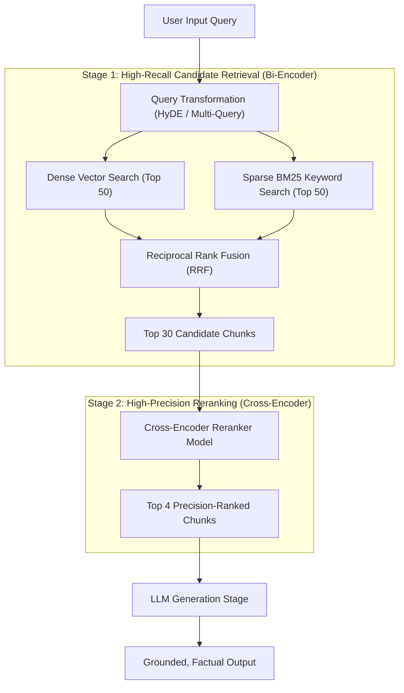
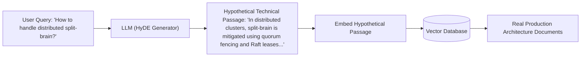
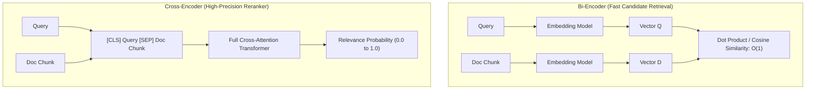

# 📚 Module 06: Advanced RAG in LangChain

> A comprehensive, production-grade guide to advanced retrieval-augmented generation architectures: Hybrid Search (BM25 + Dense Vectors), Reciprocal Rank Fusion (RRF), Query Transformation (Sub-Queries, Step-Back, HyDE), and Two-Stage Cross-Encoder Reranking.

> 💡 **Dedicated Deep-Dive RAG Engineering Reference**:  
> For more advanced RAG architectures, multi-vector indexing, re-ranking benchmarks, and specialized retrieval pipelines, refer to our dedicated companion repository:  
> 🔗 [**swapnil3104 / RAG-Engineering**](https://github.com/swapnil3104/RAG-Engineering)

---

## 📑 Table of Contents

- [1.0 🏗️ Core Architecture & The Advanced Retrieval Pipeline](#10-️-core-architecture--the-advanced-retrieval-pipeline)
  - [1.1 Limitations of Naive Vector RAG](#11-limitations-of-naive-vector-rag)
  - [1.2 The Two-Stage Retrieval Paradigm](#12-the-two-stage-retrieval-paradigm)
  - [1.3 Core Primitives & Terminology](#13-core-primitives--terminology)
- [2.0 🔀 Hybrid Search & Reciprocal Rank Fusion (RRF)](#20--hybrid-search--reciprocal-rank-fusion-rrf)
  - [2.1 Dense Semantic Vectors vs. Sparse BM25 Keyword Search](#21-dense-semantic-vectors-vs-sparse-bm25-keyword-search)
  - [2.2 The Reciprocal Rank Fusion Algorithm](#22-the-reciprocal-rank-fusion-algorithm)
  - [2.3 Implementing `EnsembleRetriever` with Weighted Merging](#23-implementing-ensembleretriever-with-weighted-merging)
- [3.0 🔄 Query Transformation Strategies](#30--query-transformation-strategies)
  - [3.1 Multi-Query Expansion & Sub-Query Decomposition](#31-multi-query-expansion--sub-query-decomposition)
  - [3.2 Step-Back Prompting for High-Level Context](#32-step-back-prompting-for-high-level-context)
  - [3.3 Hypothetical Document Embeddings (HyDE)](#33-hypothetical-document-embeddings-hyde)
- [4.0 🎯 Two-Stage Retrieval & Cross-Encoder Reranking](#40--two-stage-retrieval--cross-encoder-reranking)
  - [4.1 Bi-Encoder vs. Cross-Encoder Architecture](#41-bi-encoder-vs-cross-encoder-architecture)
  - [4.2 Solving the "Lost in the Middle" Dilemma](#42-solving-the-lost-in-the-middle-dilemma)
  - [4.3 Integrating Cross-Encoder Rerankers in LangChain](#43-integrating-cross-encoder-rerankers-in-langchain)
- [5.0 ⚖️ Advantages, Limitations & Architecture Trade-offs](#50-️-advantages-limitations--architecture-trade-offs)
- [6.0 🏢 Real-World Production Patterns](#60--real-world-production-patterns)
- [7.0 ⚠️ Common Pitfalls & Anti-Patterns (And How to Fix Them)](#70-️-common-pitfalls--anti-patterns-and-how-to-fix-them)
- [8.0 💼 Technical Interview Preparation: Questions & Scenarios](#80--technical-interview-preparation-questions--scenarios)
- [9.0 🛠️ Practical Hands-On Implementation Guide](#90-️-practical-hands-on-implementation-guide)
- [10.0 ⚡ Quick Revision, Mathematical Formulations, CLI Commands & Roadmap](#100--quick-revision-mathematical-formulations-cli-commands--roadmap)

---

## 1.0 🏗️ Core Architecture & The Advanced Retrieval Pipeline

### 1.1 Limitations of Naive Vector RAG

Naive RAG pipelines (embed query $\to$ cosine search $\to$ stuff context $\to$ prompt) fail in production environments due to four common failure modes:
1. **Vocabulary Mismatch**: Users search for exact acronyms, part numbers, or error codes (e.g. `ERR-4091-B`) that dense vector embeddings blur into generic semantic clusters.
2. **Poor Query Formulation**: User questions are often conversational, ambiguous, or compound queries covering multiple unrelated sub-topics.
3. **Relevance vs. Semantic Proximity**: Passages semantically similar to the question often do not contain the answer.
4. **Context Saturation ("Lost in the Middle")**: Passing 20 chunks directly to an LLM overwhelms the context window, and models tend to ignore chunks positioned in the middle of long prompts.

---

### 1.2 The Two-Stage Retrieval Paradigm



---

### 1.3 Core Primitives & Terminology

- **`BM25Retriever`**: Sparse keyword retriever implementing the Okapi BM25 ranking function.
- **`EnsembleRetriever`**: Merges ranked candidate lists from multiple retrievers using Reciprocal Rank Fusion.
- **`HyDE` (Hypothetical Document Embeddings)**: Generates a hallucinated mock answer first, then uses that answer's vector to find real documents.
- **Cross-Encoder**: A transformer model that processes the query and passage simultaneously through full self-attention, scoring joint relevance with high precision.

---

## 2.0 🔀 Hybrid Search & Reciprocal Rank Fusion (RRF)

### 2.1 Dense Semantic Vectors vs. Sparse BM25 Keyword Search

| Feature | Dense Vector Search (Bi-Encoder) | Sparse Keyword Search (BM25) | Hybrid Synthesis |
| :--- | :--- | :--- | :--- |
| **Matching Basis** | Geometric cosine proximity in latent space | Exact token frequency and inverse document frequency | Combines semantic intent with keyword precision |
| **Strengths** | Understands synonyms, context, and intent | Matches unique IDs, error codes, and technical jargon | Eliminates blind spots from both approaches |
| **Weaknesses** | Poor at matching rare strings and exact IDs | Ignores synonyms and conceptual relationships | Computational overhead of running two searches |

---

### 2.2 The Reciprocal Rank Fusion Algorithm

Reciprocal Rank Fusion (RRF) merges search results from different retrieval algorithms without requiring normalized score calibration. The score of a document $d$ across a set of retrieval models $M$ is:

$$\text{RRF Score}(d \in D) = \sum_{m \in M} \frac{1}{k + r_m(d)}$$

Where:
- $r_m(d)$ is the rank position of document $d$ in the result list from model $m$ (1-indexed).
- $k$ is a smoothing constant (standard industry default: $k = 60$).

---

### 2.3 Implementing `EnsembleRetriever` with Weighted Merging

```python
from langchain_community.retrievers import BM25Retriever
from langchain_community.vectorstores import FAISS
from langchain_openai import OpenAIEmbeddings
from langchain.retrievers import EnsembleRetriever

# 1. Setup sample document chunks
chunks = [...] # List of Document objects

# 2. Sparse BM25 Keyword Index
bm25 = BM25Retriever.from_documents(chunks)
bm25.k = 15

# 3. Dense Vector Index
vector_store = FAISS.from_documents(chunks, OpenAIEmbeddings(model="text-embedding-3-small"))
dense = vector_store.as_retriever(search_kwargs={"k": 15})

# 4. Hybrid Search with Reciprocal Rank Fusion
hybrid_retriever = EnsembleRetriever(
    retrievers=[bm25, dense],
    weights=[0.4, 0.6]  # 40% Keyword, 60% Semantic
)
```

---

## 3.0 🔄 Query Transformation Strategies

### 3.1 Multi-Query Expansion & Sub-Query Decomposition

Users often phrase queries using terms that differ from the index vocabulary. Multi-query expansion prompts an LLM to generate 3-5 alternative phrasings of the input query, retrieves candidates for each variant, and unions the unique documents:

```python
from langchain_core.prompts import ChatPromptTemplate
from langchain_core.output_parsers import StrOutputParser
from langchain.chat_models import init_chat_model

multi_query_prompt = ChatPromptTemplate.from_template("""
You are an AI language model assistant. Generate 3 different versions of the user question
to retrieve relevant documents from a vector database. Focus on technical synonyms and angles:
Original Question: {question}
""")

model = init_chat_model("gpt-4o-mini", model_provider="openai")
query_generator = multi_query_prompt | model | StrOutputParser()
```

---

### 3.2 Step-Back Prompting for High-Level Context

When queries ask for specific operational details, the retrieval engine may retrieve hyper-focused chunks while missing the overarching system architecture. **Step-Back Prompting** generates a broader, more abstract conceptual query to retrieve high-level principles alongside specific operational details.

---

### 3.3 Hypothetical Document Embeddings (HyDE)

HyDE prompts the model to generate a hypothetical ideal document that *would* answer the query, then embeds that hypothetical document for similarity search:



---

## 4.0 🎯 Two-Stage Retrieval & Cross-Encoder Reranking

### 4.1 Bi-Encoder vs. Cross-Encoder Architecture



---

### 4.2 Solving the "Lost in the Middle" Dilemma

LLMs recall information significantly better when relevant context is placed at the very start or very end of the prompt. Passing 20 chunks from naive retrieval leads to hallucination. Rerankers narrow the candidate pool down to the **top 3-5 high-precision chunks**, eliminating noisy distractor chunks.

---

### 4.3 Integrating Cross-Encoder Rerankers in LangChain

```python
# Conceptual Reranking Pipeline
def rerank_documents(query: str, retrieved_docs: list, top_n: int = 4):
    """
    Evaluates (query, doc.page_content) pairs through a Cross-Encoder
    and returns only the top-N highest scoring documents.
    """
    # pairs = [[query, doc.page_content] for doc in retrieved_docs]
    # scores = cross_encoder_model.predict(pairs)
    # ranked_docs = [doc for _, doc in sorted(zip(scores, retrieved_docs), reverse=True)]
    # return ranked_docs[:top_n]
    pass
```

---

## 5.0 ⚖️ Advantages, Limitations & Architecture Trade-offs

| Dimension | Advantages & Strengths | Limitations & Bottlenecks | Recommended Engineering Mitigation |
| :--- | :--- | :--- | :--- |
| **Hybrid Search** | Solves both synonym discovery and exact keyword matching | Increases ingestion complexity; dual indices require more memory | Use lightweight sparse BM25 indices alongside managed vector DBs |
| **HyDE** | Greatly improves retrieval when user queries are terse or question-heavy | Incurs additional latency and cost for the initial hallucination LLM call | Apply HyDE conditionally only for queries shorter than 5 words |
| **Cross-Encoder Reranking** | Maximizes precision@k; eliminates context window clutter | Inference latency (100-250ms for 50 candidate pairs) | Limit initial candidate pool size to top-30 candidates |

---

## 6.0 🏢 Real-World Production Patterns

### Pattern: Enterprise Technical Documentation Search
A production developer portal uses Hybrid Search to match exact error codes (e.g. `K8S-OOM-137`) while still understanding semantic queries (e.g. "pod killed due to memory exhaustion"). A Cross-Encoder reranker selects the top 3 troubleshooting guides before passing them to the synthesis model.

---

## 7.0 ⚠️ Common Pitfalls & Anti-Patterns (And How to Fix Them)

### Anti-Pattern 1: Reranking Millions of Chunks
- **Mistake**: Passing the entire database through a Cross-Encoder.
- **Consequence**: Execution times explode into minutes ($O(N)$ transformer forward passes).
- **Fix**: Use vector/BM25 retrieval to narrow the pool to 30-50 candidates, then run the Cross-Encoder only on those top candidates.

### Anti-Pattern 2: Uncalibrated Score Normalization in Hybrid Search
- **Mistake**: Adding raw BM25 scores (typically 0 to 30) directly to Cosine Similarity scores (0.0 to 1.0).
- **Consequence**: BM25 scores overwhelm vector scores, destroying semantic search benefits.
- **Fix**: Use Reciprocal Rank Fusion (`EnsembleRetriever`), which operates strictly on rank position rather than raw score magnitudes.

---

## 8.0 💼 Technical Interview Preparation: Questions & Scenarios

### Q1: Why is Reciprocal Rank Fusion (RRF) preferred over linear score combination in hybrid search?
> **Answer**: Different retrieval engines emit scores with incompatible distributions. Dense vector models emit cosine similarity in $[-1, 1]$ or $[0, 1]$, whereas BM25 emits unbounded positive scores based on term frequency and document length. Linearly combining raw scores requires fragile per-dataset normalization. RRF bypasses score calibration entirely by operating purely on the rank position ($r_m(d)$) of documents in each list, providing robust, parameter-free fusion.

### Q2: What causes the "Lost in the Middle" phenomenon in RAG, and how is it mitigated?
> **Answer**: Transformer attention architectures exhibit a U-shaped attention curve: self-attention weights are highest on tokens at the beginning of the prompt (system prompt) and the end of the prompt (recent tokens/user query), while tokens in the middle receive lower attention weights. Mitigations include:
> 1. Strict reranking to reduce context size to the top 3-5 chunks.
> 2. Re-ordering retrieved chunks to place the highest-scoring documents at the very beginning and very end of the context window.

---

## 9.0 🛠️ Practical Hands-On Implementation Guide

```python
"""
Module 06 - Advanced RAG Complete Example
Demonstrates Hybrid Retrieval (BM25 + Dense) via EnsembleRetriever.
"""
from langchain_core.documents import Document
from langchain_community.retrievers import BM25Retriever
from langchain_community.vectorstores import FAISS
from langchain_openai import OpenAIEmbeddings
from langchain.retrievers import EnsembleRetriever
from langchain_core.prompts import ChatPromptTemplate
from langchain_core.runnables import RunnablePassthrough
from langchain_core.output_parsers import StrOutputParser
from langchain.chat_models import init_chat_model

# 1. Corpus with both exact technical codes and conceptual semantics
docs = [
    Document(page_content="Error code E-503-GATEWAY indicates an upstream reverse proxy timeout.", metadata={"id": "doc1"}),
    Document(page_content="Reverse proxies terminate client TLS connections and balance load.", metadata={"id": "doc2"}),
    Document(page_content="Database deadlocks occur when two transactions hold locks on resources the other requires.", metadata={"id": "doc3"})
]

# 2. Build Sparse and Dense Indices
# bm25 = BM25Retriever.from_documents(docs)
# bm25.k = 2

# dense = FAISS.from_documents(docs, OpenAIEmbeddings(model="text-embedding-3-small")).as_retriever(search_kwargs={"k": 2})

# 3. Ensemble Hybrid Search
# hybrid_retriever = EnsembleRetriever(retrievers=[bm25, dense], weights=[0.5, 0.5])

# 4. RAG Pipeline
# prompt = ChatPromptTemplate.from_template("Explain the solution based on context:\nContext: {context}\nQuery: {query}")
# chain = {"context": hybrid_retriever, "query": RunnablePassthrough()} | prompt | init_chat_model("gpt-4o-mini", model_provider="openai") | StrOutputParser()
```

---

## 10.0 ⚡ Quick Revision, Mathematical Formulations, CLI Commands & Roadmap

### 10.1 Key Formulations in Advanced Retrieval

# Reciprocal Rank Fusion (RRF) Formulation
$$\text{RRF Score}(d \in D) = \sum_{m \in M} \frac{1}{k + r_m(d)} \quad (k = 60)$$

# Normalized Discounted Cumulative Gain (NDCG@K)
$$\text{DCG@K} = \sum_{i=1}^K \frac{2^{\text{rel}_i} - 1}{\log_2(i + 1)}, \quad \text{NDCG@K} = \frac{\text{DCG@K}}{\text{IDCG@K}}$$

---

### 10.2 Core Method & Import Reference

| Primitive | Python Import Path | Primary Operational Method |
| :--- | :--- | :--- |
| **BM25Retriever** | `from langchain_community.retrievers import BM25Retriever` | `BM25Retriever.from_documents(docs)` |
| **EnsembleRetriever** | `from langchain.retrievers import EnsembleRetriever` | `EnsembleRetriever(retrievers=[bm25, dense], weights=[...])` |
| **HyDE Pipeline** | Composed via standard LCEL | `prompt \| model \| StrOutputParser() \| retriever` |

---

### 10.3 Essential CLI Setup Commands

```bash
pip install rank_bm25 langchain langchain-core langchain-community langchain-openai faiss-cpu
```

---

### 10.4 Advanced RAG Learning Roadmap


