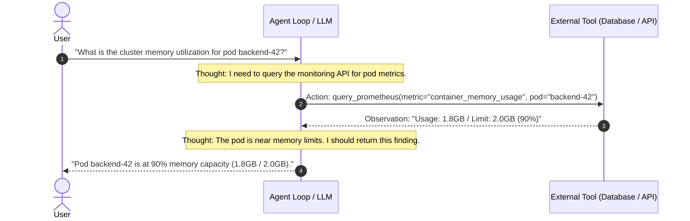
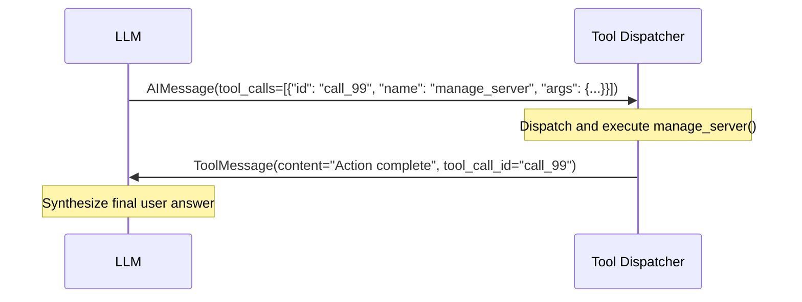
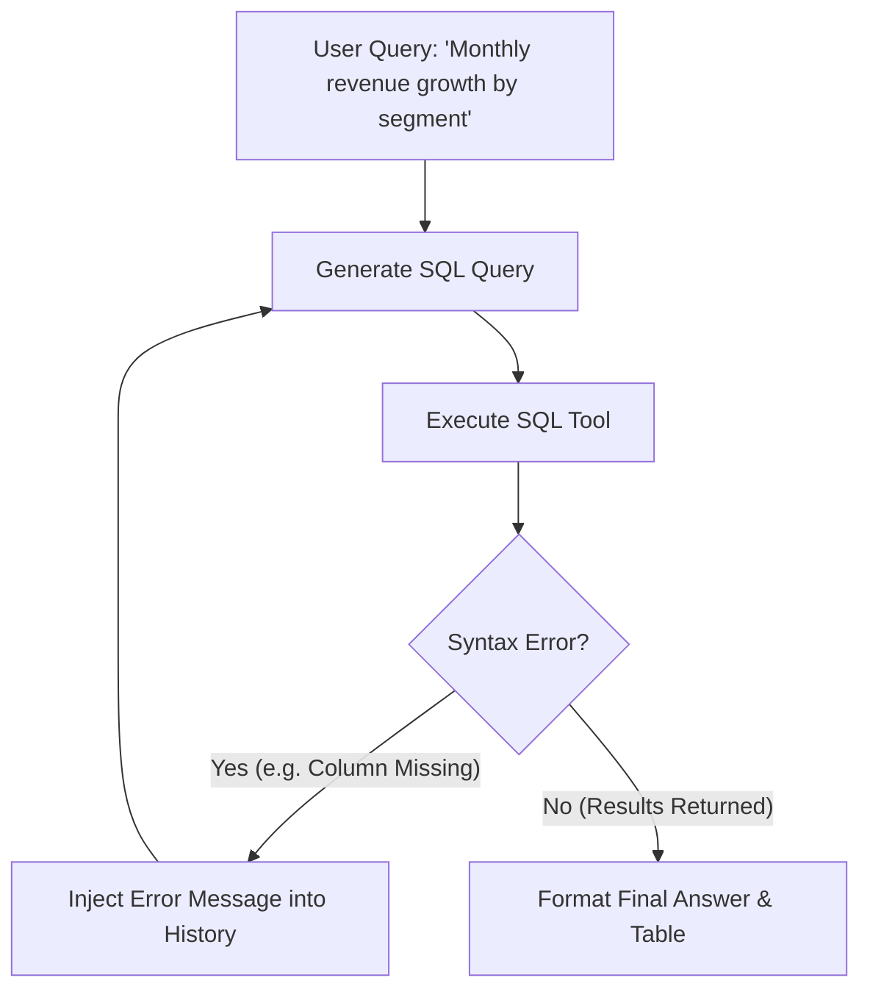
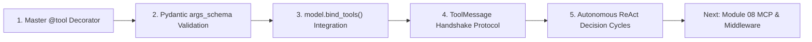

# 📚 Module 07: Tools & Autonomous Agents in LangChain

> A comprehensive, production-grade guide to building autonomous agent loops: typed tool creation via `@tool`, OpenAPI/JSON schema generation, ToolMessage protocol handshakes, and ReAct decision-making cycles in LangChain v1.0.

---

## 📑 Table of Contents

- [1.0 🏗️ Core Architecture & The Agent Paradigm](#10-️-core-architecture--the-agent-paradigm)
  - [1.1 From Static Chains to Dynamic Autonomous Agents](#11-from-static-chains-to-dynamic-autonomous-agents)
  - [1.2 The ReAct Framework: Thought, Action, Observation](#12-the-react-framework-thought-action-observation)
  - [1.3 Core Primitives & Terminology](#13-core-primitives--terminology)
- [2.0 🛠️ Typed Tool Creation with the `@tool` Decorator](#20-️-typed-tool-creation-with-the-tool-decorator)
  - [2.1 The `@tool` Decorator Syntax & Docstring Inference](#21-the-tool-decorator-syntax--docstring-inference)
  - [2.2 Strict Schema Validation with Pydantic `args_schema`](#22-strict-schema-validation-with-pydantic-args_schema)
  - [2.3 Error Handling & Fallbacks Inside Tool Functions](#23-error-handling--fallbacks-inside-tool-functions)
- [3.0 📦 Prebuilt Tools Ecosystem](#30--prebuilt-tools-ecosystem)
  - [3.1 Web Search & Information Retrieval (DuckDuckGo, Tavily)](#31-web-search--information-retrieval-duckduckgo-tavily)
  - [3.2 Analytical Code Execution (PythonREPL)](#32-analytical-code-execution-pythonrepl)
  - [3.3 Relational Database Tools (SQLDatabaseToolkit)](#33-relational-database-tools-sqldatabasetoolkit)
- [4.0 🔄 The Autonomous Execution Loop](#40--the-autonomous-execution-loop)
  - [4.1 Tool Binding with `model.bind_tools()`](#41-tool-binding-with-modelbind_tools)
  - [4.2 The ToolMessage Handshake Protocol](#42-the-toolmessage-handshake-protocol)
  - [4.3 Multi-Turn Reasoning and Loop Termination](#43-multi-turn-reasoning-and-loop-termination)
- [5.0 ⚖️ Advantages, Limitations & Architecture Trade-offs](#50-️-advantages-limitations--architecture-trade-offs)
- [6.0 🏢 Real-World Production Patterns](#60--real-world-production-patterns)
- [7.0 ⚠️ Common Pitfalls & Anti-Patterns (And How to Fix Them)](#70-️-common-pitfalls--anti-patterns-and-how-to-fix-them)
- [8.0 💼 Technical Interview Preparation: Questions & Scenarios](#80--technical-interview-preparation-questions--scenarios)
- [9.0 🛠️ Practical Hands-On Implementation Guide](#90-️-practical-hands-on-implementation-guide)
- [10.0 ⚡ Quick Revision, Mathematical Formulations, CLI Commands & Roadmap](#100--quick-revision-mathematical-formulations-cli-commands--roadmap)

---

## 1.0 🏗️ Core Architecture & The Agent Paradigm

### 1.1 From Static Chains to Dynamic Autonomous Agents

Static LCEL chains execute predetermined, fixed sequences of steps. However, real-world enterprise problems require dynamic decision-making:
- Which tools are needed to answer the user's request?
- In what order should external systems be queried?
- Did an external API return an error that requires retrying with alternative arguments?

**Autonomous Agents** use foundation models as reasoning engines to decide which actions to take, observe the outputs of those actions, and repeat until the task is complete.

---

### 1.2 The ReAct Framework: Thought, Action, Observation



---

### 1.3 Core Primitives & Terminology

- **`BaseTool`**: The core LangChain abstraction for external capabilities callable by an LLM.
- **`@tool`**: A Python decorator that converts functions into type-safe LangChain tools.
- **`tool_calls`**: A list of structured tool invocation requests emitted within an `AIMessage`.
- **`ToolMessage`**: The typed message containing the execution result of a tool, matching a specific `tool_call_id`.
- **`create_agent`**: The modern factory for composing tool-calling models into an autonomous loop.

---

## 2.0 🛠️ Typed Tool Creation with the `@tool` Decorator

### 2.1 The `@tool` Decorator Syntax & Docstring Inference

The `@tool` decorator inspects Python type hints and the docstring to generate the OpenAPI JSON Schema passed to the model:

```python
from langchain_core.tools import tool

@tool
def calculate_compound_interest(principal: float, rate: float, years: int) -> float:
    """
    Calculates the future value of an investment using compound interest.
    
    Args:
        principal: Initial investment amount in dollars.
        rate: Annual interest rate as a decimal (e.g. 0.05 for 5%).
        years: Number of years the investment grows.
    """
    return round(principal * ((1 + rate) ** years), 2)
```

---

### 2.2 Strict Schema Validation with Pydantic `args_schema`

For enterprise tools with complex validation rules, pass an explicit Pydantic v2 `args_schema`:

```python
from pydantic import BaseModel, Field
from typing import Literal

class ServerActionInput(BaseModel):
    server_id: str = Field(description="Unique AWS EC2 instance ID (e.g. i-0123456789abcdef0).")
    action: Literal["RESTART", "STOP", "TERMINATE"] = Field(description="The operational lifecycle action to execute.")
    force: bool = Field(default=False, description="Whether to bypass graceful shutdown timeouts.")

@tool("manage_cloud_server", args_schema=ServerActionInput)
def manage_cloud_server(server_id: str, action: str, force: bool = False) -> str:
    """Executes lifecycle management operations on cloud virtual servers."""
    if action == "TERMINATE" and not force:
        return "ERROR: Termination requires explicit force=True flag."
    return f"Successfully executed {action} on server {server_id}."
```

---

### 2.3 Error Handling & Fallbacks Inside Tool Functions

Tools should catch exceptions internally and return informative error strings rather than raising uncaught Python exceptions, allowing the agent to self-correct:

```python
@tool
def fetch_user_record(user_id: str) -> str:
    """Retrieves user account metadata from the internal customer database."""
    try:
        # Simulate database lookup
        if not user_id.startswith("USR-"):
            return "ERROR: User ID format must begin with 'USR-' prefix (e.g. USR-1002). Please verify the ID."
        return f"User {user_id}: Name: Sarah Connor, Tier: Enterprise, Status: Active"
    except Exception as e:
        return f"TOOL_EXECUTION_ERROR: Database connection failed: {str(e)}"
```

---

## 3.0 📦 Prebuilt Tools Ecosystem

LangChain Community provides battle-tested prebuilt tools:

| Tool Integration | Import Path | Functionality |
| :--- | :--- | :--- |
| **DuckDuckGo Search** | `langchain_community.tools import DuckDuckGoSearchRun` | Live web search without requiring an API key |
| **Wikipedia** | `langchain_community.tools import WikipediaQueryRun` | Encyclopedic search and factual lookup |
| **Python REPL** | `langchain_experimental.utilities import PythonREPL` | Sandboxed Python code evaluation for math and analytics |
| **SQL Database** | `langchain_community.agent_toolkits import SQLDatabaseToolkit` | Schema exploration, query checking, and database execution |

---

## 4.0 🔄 The Autonomous Execution Loop

### 4.1 Tool Binding with `model.bind_tools()`

Modern ChatModels bind tools directly via native provider APIs:

```python
from langchain.chat_models import init_chat_model

tools = [calculate_compound_interest, manage_cloud_server]
model = init_chat_model("gpt-4o-mini", model_provider="openai")

# Binds the JSON schema of each tool to the model's tool calling parameters
model_with_tools = model.bind_tools(tools)
```

---

### 4.2 The ToolMessage Handshake Protocol

When an LLM requests a tool call, the execution environment must return a `ToolMessage` carrying the exact `tool_call_id` emitted by the model. Omitting this handshake causes provider API validation errors:



---

### 4.3 Multi-Turn Reasoning and Loop Termination

An autonomous agent loops through tool invocations until one of two conditions is met:
1. **Completion**: The model emits an `AIMessage` with no `tool_calls`, indicating it has sufficient data to answer the user.
2. **Circuit Breaker**: The loop reaches a configured `max_iterations` limit, preventing runaway billing and infinite loops.

---

## 5.0 ⚖️ Advantages, Limitations & Architecture Trade-offs

| Dimension | Advantages & Strengths | Limitations & Bottlenecks | Recommended Engineering Mitigation |
| :--- | :--- | :--- | :--- |
| **Typed `@tool` Decorator** | Generates OpenAPI schemas automatically; validates args with Pydantic | Schema descriptions consume tokens in every prompt invocation | Keep tool docstrings concise; bind only relevant tools |
| **Autonomous ReAct Loops** | Solves complex, open-ended tasks dynamically without hardcoded logic | Non-deterministic latency; compounding errors across multiple steps | Enforce strict step limits; implement validation guardrails |
| **Tool Side-Effects** | Automates operational tasks (cloud deployment, ticket creation) | Risk of unintended changes from hallucinations | Enforce read-only tools by default; require human approval for write actions |

---

## 6.0 🏢 Real-World Production Patterns

### Pattern: Self-Healing Analytical SQL Agent
The agent writes a SQL query, executes it via a tool, catches database syntax errors, and loops the error message back to the model for self-correction:



---

## 7.0 ⚠️ Common Pitfalls & Anti-Patterns (And How to Fix Them)

### Anti-Pattern 1: Missing or Vague Tool Descriptions
- **Mistake**: Defining a tool with no docstring or description:
  ```python
  @tool
  def search(q: str):
      return query_db(q)
  ```
  The LLM has no context on when or why to choose this tool over others.
- **Fix**: Write explicit descriptions detailing the tool's purpose, expected input format, and operational boundaries.

### Anti-Pattern 2: Discarding the `tool_call_id`
- **Mistake**: Returning a standard `HumanMessage` or string with the tool result.
- **Consequence**: APIs like OpenAI will raise `InvalidRequestError: Tool response does not match an active tool call`.
- **Fix**: Always return a `ToolMessage` with `tool_call_id=tool_call["id"]`.

---

## 8.0 💼 Technical Interview Preparation: Questions & Scenarios

### Q1: How does the model know when to stop calling tools and return a final response?
> **Answer**: At each step of the agent loop, the model evaluates the conversation history (including the latest `ToolMessage` observations). If the model determines it has gathered sufficient information to answer the initial query, it generates an `AIMessage` with a text `content` payload and an empty `tool_calls` list (`tool_calls=[]`). The agent loop detects this condition and terminates, returning the content to the caller.

### Q2: What are the security risks associated with giving autonomous agents code execution tools (e.g. `PythonREPL`)?
> **Answer**: Arbitrary code execution can allow prompt injections to access file systems, read environment variables, exfiltrate API secrets, or run Denial of Service attacks. In production, code execution tools must run inside isolated containers (e.g. Docker / gVisor) with network egress blocked, non-root user permissions, and strict memory/CPU resource caps.

---

## 9.0 🛠️ Practical Hands-On Implementation Guide

```python
"""
Module 07 - Complete Tool Calling Agent Loop
"""
from langchain_core.tools import tool
from langchain_core.messages import HumanMessage, SystemMessage, ToolMessage
from langchain.chat_models import init_chat_model

# 1. Define Custom Tool
@tool
def get_service_latency(service_name: str) -> str:
    """Retrieves real-time p99 latency metrics for a named infrastructure service."""
    metrics = {
        "auth-service": "p99: 42ms (HEALTHY)",
        "billing-gateway": "p99: 1450ms (DEGRADED - High DB lock contention)"
    }
    return metrics.get(service_name.lower(), f"Service '{service_name}' not found.")

# 2. Bind Tools
model = init_chat_model("gpt-4o-mini", model_provider="openai", temperature=0.0)
tools = [get_service_latency]
tools_by_name = {t.name: t for t in tools}
model_with_tools = model.bind_tools(tools)

# 3. Manual Autonomous ReAct Execution Loop
def run_agent_loop(user_query: str, max_steps: int = 5):
    messages = [
        SystemMessage(content="You are an SRE diagnostic assistant. Query service health to diagnose issues."),
        HumanMessage(content=user_query)
    ]

    for step in range(max_steps):
        ai_msg = model_with_tools.invoke(messages)
        messages.append(ai_msg)

        # Termination condition: No tool calls requested
        if not getattr(ai_msg, "tool_calls", None):
            return ai_msg.content

        # Execute requested tool calls
        for tool_call in ai_msg.tool_calls:
            tool_obj = tools_by_name[tool_call["name"]]
            observation = tool_obj.invoke(tool_call["args"])
            messages.append(ToolMessage(content=str(observation), tool_call_id=tool_call["id"]))

    return "ERROR: Exceeded maximum reasoning steps without conclusion."
```

---

## 10.0 ⚡ Quick Revision, Mathematical Formulations, CLI Commands & Roadmap

### 10.1 Key Formulations in Autonomous Agent Systems

# Agent State Recurrence Formulation
$$S_{t+1} = \mathcal{T}(S_t, A_t, O_t) \quad \text{where } O_t = \text{Execute}(A_t)$$

# Loop Termination Condition
$$\text{Halt if } \text{ToolCalls}(A_t) = \emptyset \quad \lor \quad t \ge \text{MaxIterations}$$

---

### 10.2 Core Method & Import Reference

| Primitive | Python Import Path | Primary Operational Method |
| :--- | :--- | :--- |
| **@tool** | `from langchain_core.tools import tool` | `@tool def my_tool(arg: str): ...` |
| **ToolMessage** | `from langchain_core.messages import ToolMessage` | `ToolMessage(content="...", tool_call_id="...")` |
| **bind_tools** | Method on any `BaseChatModel` | `model.bind_tools([tool1, tool2])` |

---

### 10.3 Essential CLI Setup Commands

```bash
pip install langchain langchain-core langchain-openai pydantic
```

---

### 10.4 Tools & Agents Learning Roadmap


