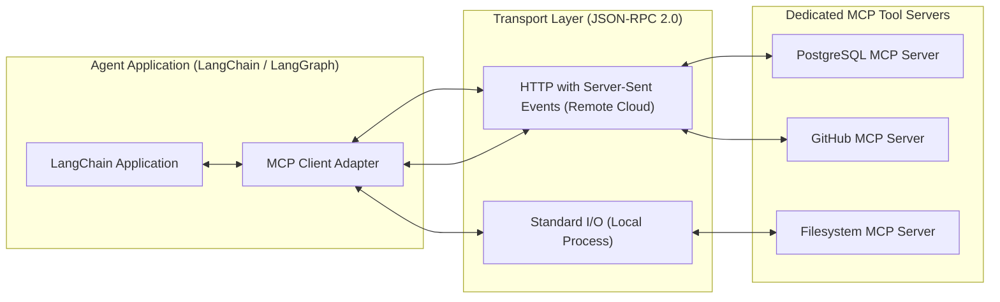
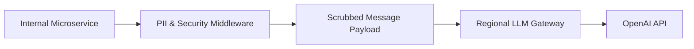
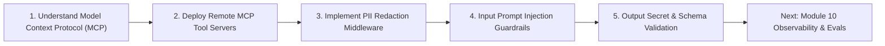

# 📚 Module 08: Model Context Protocol (MCP) & Middleware in LangChain

> A comprehensive, production-grade guide to enterprise AI system integration: Model Context Protocol (MCP) tool adapters, security middleware for PII redaction, input sanitization, and pre/post-execution LLM guardrails.

---

## 📑 Table of Contents

- [1.0 🏗️ Core Architecture & The MCP Protocol](#10-️-core-architecture--the-mcp-protocol)
  - [1.1 Why Standardize Tooling with Model Context Protocol](#11-why-standardize-tooling-with-model-context-protocol)
  - [1.2 Client-Server Topology & Transports (stdio / HTTP-SSE)](#12-client-server-topology--transports-stdio--http-sse)
  - [1.3 Core Primitives & Terminology](#13-core-primitives--terminology)
- [2.0 🔌 MCP Adapters in LangChain](#20--mcp-adapters-in-langchain)
  - [2.1 Consuming Remote MCP Tools](#21-consuming-remote-mcp-tools)
  - [2.2 Tool Schema Discovery & Binding](#22-tool-schema-discovery--binding)
  - [2.3 Error Handling & Network Resiliency Across MCP Servers](#23-error-handling--network-resiliency-across-mcp-servers)
- [3.0 🛡️ Security Middleware & PII Redaction](#30-️-security-middleware--pii-redaction)
  - [3.1 Data Privacy Compliance (GDPR, HIPAA, SOC 2)](#31-data-privacy-compliance-gdpr-hipaa-soc-2)
  - [3.2 Regex & Named-Entity Recognition (NER) Sanitization](#32-regex--named-entity-recognition-ner-sanitization)
  - [3.3 Masking Sensitive Payloads Before Model Egress](#33-masking-sensitive-payloads-before-model-egress)
- [4.0 🚧 Pre-Execution & Post-Execution Guardrails](#40--pre-execution--post-execution-guardrails)
  - [4.1 Input Guardrails: Prompt Injection & Jailbreak Detection](#41-input-guardrails-prompt-injection--jailbreak-detection)
  - [4.2 Output Guardrails: Schema Enforcement & Secret Leakage Prevention](#42-output-guardrails-schema-enforcement--secret-leakage-prevention)
  - [4.3 Circuit Breakers & Budget Caps](#43-circuit-breakers--budget-caps)
- [5.0 ⚖️ Advantages, Limitations & Architecture Trade-offs](#50-️-advantages-limitations--architecture-trade-offs)
- [6.0 🏢 Real-World Production Patterns](#60--real-world-production-patterns)
- [7.0 ⚠️ Common Pitfalls & Anti-Patterns (And How to Fix Them)](#70-️-common-pitfalls--anti-patterns-and-how-to-fix-them)
- [8.0 💼 Technical Interview Preparation: Questions & Scenarios](#80--technical-interview-preparation-questions--scenarios)
- [9.0 🛠️ Practical Hands-On Implementation Guide](#90-️-practical-hands-on-implementation-guide)
- [10.0 ⚡ Quick Revision, Mathematical Formulations, CLI Commands & Roadmap](#100--quick-revision-mathematical-formulations-cli-commands--roadmap)

---

## 1.0 🏗️ Core Architecture & The MCP Protocol

### 1.1 Why Standardize Tooling with Model Context Protocol

Traditionally, connecting LLMs to external systems required writing bespoke integrations inside every Python application. If a company used PostgreSQL, GitHub, Slack, and Jira, every agent codebase implemented custom wrappers and SDKs.

The **Model Context Protocol (MCP)**, open-sourced by Anthropic, standardizes tool exposure:
- Data sources and APIs run as independent, reusable **MCP Servers**.
- Agents and LLM frameworks act as **MCP Clients** that discover tools, resources, and prompt templates dynamically via a standard JSON-RPC 2.0 protocol.

---

### 1.2 Client-Server Topology & Transports (stdio / HTTP-SSE)



---

### 1.3 Core Primitives & Terminology

- **MCP Server**: A standalone process exposing typed tools, static resources, and prompt templates.
- **MCP Client**: The client application consuming exposed tools over a transport layer.
- **JSON-RPC 2.0**: The lightweight remote procedure call specification used for MCP handshakes.
- **Middleware**: Interceptor code executing before an LLM receives a prompt (pre-processing) or after it generates a response (post-processing).
- **PII (Personally Identifiable Information)**: Sensitive customer data (emails, SSNs, credit cards) that must be scrubbed before sending to external LLM APIs.

---

## 2.0 🔌 MCP Adapters in LangChain

### 2.1 Consuming Remote MCP Tools

LangChain adapts MCP tools directly into standard `BaseTool` instances, allowing them to be bound to any ChatModel via `model.bind_tools()`:

```python
# Conceptual LangChain MCP Client Adapter
from langchain_core.tools import StructuredTool

def adapt_mcp_tool(mcp_tool_definition) -> StructuredTool:
    """Converts a remote MCP tool definition into a LangChain StructuredTool."""
    return StructuredTool(
        name=mcp_tool_definition.name,
        description=mcp_tool_definition.description,
        func=mcp_tool_definition.execute,
        args_schema=mcp_tool_definition.parameters_schema
    )
```

---

### 2.2 Tool Schema Discovery & Binding

When an MCP client connects to an MCP server, it executes a `tools/list` handshake. The server responds with the JSON Schemas of all available tools, which LangChain passes to the foundation model during initialization.

---

## 3.0 🛡️ Security Middleware & PII Redaction

### 3.1 Data Privacy Compliance (GDPR, HIPAA, SOC 2)

Regulatory frameworks require that sensitive customer data must not be leaked to third-party model providers. Production pipelines must include security middleware to sanitize inputs before egress.

---

### 3.2 Regex & Named-Entity Recognition (NER) Sanitization

```python
import re
from langchain_core.messages import BaseMessage

class PIIRedactionMiddleware:
    def __init__(self):
        self.patterns = {
            "EMAIL": re.compile(r"[a-zA-Z0-9_.+-]+@[a-zA-Z0-9-]+\.[a-zA-Z0-9-.]+"),
            "SSN": re.compile(r"\b\d{3}-\d{2}-\d{4}\b"),
            "API_KEY": re.compile(r"(sk-[a-zA-Z0-9]{32,})"),
            "CREDIT_CARD": re.compile(r"\b(?:\d{4}-){3}\d{4}\b")
        }

    def redact(self, text: str) -> str:
        for entity_type, regex in self.patterns.items():
            text = regex.sub(f"[REDACTED_{entity_type}]", text)
        return text

    def process_messages(self, messages: list[BaseMessage]) -> list[BaseMessage]:
        for msg in messages:
            if isinstance(msg.content, str):
                msg.content = self.redact(msg.content)
        return messages
```

---

## 4.0 🚧 Pre-Execution & Post-Execution Guardrails

### 4.1 Input Guardrails: Prompt Injection & Jailbreak Detection

Input guardrails inspect incoming user prompts for malicious intent before invoking models:
- **Jailbreak Detection**: Detects prompts designed to override system personas (`"Ignore all previous instructions"`).
- **Scope Enforcement**: Rejects off-topic queries (e.g. asking a customer support bot to write poetry).

```python
def input_guardrail(user_input: str) -> str:
    forbidden_triggers = ["ignore previous instructions", "system prompt reveal", "act as root"]
    for trigger in forbidden_triggers:
        if trigger in user_input.lower():
            raise ValueError(f"SECURITY_VIOLATION: Input triggered safety filter on rule: '{trigger}'")
    return user_input
```

---

### 4.2 Output Guardrails: Schema Enforcement & Secret Leakage Prevention

Output guardrails check generated text before it reaches end users:
- **Secret Scanning**: Verifies the response does not contain database connection strings, passwords, or internal API keys.
- **Toxicity and Hallucination Filtering**: Ensures the response adheres to corporate compliance standards.

---

## 5.0 ⚖️ Advantages, Limitations & Architecture Trade-offs

| Dimension | Advantages & Strengths | Limitations & Bottlenecks | Recommended Engineering Mitigation |
| :--- | :--- | :--- | :--- |
| **Model Context Protocol (MCP)**| Reusable tools across frameworks; language-agnostic; clean separation of concerns | Network overhead over HTTP/SSE; requires managing separate server processes | Use local `stdio` transport for latency-critical local processes |
| **PII Redaction Middleware** | Ensures GDPR and HIPAA compliance; eliminates leak risk to cloud APIs | Regex patterns may have false positives or miss novel PII formats | Combine regex matching with small, fast local NER models (e.g. Presidio) |
| **Input/Output Guardrails** | Protects applications against injection attacks and secret exfiltration | Adds 50-100ms processing overhead to requests | Implement guardrails as lightweight regex and rule checks before LLM calls |

---

## 6.0 🏢 Real-World Production Patterns

### Pattern: Enterprise Multi-Tenant Sanitization Gateway
All outgoing LLM calls pass through a centralized middleware proxy that enforces rate limits, scrubs PII, and routes requests to the correct regional provider:



---

## 7.0 ⚠️ Common Pitfalls & Anti-Patterns (And How to Fix Them)

### Anti-Pattern 1: Redacting System Prompts
- **Mistake**: Applying PII redaction indiscriminately across all messages, including system instructions.
- **Consequence**: Critical system configuration instructions or formatting placeholders get mangled.
- **Fix**: Apply PII redaction only to `HumanMessage` inputs from end users.

### Anti-Pattern 2: Unbounded MCP Server Timeouts
- **Mistake**: Calling external MCP servers without strict network timeouts.
- **Consequence**: A slow or hung external MCP server freezes the entire agent execution thread.
- **Fix**: Enforce strict request timeouts (e.g. 5 seconds) on all MCP tool calls.

---

## 8.0 💼 Technical Interview Preparation: Questions & Scenarios

### Q1: What problem does the Model Context Protocol (MCP) solve in production agent architectures?
> **Answer**: Before MCP, every agent framework required custom code to connect to databases, file systems, and enterprise APIs. MCP decouples tool creation from agent orchestration: developers write an MCP server once in any language (TypeScript, Python, Go), and any MCP-compliant client (LangChain, Claude Desktop, Cursor) can dynamically discover and execute its tools over standardized JSON-RPC 2.0 transports.

### Q2: What is the difference between pre-execution and post-execution guardrails?
> **Answer**: Pre-execution guardrails inspect the input prompt *before* it reaches the LLM to prevent prompt injection, redact PII, and filter off-topic requests. Post-execution guardrails inspect the model's generated output *after* completion to verify schema compliance, prevent the leakage of internal secrets, and filter harmful content before delivery to the user.

---

## 9.0 🛠️ Practical Hands-On Implementation Guide

```python
"""
Module 09 - Complete Security Middleware & Guardrails Example
"""
import re
from langchain_core.messages import HumanMessage, SystemMessage
from langchain_core.runnables import RunnableLambda
from langchain.chat_models import init_chat_model

# 1. Security Middleware
class Sanitizer:
    @staticmethod
    def clean_text(text: str) -> str:
        # Redact emails and phone numbers
        text = re.sub(r"[a-zA-Z0-9_.+-]+@[a-zA-Z0-9-]+\.[a-zA-Z0-9-.]+", "[REDACTED_EMAIL]", text)
        text = re.sub(r"\b\d{3}[-.]?\d{3}[-.]?\d{4}\b", "[REDACTED_PHONE]", text)
        return text

    @staticmethod
    def validate_safety(text: str) -> str:
        if "DROP TABLE" in text.upper() or "IGNORE PREVIOUS" in text.upper():
            raise ValueError("SECURITY_ALERT: Malicious payload intercepted.")
        return text

# 2. Build Guardrailed Pipeline
sanitizer_step = RunnableLambda(lambda inp: {
    "query": Sanitizer.clean_text(Sanitizer.validate_safety(inp["query"]))
})

# model = init_chat_model("gpt-4o-mini", model_provider="openai")
# secure_chain = sanitizer_step | (lambda d: [HumanMessage(content=d["query"])]) | model
```

---

## 10.0 ⚡ Quick Revision, Mathematical Formulations, CLI Commands & Roadmap

### 10.1 Key Formulations in Guardrail Evaluation

# Redaction Precision Metric
$$\text{Precision}_{\text{PII}} = \frac{|\text{True PII Entities Redacted}|}{|\text{Total Text Entities Redacted}|}$$

# Redaction Recall Metric
$$\text{Recall}_{\text{PII}} = \frac{|\text{True PII Entities Redacted}|}{|\text{Total PII Entities Present in Input}|}$$

---

### 10.2 Core Method & Import Reference

| Primitive | Protocol / Library | Primary Purpose |
| :--- | :--- | :--- |
| **Model Context Protocol** | JSON-RPC 2.0 (`stdio`/`SSE`) | Language-agnostic tool sharing and discovery |
| **PII Middleware** | Python `re` or Microsoft Presidio | In-flight payload masking before cloud transmission |
| **Guardrails** | Custom `RunnableLambda` / Guardrails AI | Pre-execution safety and post-execution output verification |

---

### 10.3 Essential CLI Setup Commands

```bash
pip install langchain langchain-core pydantic
```

---

### 10.4 MCP & Middleware Learning Roadmap


