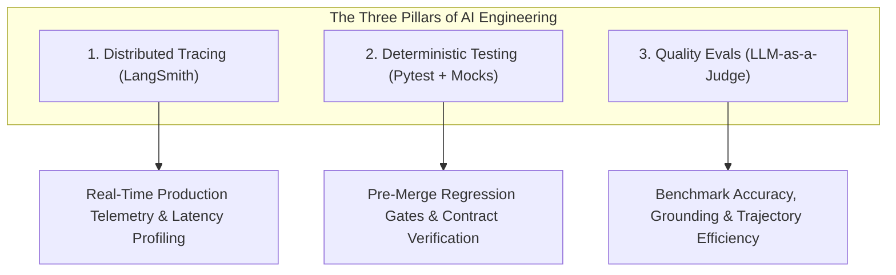
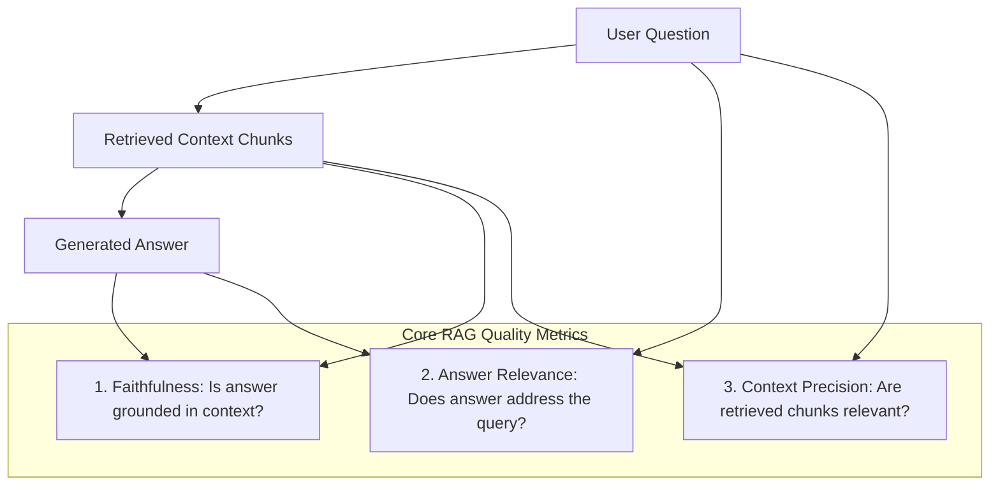
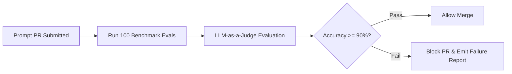
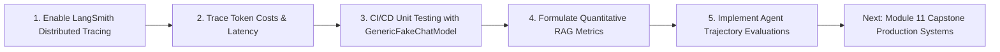

# 📚 Module 09: Observability, Testing & Evals in LangChain

> A comprehensive, production-grade guide to enterprise LLM observability and quality assurance: LangSmith distributed tracing, deterministic unit testing with `GenericFakeChatModel`, agent trajectory evaluations, and LLM-as-a-Judge benchmarking.

---

## 📑 Table of Contents

- [1.0 🏗️ Core Architecture & Observability Foundations](#10-️-core-architecture--observability-foundations)
  - [1.1 Why Observability is Non-Negotiable for Non-Deterministic Systems](#11-why-observability-is-non-negotiable-for-non-deterministic-systems)
  - [1.2 The Three Pillars: Tracing, Testing, Evaluation](#12-the-three-pillars-tracing-testing-evaluation)
  - [1.3 Core Primitives & Terminology](#13-core-primitives--terminology)
- [2.0 🔭 Distributed Tracing with LangSmith](#20--distributed-tracing-with-langsmith)
  - [2.1 Zero-Code Instrumentation via Environment Variables](#21-zero-code-instrumentation-via-environment-variables)
  - [2.2 Run Trees, Spans & Metadata Tagging](#22-run-trees-spans--metadata-tagging)
  - [2.3 Diagnosing Latency, Token Usage & Tool Failures](#23-diagnosing-latency-token-usage--tool-failures)
- [3.0 🧪 Deterministic Unit Testing in CI/CD](#30--deterministic-unit-testing-in-cicd)
  - [3.1 Eliminating Flakiness & API Costs in Unit Tests](#31-eliminating-flakiness--api-costs-in-unit-tests)
  - [3.2 Mocking Model Outputs with `GenericFakeChatModel`](#32-mocking-model-outputs-with-genericfakechatmodel)
  - [3.3 Testing LCEL Pipelines & State Graph Transitions](#33-testing-lcel-pipelines--state-graph-transitions)
- [4.0 📊 Evaluation Frameworks & LLM-as-a-Judge](#40--evaluation-frameworks--llm-as-a-judge)
  - [4.1 The Triad of RAG Metrics: Faithfulness, Relevance, Groundedness](#41-the-triad-of-rag-metrics-faithfulness-relevance-groundedness)
  - [4.2 Agent Trajectory Evaluation (Tool Selection & Efficiency)](#42-agent-trajectory-evaluation-tool-selection--efficiency)
  - [4.3 Designing Robust LLM-as-a-Judge Prompts & Rubrics](#43-designing-robust-llm-as-a-judge-prompts--rubrics)
- [5.0 ⚖️ Advantages, Limitations & Architecture Trade-offs](#50-️-advantages-limitations--architecture-trade-offs)
- [6.0 🏢 Real-World Production Patterns](#60--real-world-production-patterns)
- [7.0 ⚠️ Common Pitfalls & Anti-Patterns (And How to Fix Them)](#70-️-common-pitfalls--anti-patterns-and-how-to-fix-them)
- [8.0 💼 Technical Interview Preparation: Questions & Scenarios](#80--technical-interview-preparation-questions--scenarios)
- [9.0 🛠️ Practical Hands-On Implementation Guide](#90-️-practical-hands-on-implementation-guide)
- [10.0 ⚡ Quick Revision, Mathematical Formulations, CLI Commands & Roadmap](#100--quick-revision-mathematical-formulations-cli-commands--roadmap)

---

## 1.0 🏗️ Core Architecture & Observability Foundations

### 1.1 Why Observability is Non-Negotiable for Non-Deterministic Systems

Traditional software is deterministic: identical inputs yield identical outputs. In contrast, LLM applications:
- Produce varying natural language completions across runs.
- Rely on multi-step reasoning loops where a single bad tool call compounds down the chain.
- Incur variable token costs and unpredictable network latencies.

Without structured observability, debugging production incidents (hallucinations, infinite loops, API rate limits) is nearly impossible.

---

### 1.2 The Three Pillars: Tracing, Testing, Evaluation



---

### 1.3 Core Primitives & Terminology

- **Trace**: The complete execution tree of a single user request across all nested chains, prompts, models, and tools.
- **Span / Run**: An individual operation within a trace (e.g. one LLM call or one tool execution).
- **`GenericFakeChatModel`**: A deterministic mock model that returns pre-configured responses, enabling fast, free CI/CD unit testing.
- **LLM-as-a-Judge**: Using a powerful foundation model (e.g. GPT-4o) with a structured evaluation rubric to score the output of another model.
- **Trajectory**: The sequence of intermediate reasoning steps and tool calls an agent takes to arrive at an answer.

---

## 2.0 🔭 Distributed Tracing with LangSmith

### 2.1 Zero-Code Instrumentation via Environment Variables

LangChain includes native telemetry hooks. Configuring three environment variables automatically streams execution traces to **LangSmith** without modifying code:

```bash
export LANGCHAIN_TRACING_V2="true"
export LANGCHAIN_API_KEY="lsv2_pt_..."
export LANGCHAIN_PROJECT="prod-customer-assistant"
```

---

### 2.2 Run Trees, Spans & Metadata Tagging

Custom metadata (user IDs, tenant tiers, environment flags) can be attached to execution runs for filtered querying in the LangSmith dashboard:

```python
from langchain.chat_models import init_chat_model
from langchain_core.messages import HumanMessage

model = init_chat_model("gpt-4o-mini", model_provider="openai")

# Invoke with operational tags and metadata
response = model.invoke(
    [HumanMessage(content="Explain Kubernetes namespaces.")],
    config={
        "tags": ["production", "tier-enterprise", "billing-team"],
        "metadata": {"user_id": "usr-8841", "session_id": "sess-9901"}
    }
)
```

---

### 2.3 Diagnosing Latency, Token Usage & Tool Failures

LangSmith traces capture:
- **Exact Input/Output Payloads**: Full prompt strings, system instructions, and completion tokens.
- **Latency Breakdown**: Pinpoints whether delays originate from model inference, vector DB retrieval, or external API calls.
- **Token Usage**: Measures prompt and completion token counts per step, helping spot costly prompt bloat.

---

## 3.0 🧪 Deterministic Unit Testing in CI/CD

### 3.1 Eliminating Flakiness & API Costs in Unit Tests

Running automated test suites (e.g. in GitHub Actions) against live frontier LLMs has three major drawbacks:
1. High API costs for frequent test runs.
2. Flaky tests caused by non-deterministic completions.
3. Test failures during third-party provider outages or rate limits.

---

### 3.2 Mocking Model Outputs with `GenericFakeChatModel`

`GenericFakeChatModel` provides deterministic, repeatable completions:

```python
import pytest
from langchain_core.language_models.fake_chat_models import GenericFakeChatModel
from langchain_core.messages import AIMessage
from langchain_core.prompts import ChatPromptTemplate
from langchain_core.output_parsers import StrOutputParser

def test_pipeline_transformation():
    # Setup mock model with predefined response sequence
    fake_model = GenericFakeChatModel(messages=iter([
        AIMessage(content="DEPLOYMENT_VERIFIED")
    ]))

    prompt = ChatPromptTemplate.from_template("Audit: {system}")
    chain = prompt | fake_model | StrOutputParser()

    result = chain.invoke({"system": "Kubernetes Ingress Controller"})
    assert result == "DEPLOYMENT_VERIFIED"
```

---

## 4.0 📊 Evaluation Frameworks & LLM-as-a-Judge

### 4.1 The Triad of RAG Metrics: Faithfulness, Relevance, Groundedness



---

### 4.2 Agent Trajectory Evaluation (Tool Selection & Efficiency)

Evaluating an autonomous agent requires evaluating both the final answer and the path taken:

| Trajectory Metric | Evaluation Target | Ideal Target |
| :--- | :--- | :--- |
| **Tool Selection Accuracy** | Did the agent pick the correct tool for the sub-task? | $100\%$ |
| **Argument Validity** | Did tool parameters conform to expected schemas without errors? | $100\%$ |
| **Step Parsimony** | Did the agent avoid redundant or cyclic tool calls? | Minimal steps |
| **Error Recovery** | Did the agent self-correct after receiving tool error messages? | $\ge 90\%$ |

---

### 4.3 Designing Robust LLM-as-a-Judge Prompts & Rubrics

```python
from langchain_core.prompts import ChatPromptTemplate
from langchain.chat_models import init_chat_model
from pydantic import BaseModel, Field

class EvaluationScore(BaseModel):
    faithfulness_score: float = Field(ge=0.0, le=1.0, description="1.0 if entirely grounded in context; 0.0 if hallucinated.")
    reasoning: str = Field(description="Step-by-step evidence justifying the score.")

eval_prompt = ChatPromptTemplate.from_template("""
You are an expert impartial quality evaluator. Evaluate whether the student answer is supported by the context:

CONTEXT:
{context}

STUDENT ANSWER:
{answer}
""")

judge_model = init_chat_model("gpt-4o", model_provider="openai")
evaluator = eval_prompt | judge_model.with_structured_output(EvaluationScore)
```

---

## 5.0 ⚖️ Advantages, Limitations & Architecture Trade-offs

| Dimension | Advantages & Strengths | Limitations & Bottlenecks | Recommended Engineering Mitigation |
| :--- | :--- | :--- | :--- |
| **LangSmith Tracing** | Zero code overhead; captures complete nested execution trees | Cloud telemetry data transfer; sensitive data may leave perimeter | Configure local masking or deploy LangSmith self-hosted instances |
| **`GenericFakeChatModel`**| Fast, free, deterministic CI/CD unit tests | Mocks do not test actual LLM reasoning capabilities | Use mocks for unit tests; use LLM-as-a-Judge for scheduled integration evals |
| **LLM-as-a-Judge** | Accurately evaluates nuanced qualitative responses | Evaluator models can exhibit position bias and verbosity bias | Use strict scoring rubrics, few-shot examples, and Pydantic schemas |

---

## 6.0 🏢 Real-World Production Patterns

### Pattern: Automated Pre-Merge Benchmark Pipeline
In a pull-request pipeline, PR changes to system prompts run against an automated evaluation dataset of 100 historical queries. An LLM-as-a-Judge scores accuracy; if the average quality score drops below 0.90, the PR is automatically blocked:



---

## 7.0 ⚠️ Common Pitfalls & Anti-Patterns (And How to Fix Them)

### Anti-Pattern 1: Running Live LLM Calls in Standard Unit Tests
- **Mistake**: Writing `def test_summary(): model.invoke(...)` in daily unit tests.
- **Consequence**: Flaky test failures during CI runs and compounding API bills.
- **Fix**: Use `GenericFakeChatModel` for unit tests; keep live API tests in a separate, scheduled integration suite.

### Anti-Pattern 2: Unbounded LLM Judge Free-Form Text Outputs
- **Mistake**: Asking an evaluation model to "give a score from 1 to 5" in plain text.
- **Consequence**: Parsing scores from unstructured text is brittle and prone to format drift.
- **Fix**: Enforce structured outputs using Pydantic schemas (`.with_structured_output(EvaluationScore)`).

---

## 8.0 💼 Technical Interview Preparation: Questions & Scenarios

### Q1: What is the difference between unit testing an LLM application and evaluating it?
> **Answer**: Unit testing verifies the deterministic software engineering components around the LLM: prompt formatting, output parsing, schema validation, tool dispatching, and error handling. It should be deterministic, fast, and free (using mocks like `GenericFakeChatModel`). LLM Evaluation assesses the quality, factual accuracy, and safety of the model's non-deterministic generative outputs using scoring rubrics and benchmark datasets.

### Q2: What biases are common in LLM-as-a-Judge evaluation, and how can they be mitigated?
> **Answer**: Common biases include:
> 1. **Position Bias**: Models tend to prefer whichever answer is presented first. (Mitigation: swap option positions and average scores).
> 2. **Verbosity Bias**: Models favor longer, wordier completions over concise ones. (Mitigation: instruct the judge model to value conciseness).
> 3. **Self-Enhancement Bias**: Models often score outputs generated by their own family higher. (Mitigation: use different model families for generation and judging).

---

## 9.0 🛠️ Practical Hands-On Implementation Guide

```python
"""
Module 10 - Complete Unit Testing & Evaluation Example
"""
import pytest
from langchain_core.language_models.fake_chat_models import GenericFakeChatModel
from langchain_core.messages import AIMessage
from langchain_core.prompts import ChatPromptTemplate
from langchain_core.output_parsers import StrOutputParser

def build_support_chain(model):
    prompt = ChatPromptTemplate.from_template("Classify urgency (URGENT / NORMAL):\n{ticket}")
    return prompt | model | StrOutputParser()

def test_support_chain_routing():
    # 1. Setup deterministic mock model
    mock_model = GenericFakeChatModel(messages=iter([
        AIMessage(content="URGENT")
    ]))

    # 2. Build chain with mock
    chain = build_support_chain(mock_model)

    # 3. Assert on output
    result = chain.invoke({"ticket": "Database cluster completely down in production!"})
    assert result == "URGENT"
    print("Unit test passed: Chain correctly returned mocked classification.")

if __name__ == "__main__":
    test_support_chain_routing()
```

---

## 10.0 ⚡ Quick Revision, Mathematical Formulations, CLI Commands & Roadmap

### 10.1 Key Formulations in LLM Quality Evaluation

# Grounded Answer Faithfulness Metric
$$\text{Faithfulness} = \frac{|\text{Factual claims in answer supported by retrieved context}|}{|\text{Total factual claims extracted from generated answer}|}$$

# Answer Relevance Metric
$$\text{Relevance} = \frac{1}{N} \sum_{i=1}^N \text{CosineSimilarity}(E(\text{Generated Answer}), E(\text{Reference Query}_i))$$

---

### 10.2 Core Method & Import Reference

| Primitive | Python Import Path | Primary Operational Method |
| :--- | :--- | :--- |
| **GenericFakeChatModel** | `from langchain_core.language_models.fake_chat_models import GenericFakeChatModel` | `GenericFakeChatModel(messages=iter([...]))` |
| **LangSmith Tracing** | Activated via environment variables | `LANGCHAIN_TRACING_V2="true"` |
| **Judge Evals** | Composed with `.with_structured_output` | `eval_prompt \| judge_model.with_structured_output(Schema)` |

---

### 10.3 Essential CLI Setup Commands

```bash
# LangSmith Tracing Environment Variables
export LANGCHAIN_TRACING_V2="true"
export LANGCHAIN_API_KEY="lsv2_pt_..."
export LANGCHAIN_PROJECT="applied-langchain-handbook"

pip install langchain langchain-core pytest
```

---

### 10.4 Observability & Evals Learning Roadmap


