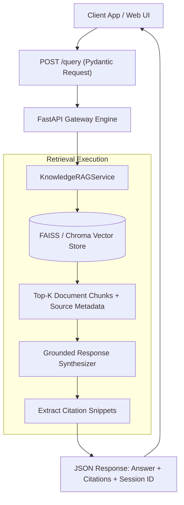

# 📚 Capstone 01: Enterprise RAG Knowledge Assistant with FastAPI & Citations

> A production-grade, citation-backed knowledge retrieval microservice integrating LangChain RAG pipelines with FastAPI, vector indexing, session tracking, and structured REST API endpoints.

---

## 📑 Table of Contents

- [1.0 🏗️ Architecture & System Topology](#10-️-architecture--system-topology)
  - [1.1 Production RAG Microservice Design](#11-production-rag-microservice-design)
  - [1.2 Data Ingestion & Source Attribution Mechanics](#12-data-ingestion--source-attribution-mechanics)
  - [1.3 Core Primitives & Request/Response Contracts](#13-core-primitives--requestresponse-contracts)
- [2.0 🔍 Retrieval Service & Citation Tracking](#20--retrieval-service--citation-tracking)
  - [2.1 Vector Store Indexing with Metadata Schemas](#21-vector-store-indexing-with-metadata-schemas)
  - [2.2 Source Citation Extraction & Snippet Mapping](#22-source-citation-extraction--snippet-mapping)
  - [2.3 Multi-Turn Session Memory Tracking](#23-multi-turn-session-memory-tracking)
- [3.0 🚀 FastAPI Service Layer & REST Integration](#30--fastapi-service-layer--rest-integration)
  - [3.1 Request Validation with Pydantic](#31-request-validation-with-pydantic)
  - [3.2 Health Check & Telemetry Endpoints](#32-health-check--telemetry-endpoints)
  - [3.3 Streaming Server-Sent Events (SSE) Extensions](#33-streaming-server-sent-events-sse-extensions)
- [4.0 ⚖️ Advantages, Limitations & Architecture Trade-offs](#40-️-advantages-limitations--architecture-trade-offs)
- [5.0 ⚠️ Common Pitfalls & Anti-Patterns](#50-️-common-pitfalls--anti-patterns)
- [6.0 💼 Technical Interview Preparation: Questions & Scenarios](#60--technical-interview-preparation-questions--scenarios)
- [7.0 ⚡ Quick Revision, Key Formulas & Setup Commands](#70--quick-revision-key-formulas--setup-commands)

---

## 1.0 🏗️ Architecture & System Topology

### 1.1 Production RAG Microservice Design

Building an enterprise-ready RAG assistant requires wrapping retrieval logic in a robust API framework like FastAPI. This decouples AI orchestration from frontend clients (web chat, mobile apps, Slack bots) while enforcing schema contracts and SLA monitoring:



---

### 1.2 Data Ingestion & Source Attribution Mechanics

In enterprise legal, healthcare, and engineering systems, an ungrounded answer is unacceptable. Every factual claim must be backed by transparent source citations:
- Every ingested document chunk retains its source metadata: `{"source": "security_policy.pdf", "page": 14}`.
- Retrieved chunks are returned in the API response as typed `SourceCitation` objects alongside the generated text.

---

### 1.3 Core Primitives & Request/Response Contracts

```python
from pydantic import BaseModel, Field
from typing import List

class QueryRequest(BaseModel):
    question: str = Field(..., description="User prompt or question")
    session_id: str = Field("default_session", description="Unique session identifier for memory tracking")

class SourceCitation(BaseModel):
    source: str = Field(description="Document filename or URI")
    snippet: str = Field(description="Exact retrieved chunk text providing grounding")

class QueryResponse(BaseModel):
    answer: str
    citations: List[SourceCitation]
    session_id: str
```

---

## 2.0 🔍 Retrieval Service & Citation Tracking

### 2.1 Vector Store Indexing with Metadata Schemas

The `KnowledgeRAGService` seeds a vector store with domain documents, attaching structured metadata to every document object:

```python
from langchain_core.documents import Document
from langchain_community.vectorstores import FAISS

documents = [
    Document(
        page_content="LangGraph workflows represent cognitive architectures as StateGraphs.",
        metadata={"source": "langgraph_architecture.pdf"}
    ),
    Document(
        page_content="LCEL provides declarative pipe composition for deterministic LLM execution.",
        metadata={"source": "lcel_specification.md"}
    )
]
```

---

### 2.2 Source Citation Extraction & Snippet Mapping

During retrieval, candidate chunks are mapped directly into structured citation payloads:

```python
retrieved_docs = vector_store.similarity_search(question, k=2)
citations = [
    {"source": d.metadata.get("source", "unknown"), "snippet": d.page_content}
    for d in retrieved_docs
]
```

---

## 3.0 🚀 FastAPI Service Layer & REST Integration

The microservice exposes standard REST routes for health checks and query execution:

```python
from fastapi import FastAPI, HTTPException
from rag_service import KnowledgeRAGService

app = FastAPI(title="Enterprise RAG Assistant", version="1.0.0")
rag_service = KnowledgeRAGService()

@app.get("/health")
def health_check():
    return {"status": "HEALTHY", "indexed_documents": rag_service.get_doc_count()}

@app.post("/query", response_model=QueryResponse)
def query_knowledge_base(request: QueryRequest):
    if not request.question.strip():
        raise HTTPException(status_code=400, detail="Question cannot be empty.")
    return rag_service.answer_query(request.question, request.session_id)
```

---

## 4.0 ⚖️ Advantages, Limitations & Architecture Trade-offs

| Dimension | Advantages | Limitations | Engineering Mitigation |
| :--- | :--- | :--- | :--- |
| **FastAPI REST Layer** | High-performance async runtime; automatic OpenAPI/Swagger docs | HTTP connection overhead for streaming | Implement WebSockets or Server-Sent Events (SSE) for low TTFT |
| **In-Memory FAISS** | Sub-millisecond similarity search; zero network hops | RAM consumption scales linearly with corpus size | Migrate to distributed vector stores (Qdrant, Milvus) at scale |
| **Explicit Citations** | Eliminates blind hallucinations; allows users to verify sources | Chunks may contain extraneous noise | Use Cross-Encoder rerankers to filter noisy candidates |

---

## 5.0 ⚠️ Common Pitfalls & Anti-Patterns

- **Missing Input Sanitization**: Accepting raw user queries without checking for empty strings or injection payloads causes unhandled 500 errors.
- **Dropping Metadata**: Extracting chunk text without preserving `metadata["source"]` prevents source attribution.

---

## 6.0 💼 Technical Interview Preparation: Questions & Scenarios

### Q1: How do you prevent hallucinated citations in an enterprise RAG API?
> **Answer**: Rather than asking the LLM to invent citations in natural language, the application code constructs citation payloads deterministically: the vector database returns exact `Document` objects containing verified metadata fields (e.g. `source`, `page`), and the API maps those verified objects into the JSON response.

---

## 7.0 ⚡ Quick Revision, Key Formulas & Setup Commands

# Grounded Citation Precision
$$\text{Citation Precision} = \frac{|\text{Retrieved Citations Actually Referenced in Answer}|}{|\text{Total Citations Returned to User}|}$$

# Running the Capstone Microservice
```bash
cd 11-capstone-projects/01-rag-knowledge-assistant
python -m uvicorn main:app --reload --port 8000
```
