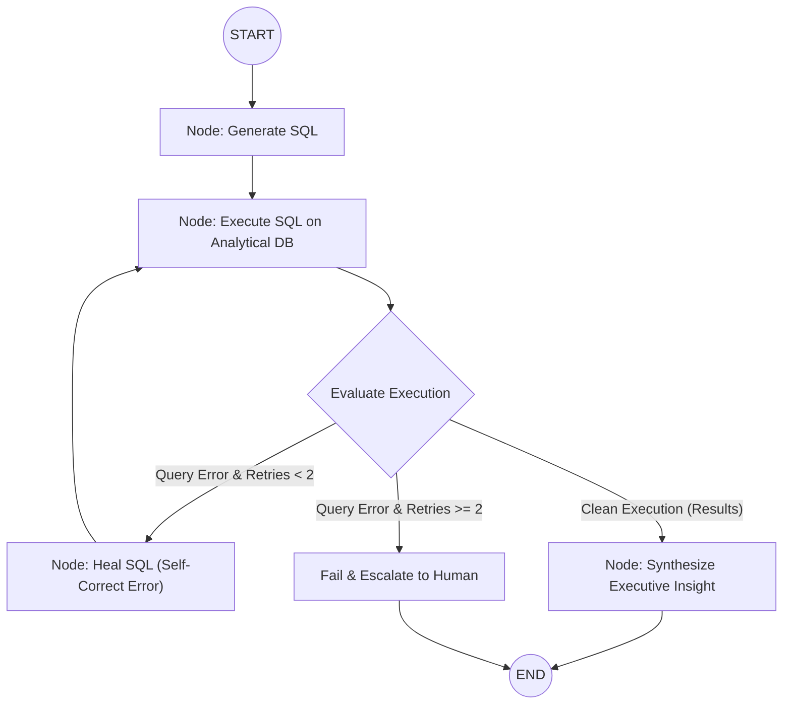

# 📚 Capstone 02: Self-Correcting Natural Language to SQL Analyst Agent

> A production-grade cognitive architecture built with LangGraph: schema-aware SQL generation, read-only database query execution, automated error interception, and self-healing cyclic retry loops.

---

## 📑 Table of Contents

- [1.0 🏗️ Architecture & Cyclical Cognitive Workflow](#10-️-architecture--cyclical-cognitive-workflow)
  - [1.1 Why Simple NL-to-SQL Prompts Fail in Production](#11-why-simple-nl-to-sql-prompts-fail-in-production)
  - [1.2 The Self-Healing Graph Architecture](#12-the-self-healing-graph-architecture)
  - [1.3 State Schema & Data Flow](#13-state-schema--data-flow)
- [2.0 🛠️ Graph Nodes & Cyclic Logic](#20-️-graph-nodes--cyclic-logic)
  - [2.1 SQL Generation Node](#21-sql-generation-node)
  - [2.2 Safe Database Execution Node](#22-safe-database-execution-node)
  - [2.3 Error Interception & The Healing Refactor Loop](#23-error-interception--the-healing-refactor-loop)
- [3.0 🛡️ Security & Read-Only Guardrails](#30-️-security--read-only-guardrails)
  - [3.1 Preventing Destructive DDL / DML Operations](#31-preventing-destructive-ddl--dml-operations)
  - [3.2 SQL Injection Prevention](#32-sql-injection-prevention)
- [4.0 ⚖️ Advantages, Limitations & Architecture Trade-offs](#40-️-advantages-limitations--architecture-trade-offs)
- [5.0 ⚠️ Common Pitfalls & Anti-Patterns](#50-️-common-pitfalls--anti-patterns)
- [6.0 💼 Technical Interview Preparation: Questions & Scenarios](#60--technical-interview-preparation-questions--scenarios)
- [7.0 ⚡ Quick Revision, Key Formulas & Setup Commands](#70--quick-revision-key-formulas--setup-commands)

---

## 1.0 🏗️ Architecture & Cyclical Cognitive Workflow

### 1.1 Why Simple NL-to-SQL Prompts Fail in Production

Directly prompting an LLM to generate SQL and executing it immediately suffers from:
- **Hallucinated Column / Table Names**: Models frequently guess table names that do not exist.
- **Dialect Incompatibilities**: Generating PostgreSQL-specific syntax for an SQLite or MySQL database.
- **Hard Runtime Crashes**: A single syntax error crashes the user's request.

---

### 1.2 The Self-Healing Graph Architecture

LangGraph models SQL generation as an explicit **Self-Correcting State Machine**:



---

### 1.3 State Schema & Data Flow

```python
from typing import TypedDict, Optional

class SQLAgentState(TypedDict):
    question: str
    generated_sql: str
    query_result: Optional[dict]
    retry_count: int
    final_analysis: str
```

---

## 2.0 🛠️ Graph Nodes & Cyclic Logic

### 2.1 SQL Generation Node

Translates the natural language query into a SQL statement based on the database schema:

```python
def generate_sql_node(state: SQLAgentState) -> dict:
    # Model inspects schema and produces target SQL
    sql = "SELECT category, SUM(amount) AS total_revenue FROM orders WHERE status = 'COMPLETED' GROUP BY category;"
    return {"generated_sql": sql}
```

---

### 2.2 Safe Database Execution Node

Executes the generated SQL query against a read-only database connection and captures results or exceptions:

```python
def execute_sql_node(state: SQLAgentState) -> dict:
    sql = state["generated_sql"]
    result = execute_query(sql)  # Returns {"data": [...]} or {"error": "no such column: total_amt"}
    return {"query_result": result}
```

---

### 2.3 Error Interception & The Healing Refactor Loop

The conditional edge inspects the query result. If an error is detected, execution loops back to the healing node to generate a corrected query:

```python
def evaluate_sql_execution(state: SQLAgentState) -> str:
    result = state.get("query_result", {})
    if result.get("error"):
        if state["retry_count"] < 2:
            return "retry"
        return "fail"
    return "synthesize"
```

---

## 3.0 🛡️ Security & Read-Only Guardrails

### 3.1 Preventing Destructive DDL / DML Operations

The execution engine enforces read-only access by rejecting queries containing destructive statements:

```python
def execute_query(sql: str) -> dict:
    forbidden = ["DROP", "DELETE", "UPDATE", "INSERT", "ALTER", "TRUNCATE"]
    if any(token in sql.upper() for token in forbidden):
        return {"error": "Destructive SQL statements are strictly forbidden."}
    # Execute query...
```

---

## 4.0 ⚖️ Advantages, Limitations & Architecture Trade-offs

| Dimension | Advantages | Limitations | Engineering Mitigation |
| :--- | :--- | :--- | :--- |
| **Cyclic Error Correction** | Self-corrects schema typos and syntax errors automatically | Consumes additional tokens on retry loops | Cap retries at 2 attempts; provide few-shot schema examples |
| **Read-Only Gate** | Prevents accidental data deletion or corruption | May block legitimate analytics queries if string keywords collide | Use a dedicated database user with read-only permissions at the DB engine level |

---

## 5.0 ⚠️ Common Pitfalls & Anti-Patterns

- **Unrestricted Database Connections**: Giving the agent credentials with `SUPERUSER` or `WRITE` privileges. Always use a dedicated read-only database user.
- **Missing Circuit Breakers**: Allowing infinite retry loops when a database table truly does not exist.

---

## 6.0 💼 Technical Interview Preparation: Questions & Scenarios

### Q1: How do you design an NL-to-SQL system that self-heals after syntax errors?
> **Answer**: By modeling the workflow as a cyclic state graph in LangGraph:
> 1. Node 1 generates the SQL query from natural language.
> 2. Node 2 executes the query against the database, catching any SQL syntax or schema exceptions.
> 3. A conditional edge checks the execution status. If an error is caught, it routes to a healing node that passes the error traceback back to the LLM with instructions to correct the query.
> 4. The graph re-executes the healed query, terminating when successful or when `max_retries` is reached.

---

## 7.0 ⚡ Quick Revision, Key Formulas & Setup Commands

# Self-Correction Success Rate Formulation
$$\text{Healing Success Rate} = \frac{|\text{Queries Successfully Corrected on Retry}|}{|\text{Total Queries Failing Initial Attempt}|}$$

# Running the Capstone Agent
```bash
cd 11-capstone-projects/02-nl-to-sql-analyst
python agent.py
```
