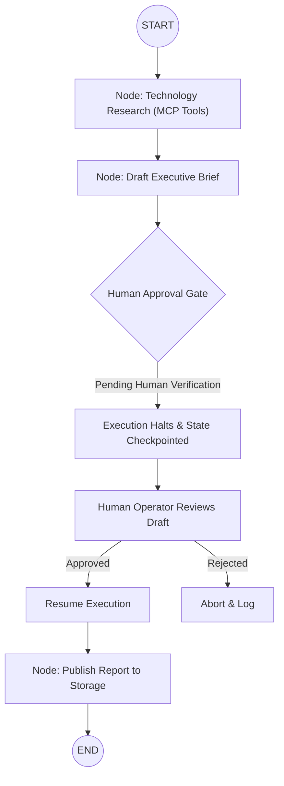

# 📚 Capstone 03: Multi-Tool Research Agent with Human-in-the-Loop Approval Gate

> A production-grade multi-tool research system built with LangGraph: decoupled MCP-style tooling, automated research synthesis, state checkpointing, and compile-time Human-in-the-Loop (HITL) authorization gates.

---

## 📑 Table of Contents

- [1.0 🏗️ Architecture & System Topology](#10-️-architecture--system-topology)
  - [1.1 Why Production Autonomous Agents Require Human Gates](#11-why-production-autonomous-agents-require-human-gates)
  - [1.2 The Multi-Tool HITL Workflow](#12-the-multi-tool-hitl-workflow)
  - [1.3 State Schema & Checkpoint Lifecycle](#13-state-schema--checkpoint-lifecycle)
- [2.0 🛠️ Graph Nodes & Tool Integrations](#20-️-graph-nodes--tool-integrations)
  - [2.1 Technology Research Node](#21-technology-research-node)
  - [2.2 Executive Synthesis & Draft Report Node](#22-executive-synthesis--draft-report-node)
  - [2.3 The Human Authorization Gate](#23-the-human-authorization-gate)
  - [2.4 Artifact Publishing Node](#24-artifact-publishing-node)
- [3.0 🛑 State Interruption & Resumption Mechanics](#30--state-interruption--resumption-mechanics)
  - [3.1 Halting at the Approval Boundary](#31-halting-at-the-approval-boundary)
  - [3.2 Inspecting and Overriding State](#32-inspecting-and-overriding-state)
  - [3.3 Resuming with Checkpointer Memory](#33-resuming-with-checkpointer-memory)
- [4.0 ⚖️ Advantages, Limitations & Architecture Trade-offs](#40-️-advantages-limitations--architecture-trade-offs)
- [5.0 ⚠️ Common Pitfalls & Anti-Patterns](#50-️-common-pitfalls--anti-patterns)
- [6.0 💼 Technical Interview Preparation: Questions & Scenarios](#60--technical-interview-preparation-questions--scenarios)
- [7.0 ⚡ Quick Revision, Key Formulas & Setup Commands](#70--quick-revision-key-formulas--setup-commands)

---

## 1.0 🏗️ Architecture & System Topology

### 1.1 Why Production Autonomous Agents Require Human Gates

Fully autonomous agents that perform external actions (e.g. sending emails, publishing public reports, executing financial trades) carry severe risks if left unguarded:
- Hallucinated recommendations can damage business credibility.
- External side-effects cannot be rolled back once executed.

**Human-in-the-Loop (HITL)** architectures combine the speed of automated research with the accountability of human sign-off:



---

### 1.2 The Multi-Tool HITL Workflow

The agent:
1. Gathers intelligence using external tools (`search_technology_trends`).
2. Synthesizes findings into a structured markdown report draft.
3. Pauses execution at the approval gate node, checkpointing state to memory or database.
4. Resumes only when an operator sets `human_approved: True`.
5. Publishes the verified report to persistent storage (`export_markdown_report`).

---

### 1.3 State Schema & Checkpoint Lifecycle

```python
from typing import TypedDict

class ResearchState(TypedDict):
    topic: str
    findings: str
    report_draft: str
    human_approved: bool
    status: str
```

---

## 2.0 🛠️ Graph Nodes & Tool Integrations

### 2.1 Technology Research Node

Queries external search tools for domain intelligence:

```python
def research_node(state: ResearchState) -> dict:
    raw_data = search_technology_trends.invoke({"keyword": state["topic"]})
    return {"findings": raw_data}
```

---

### 2.2 Executive Synthesis & Draft Report Node

Structures raw data into a publication-ready technical briefing:

```python
def draft_report_node(state: ResearchState) -> dict:
    draft = f"""# Research Brief: {state['topic']}
## Executive Summary
{state['findings']}

## Recommendations
- Standardize tool interfaces using Model Context Protocol (MCP).
- Implement explicit human review gates prior to side effects.
"""
    return {"report_draft": draft, "status": "AWAITING_HUMAN_APPROVAL"}
```

---

### 2.3 The Human Authorization Gate

Enforces verification before allowing execution to proceed:

```python
def approval_gate_node(state: ResearchState) -> dict:
    if not state.get("human_approved", False):
        raise PermissionError("Human operator has not approved publication!")
    return {"status": "APPROVED"}
```

---

## 3.0 🛑 State Interruption & Resumption Mechanics

### 3.1 Halting at the Approval Boundary

LangGraph checkpointers save the state snapshot before the gate executes:

```python
from langgraph.checkpoint.memory import InMemorySaver

builder = StateGraph(ResearchState)
# Add nodes & edges...
app = builder.compile(checkpointer=InMemorySaver())
```

---

### 3.2 Resuming with Checkpointer Memory

When human verification is received, the operator updates state and resumes the run:

```python
config = {"configurable": {"thread_id": "research-sess-01"}}

# Step 1: Initial run pauses before publishing
# app.invoke({"topic": "Model Context Protocol", "human_approved": False}, config=config)

# Step 2: Human approves the draft
# app.update_state(config, {"human_approved": True})

# Step 3: Resumed invocation proceeds through the gate to publish
# app.invoke(None, config=config)
```

---

## 4.0 ⚖️ Advantages, Limitations & Architecture Trade-offs

| Dimension | Advantages | Limitations | Engineering Mitigation |
| :--- | :--- | :--- | :--- |
| **HITL Authorization Gate** | Eliminates risk of unauthorized automated actions | Introduces latency while waiting for human review | Provide webhooks / Slack bots for instant review notifications |
| **State Checkpointing** | Zero state lost during hours or days of waiting | Long-lived threads require database persistence | Use PostgreSQL or Redis checkpointers for durable storage |

---

## 5.0 ⚠️ Common Pitfalls & Anti-Patterns

- **Stateless Interrupts**: Attempting to implement human-in-the-loop without a checkpointer. Without a checkpointer, pausing the process wipes the execution state.
- **Ignoring the Resumption Payload**: Forgetting to pass `None` when resuming a checkpointed thread (`app.invoke(None, config=config)`).

---

## 6.0 💼 Technical Interview Preparation: Questions & Scenarios

### Q1: How does LangGraph maintain state during asynchronous human approval pauses?
> **Answer**: LangGraph compiles graphs with a Checkpointer backend (e.g. `PostgresSaver`). When an interruption occurs (via compile-time `interrupt_before` or dynamic `interrupt()`), the complete graph state dictionary and next node pointer are serialized and saved to the database keyed by `thread_id`. The process can terminate completely. When the human approves via an API call or dashboard, the graph loads the state for that `thread_id` and resumes execution from the exact interrupted node.

---

## 7.0 ⚡ Quick Revision, Key Formulas & Setup Commands

# Running the Capstone Agent
```bash
cd 11-capstone-projects/03-mcp-research-agent
python agent.py
```
