# 📘 Applied LangChain: The Complete Engineering Handbook

> A production-grade architectural guide and comprehensive learning resource covering modern LLM application development—from foundational ChatModel abstractions and LCEL to advanced RAG, conversational memory, output parsers, and autonomous agents with LangChain.

---

## 📑 Table of Contents

- [1.0 🏗️ Architecture & Core Foundations](#10-️-architecture--core-foundations)
  - [1.1 The Paradigm Shift: LangChain Legacy vs. LangChain v1.0 & LangGraph](#11-the-paradigm-shift-langchain-legacy-vs-langchain-v10--langgraph)
  - [1.2 The Modern Architectural Stack](#12-the-modern-architectural-stack)
  - [1.3 Core Terminology & Fundamental Primitives](#13-core-terminology--fundamental-primitives)
- [2.0 💬 ChatModels, Content Blocks & Token Streaming](#20--chatmodels-content-blocks--token-streaming)
  - [2.1 Provider-Agnostic Model Initialization (`init_chat_model`)](#21-provider-agnostic-model-initialization-init_chat_model)
  - [2.2 Typed Message Hierarchy & Multimodal Content Blocks](#22-typed-message-hierarchy--multimodal-content-blocks)
  - [2.3 Low-Latency Token Streaming & Asynchronous Batching](#23-low-latency-token-streaming--asynchronous-batching)
- [3.0 🎯 Prompts, Few-Shot Engineering & Structured Output](#30--prompts-few-shot-engineering--structured-output)
  - [3.1 ChatPromptTemplate & MessagesPlaceholder Composition](#31-chatprompttemplate--messagesplaceholder-composition)
  - [3.2 Dynamic Few-Shot Prompting with Semantic Selectors](#32-dynamic-few-shot-prompting-with-semantic-selectors)
  - [3.3 Native Structured Outputs (`.with_structured_output`)](#33-native-structured-outputs-with_structured_output)
- [4.0 ⚡ LangChain Expression Language (LCEL) & Runnable Protocol](#40--langchain-expression-language-lcel--runnable-protocol)
  - [4.1 The Runnable Contract (`invoke`, `stream`, `batch`)](#41-the-runnable-contract-invoke-stream-batch)
  - [4.2 Composition with the Pipe Operator (`|`)](#42-composition-with-the-pipe-operator-)
  - [4.3 Concurrent Fan-Out & Merging with `RunnableParallel`](#43-concurrent-fan-out--merging-with-runnableparallel)
  - [4.4 Dynamic Routing, Conditional Branching & Fallbacks](#44-dynamic-routing-conditional-branching--fallbacks)
- [5.0 🧠 Memory, State Isolation & Thread Persistence](#50--memory-state-isolation--thread-persistence)
  - [5.1 The Stateless Nature of LLMs & Persistence Architecture](#51-the-stateless-nature-of-llms--persistence-architecture)
  - [5.2 LangGraph Checkpointers (`MemorySaver`, `SqliteSaver`)](#52-langgraph-checkpointers-memorysaver-sqlitesaver)
  - [5.3 Context Window Management: Token Trimming & Rolling Summarization](#53-context-window-management-token-trimming--rolling-summarization)
- [6.0 📚 Retrieval-Augmented Generation (RAG) Fundamentals](#60--retrieval-augmented-generation-rag-fundamentals)
  - [6.1 End-to-End Grounded Generation Architecture](#61-end-to-end-grounded-generation-architecture)
  - [6.2 Document Ingestion, Parsing & Chunking Strategies](#62-document-ingestion-parsing--chunking-strategies)
  - [6.3 Vector Embeddings & Vector Stores (FAISS, Chroma, Qdrant)](#63-vector-embeddings--vector-stores-faiss-chroma-qdrant)
  - [6.4 Constructing Production LCEL RAG Chains](#64-constructing-production-lcel-rag-chains)
- [7.0 🔍 Advanced RAG: Hybrid Search, HyDE & Reranking](#70--advanced-rag-hybrid-search-hyde--reranking)
  - [7.1 Hybrid Retrieval: Dense Vectors + Sparse BM25 Keyword Search](#71-hybrid-retrieval-dense-vectors--sparse-bm25-keyword-search)
  - [7.2 Query Transformation: Sub-Queries, Step-Back & HyDE](#72-query-transformation-sub-queries-step-back--hyde)
  - [7.3 Two-Stage Retrieval with Cross-Encoder Rerankers](#73-two-stage-retrieval-with-cross-encoder-rerankers)
- [8.0 🛠️ Tools, Tool Calling Loops & Autonomous ReAct Agents](#80-️-tools-tool-calling-loops--autonomous-react-agents)
  - [8.1 Typed Tool Creation with the `@tool` Decorator](#81-typed-tool-creation-with-the-tool-decorator)
  - [8.2 Tool Execution Protocol & ToolMessage Handshakes](#82-tool-execution-protocol--toolmessage-handshakes)
  - [8.3 The ReAct Reasoning Cycle](#83-the-react-reasoning-cycle)
- [9.0 🕸️ LangGraph: Cyclic Graphs, State Machines & Cognitive Workflows](#90-️-langgraph-cyclic-graphs-state-machines--cognitive-workflows)
  - [9.1 Core Components: State, Nodes, Edges & Reducers](#91-core-components-state-nodes-edges--reducers)
  - [9.2 Conditional Edges & Dynamic Cyclic Routing](#92-conditional-edges--dynamic-cyclic-routing)
  - [9.3 Human-in-the-Loop (HITL) Checkpoints & State Interruption](#93-human-in-the-loop-hitl-checkpoints--state-interruption)
  - [9.4 Multi-Agent Architectures: Supervisor & Swarm Topologies](#94-multi-agent-architectures-supervisor--swarm-topologies)
- [10.0 🛡️ Model Context Protocol (MCP) & Production Middleware](#100-️-model-context-protocol-mcp--production-middleware)
  - [10.1 Decoupled Tool Ecosystems with MCP](#101-decoupled-tool-ecosystems-with-mcp)
  - [10.2 Security Middleware: Dynamic PII Redaction & Sanitization](#102-security-middleware-dynamic-pii-redaction--sanitization)
  - [10.3 Pre-Execution and Post-Execution Guardrails](#103-pre-execution-and-post-execution-guardrails)
- [11.0 🔭 Observability, Tracing, Testing & LLM Evals](#110--observability-tracing-testing--llm-evals)
  - [11.1 Full-Stack Tracing with LangSmith](#111-full-stack-tracing-with-langsmith)
  - [11.2 Deterministic Unit Testing with `GenericFakeChatModel`](#112-deterministic-unit-testing-with-genericfakechatmodel)
  - [11.3 Agent Trajectory & LLM-as-a-Judge Evaluation](#113-agent-trajectory--llm-as-a-judge-evaluation)
- [12.0 ⚖️ Advantages, Limitations & Architecture Trade-offs](#120-️-advantages-limitations--architecture-trade-offs)
- [13.0 🏢 Real-World Production Patterns & Use Cases](#130--real-world-production-patterns--use-cases)
- [14.0 ⚠️ Common Pitfalls & Anti-Patterns (And How to Fix Them)](#140-️-common-pitfalls--anti-patterns-and-how-to-fix-them)
- [15.0 💼 Technical Interview Preparation: Questions & Architectural Scenarios](#150--technical-interview-preparation-questions--architectural-scenarios)
- [16.0 🚀 End-to-End Capstone: Enterprise Financial Research & Compliance Agent](#160--end-to-end-capstone-enterprise-financial-research--compliance-agent)
- [17.0 ⚡ Quick Revision, Mathematical Formulations, CLI Commands & Roadmap](#170--quick-revision-mathematical-formulations-cli-commands--roadmap)

---

## 1.0 🏗️ Architecture & Core Foundations

### 1.1 The Paradigm Shift: LangChain Legacy vs. LangChain v1.0 & LangGraph

In early iterations of LangChain (v0.0 through v0.2), workflows relied on monolithic classes like `LLMChain`, `ConversationChain`, and opaque agent executors (`initialize_agent`). These patterns suffered from tight coupling, opaque internal prompt formatting, non-standardized execution flows, and unpredictable debugging traces.

Modern **LangChain (v1.0+)** and **LangGraph** fundamentally redefine LLM application architecture:
1. **Unification around ChatModels**: String-in, string-out LLMs are deprecated in favor of typed message streams (`SystemMessage`, `HumanMessage`, `AIMessage`, `ToolMessage`).
2. **Explicit Composition via LCEL**: Chains are composed through a functional, declarative pipeline (`|`) implementing the uniform `Runnable` interface.
3. **State Machines with LangGraph**: Cyclical reasoning, agent loops, persistence, and human checkpoints are modeled as explicit, deterministic directed graphs.

| Dimension | Legacy LangChain (0.x) | Modern LangChain (1.x) & LangGraph | Production Benefit |
| :--- | :--- | :--- | :--- |
| **Model Interface** | `BaseLLM` (Raw strings) | `BaseChatModel` (Typed Message Objects) | Native multimodal input, structured tools, and token metadata |
| **Chain Building** | `LLMChain`, `SimpleSequentialChain` | LCEL (`step1 \| step2 \| step3`) | Uniform async, streaming, batching, and transparent debugging |
| **Agent Loops** | `AgentExecutor` (Black-box loop) | `StateGraph` (Explicit nodes & edges) | Full inspection of agent state, deterministic control flow, and replay |
| **Memory** | `ConversationBufferMemory` | Checkpointers (`thread_id`, `MemorySaver`) | Database-backed checkpointing, time-travel debugging, zero state loss |
| **Tool Calling** | Brittle regex parsing of strings | Native provider API schema binding | Zero parsing errors, typed Pydantic parameter validation |
| **Structured Output** | `PydanticOutputParser` (prompt hacks) | `.with_structured_output()` | Native provider JSON schema and OpenAI/Anthropic/Gemini function calling |

---

### 1.2 The Modern Architectural Stack

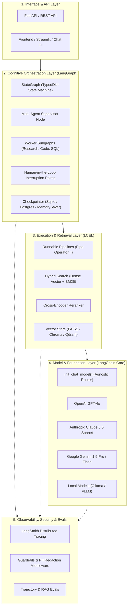

---

### 1.3 Core Terminology & Fundamental Primitives

- **BaseChatModel**: The universal abstraction for generative chat engines. Accepts a sequence of `BaseMessage` subclasses and yields an `AIMessage`.
- **BaseMessage**: The polymorphic message base class with concrete implementations:
  - `SystemMessage`: Sets model behavior, guardrails, and persona.
  - `HumanMessage`: User-generated queries or inputs.
  - `AIMessage`: Assistant responses, potentially containing `tool_calls` and token usage metrics.
  - `ToolMessage`: Raw output returned by an executed tool, tied back to a specific `tool_call_id`.
- **Runnable**: The base protocol that all LCEL components inherit from. Implements synchronous, asynchronous, streaming, and batch execution contracts.
- **StateGraph**: A graph structure whose nodes update a shared, typed data dictionary (`State`).
- **Reducer**: A merge function defining how a node's return value mutates existing state fields (e.g., appending items vs. overwriting).
- **Checkpointer**: A persistent storage backend that serializes and saves graph state at every execution step.

---

## 2.0 💬 ChatModels, Content Blocks & Token Streaming

### 2.1 Provider-Agnostic Model Initialization (`init_chat_model`)

Modern LangChain eliminates vendor lock-in via `init_chat_model()`. It dynamically instantiates the correct underlying client library (`ChatOpenAI`, `ChatAnthropic`, `ChatGoogleGenerativeAI`) based on a single unified interface.

```python
import os
from langchain.chat_models import init_chat_model

# 1. Initialize OpenAI GPT-4o
gpt_model = init_chat_model(
    model="gpt-4o",
    model_provider="openai",
    temperature=0.2,
    max_tokens=1024
)

# 2. Seamlessly switch to Anthropic Claude 3.5 Sonnet with the identical API
claude_model = init_chat_model(
    model="claude-3-5-sonnet-20241022",
    model_provider="anthropic",
    temperature=0.2
)

# 3. Invocation remains uniform across all providers
response = gpt_model.invoke("Explain idempotency in distributed APIs.")
print(f"Content: {response.content[:100]}...")
print(f"Token Metadata: {response.response_metadata.get('token_usage')}")
```

---

### 2.2 Typed Message Hierarchy & Multimodal Content Blocks

Modern models accept rich, heterogeneous content payloads including text, local base64-encoded images, and remote image URLs:

```python
from langchain_core.messages import SystemMessage, HumanMessage

multimodal_payload = HumanMessage(
    content=[
        {"type": "text", "text": "Analyze this system architecture diagram and identify single points of failure:"},
        {
            "type": "image_url",
            "image_url": {
                "url": "https://upload.wikimedia.org/wikipedia/commons/e/ea/Generic_microservices_architecture.png",
                "detail": "high"
            }
        }
    ]
)

messages = [
    SystemMessage(content="You are a Principal Cloud Infrastructure Architect."),
    multimodal_payload
]

# model = init_chat_model("gpt-4o", model_provider="openai")
# response = model.invoke(messages)
```

---

### 2.3 Low-Latency Token Streaming & Asynchronous Batching

Time To First Token (TTFT) is critical for conversational user experiences. The `.stream()` and `.astream()` methods emit `AIMessageChunk` increments, yielding text fragments and incremental tool-call tokens as they are generated by the model.

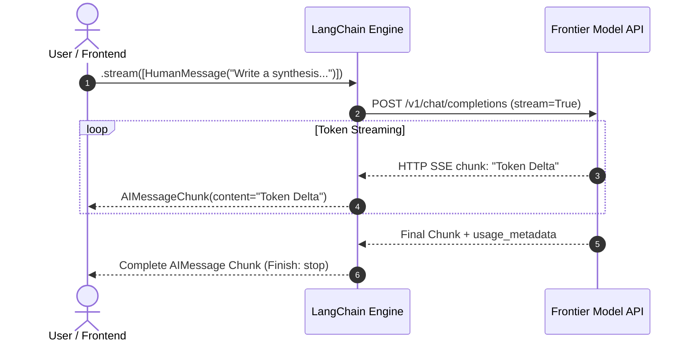

#### Synchronous Streaming & Asynchronous Batching Code Implementation:

```python
import asyncio
from langchain.chat_models import init_chat_model
from langchain_core.messages import HumanMessage

async def demonstrate_streaming_and_batching():
    model = init_chat_model("gpt-4o-mini", model_provider="openai")

    # 1. Real-time Streaming
    print("--- Streaming Output ---")
    async for chunk in model.astream([HumanMessage(content="Draft a 3-bullet summary of Raft consensus.")]):
        print(chunk.content, end="", flush=True)
    print("\n")

    # 2. High-Throughput Concurrent Batching
    queries = [
        [HumanMessage(content="Define CAP theorem in one sentence.")],
        [HumanMessage(content="Define PACELC theorem in one sentence.")],
        [HumanMessage(content="Define Byzantine Fault Tolerance in one sentence.")]
    ]

    print("--- Batch Execution ---")
    results = await model.abatch(queries, config={"max_concurrency": 3})
    for idx, res in enumerate(results, start=1):
        print(f"Result {idx}: {res.content.strip()}")

# asyncio.run(demonstrate_streaming_and_batching())
```

---

## 3.0 🎯 Prompts, Few-Shot Engineering & Structured Output

### 3.1 ChatPromptTemplate & MessagesPlaceholder Composition

`ChatPromptTemplate` prevents prompt injection and preserves conversational role boundaries. `MessagesPlaceholder` enables injection of dynamic message histories without brittle string interpolation.

```python
from langchain_core.prompts import ChatPromptTemplate, MessagesPlaceholder
from langchain_core.messages import HumanMessage, AIMessage

prompt_template = ChatPromptTemplate.from_messages([
    ("system", "You are an expert site reliability engineer. Strictly assist with: {domain}"),
    MessagesPlaceholder(variable_name="chat_history"),
    ("human", "{user_query}")
])

history = [
    HumanMessage(content="We experienced a 504 gateway timeout on our auth service."),
    AIMessage(content="Did the ingress gateway timeout waiting for the auth upstream pod?")
]

formatted_prompt = prompt_template.invoke({
    "domain": "Kubernetes Ingress Controllers",
    "chat_history": history,
    "user_query": "Yes, upstream pods were in CrashLoopBackOff."
})
```

---

### 3.2 Dynamic Few-Shot Prompting with Semantic Selectors

Few-shot prompting conditions models to follow precise formatting constraints. Dynamic selectors retrieve only the most semantically relevant exemplars for the user's specific query, protecting token budget.

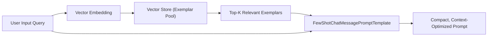

---

### 3.3 Native Structured Outputs (`.with_structured_output`)

Modern applications require deterministic schemas for downstream consumption. Instead of asking LLMs for JSON and attempting to clean markdown backticks with regex, `.with_structured_output()` binds directly to provider JSON Schema / Tool Call endpoints and returns validated **Pydantic v2** objects or `TypedDict` structures.

```python
from pydantic import BaseModel, Field
from typing import List, Literal
from langchain.chat_models import init_chat_model

class SecurityIncidentAnalysis(BaseModel):
    severity: Literal["LOW", "MEDIUM", "HIGH", "CRITICAL"] = Field(
        description="The calculated threat severity rating based on CVSS criteria."
    )
    affected_services: List[str] = Field(
        description="List of internal infrastructure services or endpoints compromised."
    )
    mitigation_steps: List[str] = Field(
        description="Immediate actionable containment and remediation commands."
    )
    root_cause_hypothesis: str = Field(
        description="A concise technical analysis of the vulnerability exploited."
    )

model = init_chat_model("gpt-4o-mini", model_provider="openai")
structured_model = model.with_structured_output(SecurityIncidentAnalysis)

incident_log = """
Alert: Unauthorized sudo escalation detected on node k8s-worker-prod-04.
Port 2222 exposed to 0.0.0.0/0. Outbound connections established to unknown IP 198.51.100.24.
Service affected: ingress-nginx-controller, auth-vault-sync.
"""

# The return object is a validated instance of SecurityIncidentAnalysis
# analysis: SecurityIncidentAnalysis = structured_model.invoke(incident_log)
# print(f"Severity: {analysis.severity}")
# print(f"Remediations: {analysis.mitigation_steps}")
```

---

## 4.0 ⚡ LangChain Expression Language (LCEL) & Runnable Protocol

### 4.1 The Runnable Contract (`invoke`, `stream`, `batch`)

Every LCEL component conforms to the uniform `Runnable` contract:

| Method | Synchronous Execution | Asynchronous Execution | Output Characteristic |
| :--- | :--- | :--- | :--- |
| **Single Input** | `.invoke(input)` | `.ainvoke(input)` | Emits full final result |
| **Streaming** | `.stream(input)` | `.astream(input)` | Emits chunks as computed |
| **Batch Input** | `.batch([inputs])` | `.abatch([inputs])` | Emits list of results concurrently |

---

### 4.2 Composition with the Pipe Operator (`|`)

The pipe operator `|` chains runnables sequentially, feeding the output of the left operand as the input to the right operand:

```python
from langchain_core.prompts import ChatPromptTemplate
from langchain_core.output_parsers import StrOutputParser
from langchain.chat_models import init_chat_model

prompt = ChatPromptTemplate.from_template("Translate the following technical requirement into a SQL DDL statement:\n{spec}")
model = init_chat_model("gpt-4o-mini", model_provider="openai")
parser = StrOutputParser()

# Declarative, production-grade chain
ddl_chain = prompt | model | parser

# Execution
# result = ddl_chain.invoke({"spec": "Create a users table with UUID primary key, indexed email, and created_at timestamp."})
```

---

### 4.3 Concurrent Fan-Out & Merging with `RunnableParallel`

`RunnableParallel` maps a single input dictionary across multiple branches concurrently, executing tasks like independent evaluations or multi-angle summarizations in parallel before merging results:

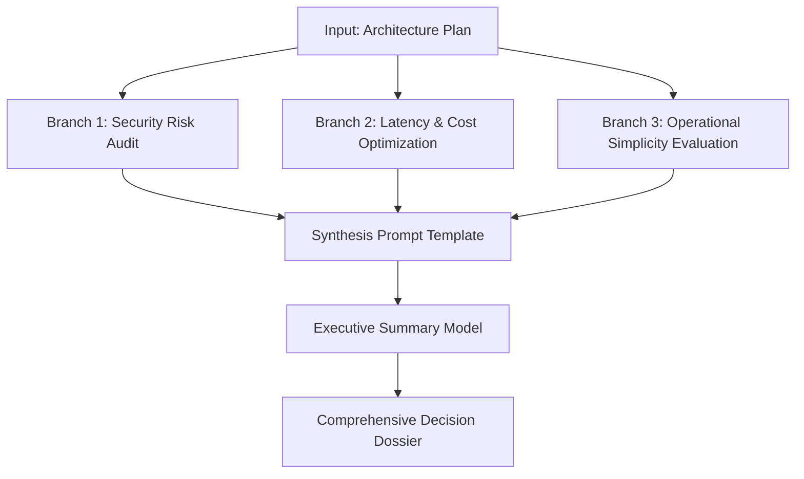

```python
from langchain_core.runnables import RunnableParallel, RunnablePassthrough
from langchain_core.prompts import ChatPromptTemplate
from langchain_core.output_parsers import StrOutputParser
from langchain.chat_models import init_chat_model

model = init_chat_model("gpt-4o-mini", model_provider="openai")
parser = StrOutputParser()

security_prompt = ChatPromptTemplate.from_template("Audit this system design for security flaws:\n{design}")
cost_prompt = ChatPromptTemplate.from_template("Analyze this system design for infrastructure cost risks:\n{design}")

# Parallel fan-out
analysis_branches = RunnableParallel({
    "security_review": security_prompt | model | parser,
    "cost_review": cost_prompt | model | parser,
    "original_design": RunnablePassthrough()
})

synthesis_prompt = ChatPromptTemplate.from_template("""
Combine these reviews into a unified architecture gate review:
Design: {original_design}
Security: {security_review}
Cost: {cost_review}
""")

full_review_chain = analysis_branches | synthesis_prompt | model | parser
```

---

### 4.4 Dynamic Routing, Conditional Branching & Fallbacks

High-availability AI applications must fail over gracefully when rate limits, provider outages, or network partitions occur. LCEL provides native routing and `.with_fallbacks()`:

```python
from langchain_core.runnables import RunnableLambda
from langchain.chat_models import init_chat_model

# 1. Fallback mechanisms
primary_model = init_chat_model("gpt-4o", model_provider="openai", max_retries=1)
backup_model = init_chat_model("claude-3-5-sonnet-20241022", model_provider="anthropic", max_retries=2)

# Resilient Model with automatic failover
resilient_model = primary_model.with_fallbacks([backup_model])

# 2. Dynamic Routing based on classifier
def route_query(info: dict):
    query = info["query"].lower()
    if "sql" in query or "database" in query:
        return sql_specialist_chain
    elif "security" in query or "cve" in query:
        return security_specialist_chain
    return general_qa_chain

dynamic_chain = RunnableLambda(route_query)
```

---

## 5.0 🧠 Memory, State Isolation & Thread Persistence

### 5.1 The Stateless Nature of LLMs & Persistence Architecture

Foundation models possess no internal memory between requests. To maintain conversation context across user turns, systems must:
1. Intercept incoming user queries.
2. Retrieve historical turns associated with a unique session identifier (`thread_id`).
3. Inject relevant history into the prompt payload.
4. Persist the generated response back to the storage layer.

---

### 5.2 LangGraph Checkpointers (`MemorySaver`, `SqliteSaver`)

LangGraph standardizes state persistence using Checkpointers. Rather than maintaining brittle local memory buffers, LangGraph records graph state snapshots into a persistent backend indexed by a session key `thread_id`:

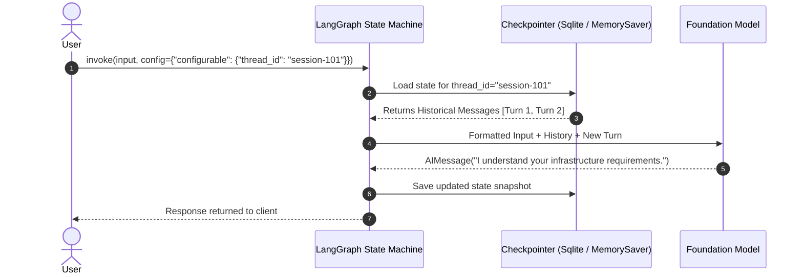

#### Production Checkpointing Implementation:

```python
from typing import Annotated
from typing_extensions import TypedDict
from langchain_core.messages import BaseMessage, HumanMessage
from langgraph.graph import StateGraph, START, END
from langgraph.graph.message import add_messages
from langgraph.checkpoint.memory import MemorySaver
from langchain.chat_models import init_chat_model

class AgentState(TypedDict):
    messages: Annotated[list[BaseMessage], add_messages]

model = init_chat_model("gpt-4o-mini", model_provider="openai")

def chatbot_node(state: AgentState):
    return {"messages": [model.invoke(state["messages"])]}

builder = StateGraph(AgentState)
builder.add_node("chatbot", chatbot_node)
builder.add_edge(START, "chatbot")
builder.add_edge("chatbot", END)

# MemorySaver checkpointer maintains session state per thread_id
checkpointer = MemorySaver()
app = builder.compile(checkpointer=checkpointer)

config = {"configurable": {"thread_id": "tenant-workspace-42"}}

# First Turn
turn1 = app.invoke({"messages": [HumanMessage(content="My cluster name is prod-us-east-k8s.")]}, config=config)

# Second Turn (State is automatically restored and maintained)
turn2 = app.invoke({"messages": [HumanMessage(content="What cluster name did I mention earlier?")]}, config=config)
# turn2["messages"][-1].content -> "You mentioned that your cluster name is prod-us-east-k8s."
```

---

### 5.3 Context Window Management: Token Trimming & Rolling Summarization

Unchecked conversational histories exhaust context windows and increase latency and cost. LangChain provides deterministic trimming using `trim_messages`:

```python
from langchain_core.messages import trim_messages, SystemMessage, HumanMessage, AIMessage
from langchain.chat_models import init_chat_model

model = init_chat_model("gpt-4o-mini", model_provider="openai")

# Trims message history to fit within a strict token budget
trimmed_history = trim_messages(
    messages=[
        SystemMessage(content="You are a production support bot."),
        HumanMessage(content="Message 1" * 100),
        AIMessage(content="Response 1" * 100),
        HumanMessage(content="Recent query regarding error 500.")
    ],
    max_tokens=150,
    strategy="last",
    token_counter=model,
    include_system=True,
    allow_partial=False
)
```

---

## 6.0 📚 Retrieval-Augmented Generation (RAG) Fundamentals

> 💡 **Specialized Deep-Dive RAG Engineering Reference**:  
> For extensive production RAG implementations, multi-modal ingestion, advanced retrieval benchmarks, and production evaluation setups, refer to our companion repository:  
> 🔗 [**swapnil3104 / RAG-Engineering**](https://github.com/swapnil3104/RAG-Engineering)

### 6.1 End-to-End Grounded Generation Architecture

Retrieval-Augmented Generation ground model reasoning on proprietary, private, or real-time domain knowledge.

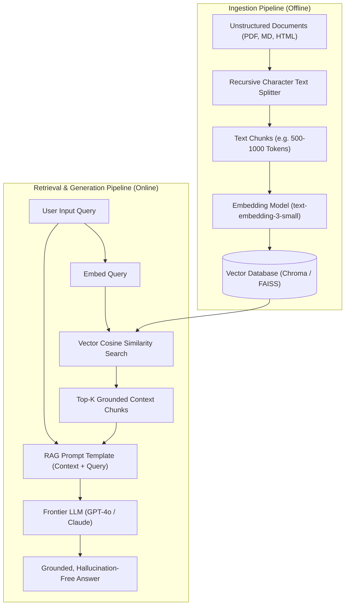

---

### 6.2 Document Ingestion, Parsing & Chunking Strategies

Semantic chunking preserves conceptual boundaries. `RecursiveCharacterTextSplitter` attempts chunk splits sequentially on double line breaks (`\n\n`), single line breaks (`\n`), spaces (` `), and characters (`""`), preserving paragraph and sentence coherence.

```python
from langchain_text_splitters import RecursiveCharacterTextSplitter
from langchain_core.documents import Document

raw_documentation = """
# Enterprise Auth Architecture
OAuth2 with PKCE is enforced across all single-page applications.

## Token Expiry Policy
Access tokens remain valid for exactly 15 minutes (900 seconds).
Refresh tokens are rotated on every issuance to prevent replay attacks.
"""

splitter = RecursiveCharacterTextSplitter(
    chunk_size=120,
    chunk_overlap=20,
    separators=["\n\n", "\n", " ", ""]
)

docs = [Document(page_content=raw_documentation, metadata={"source": "security_handbook.md"})]
chunks = splitter.split_documents(docs)
```

---

### 6.3 Vector Embeddings & Vector Stores (FAISS, Chroma, Qdrant)

Embeddings transform textual semantics into dense high-dimensional vectors. Vector databases index these embeddings for sub-millisecond approximate nearest neighbor (ANN) retrieval:

```python
from langchain_community.vectorstores import FAISS
from langchain_openai import OpenAIEmbeddings

embeddings = OpenAIEmbeddings(model="text-embedding-3-small")

# Create in-memory FAISS index
vector_store = FAISS.from_documents(chunks, embeddings)

# Expose as a standardized Retriever
retriever = vector_store.as_retriever(
    search_type="similarity",
    search_kwargs={"k": 3}
)
```

---

### 6.4 Constructing Production LCEL RAG Chains

```python
from langchain_core.prompts import ChatPromptTemplate
from langchain_core.runnables import RunnablePassthrough
from langchain_core.output_parsers import StrOutputParser
from langchain.chat_models import init_chat_model

def format_docs(retrieved_docs):
    return "\n\n".join(f"[Source: {doc.metadata.get('source', 'Unknown')}]\n{doc.page_content}" for doc in retrieved_docs)

rag_prompt = ChatPromptTemplate.from_template("""
You are a technical compliance specialist. Answer the query based SOLELY on the provided context.
If the information is not present, respond with: 'INSUFFICIENT_GROUNDING_DATA'.

Context:
{context}

Question:
{question}
""")

model = init_chat_model("gpt-4o-mini", model_provider="openai")

rag_chain = (
    {"context": retriever | format_docs, "question": RunnablePassthrough()}
    | rag_prompt
    | model
    | StrOutputParser()
)

# execution
# answer = rag_chain.invoke("What is the token expiration period?")
```

---

## 7.0 🔍 Advanced RAG: Hybrid Search, HyDE & Reranking

### 7.1 Hybrid Retrieval: Dense Vectors + Sparse BM25 Keyword Search

Dense vectors match semantic intent, but struggle with precise keywords, part numbers, and acronyms. Sparse BM25 algorithms match exact keywords, but miss semantic synonyms. **Hybrid Retrieval** combines both using **Reciprocal Rank Fusion (RRF)**:

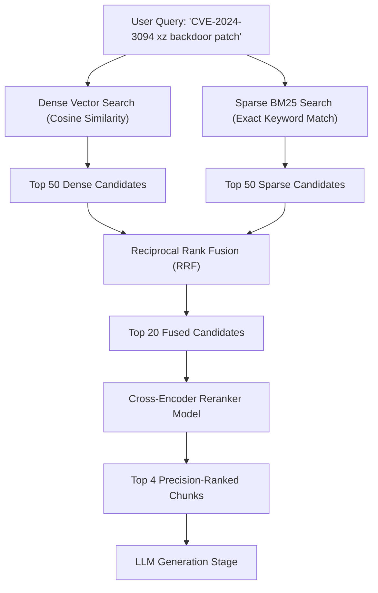

```python
from langchain_community.retrievers import BM25Retriever
from langchain.retrievers import EnsembleRetriever

# 1. Sparse BM25 Retriever
bm25_retriever = BM25Retriever.from_documents(chunks)
bm25_retriever.k = 10

# 2. Dense Semantic Retriever
dense_retriever = vector_store.as_retriever(search_kwargs={"k": 10})

# 3. Hybrid Ensemble with Reciprocal Rank Fusion
hybrid_retriever = EnsembleRetriever(
    retrievers=[bm25_retriever, dense_retriever],
    weights=[0.4, 0.6]  # 40% Keyword Weight, 60% Semantic Weight
)
```

---

### 7.2 Query Transformation: Sub-Queries, Step-Back & HyDE

Users rarely formulate queries optimal for vector similarity search. Query transformation rewrites input before retrieval:

1. **Sub-Query Decomposition**: Deconstructs complex multi-part questions into individual atomic searches.
2. **Step-Back Prompting**: Abstracts specific details to retrieve high-level principles and context.
3. **Hypothetical Document Embeddings (HyDE)**: Prompts an LLM to hallucinate a plausible answer, then embeds that hypothetical document for similarity matching against real domain chunks.

```python
from langchain_core.prompts import ChatPromptTemplate
from langchain_core.output_parsers import StrOutputParser
from langchain.chat_models import init_chat_model

hyde_prompt = ChatPromptTemplate.from_template("""
Write a detailed technical paragraph answering the question below.
Do not worry about factual errors; generate what an authoritative documentation page would look like:
Question: {question}
""")

model = init_chat_model("gpt-4o-mini", model_provider="openai")
hyde_generator = hyde_prompt | model | StrOutputParser()

# Inverted search: Embed the hypothetical document to retrieve the genuine source
def hyde_retrieval(query: str):
    hypothetical_doc = hyde_generator.invoke({"question": query})
    return vector_store.similarity_search(hypothetical_doc, k=4)
```

---

### 7.3 Two-Stage Retrieval with Cross-Encoder Rerankers

Bi-encoders (standard vector embeddings) embed queries and documents independently for fast retrieval, but miss nuanced cross-attention relationships. **Cross-Encoders** evaluate the query and document together, computing deeper contextual relevance:

| Metric | Stage 1: Vector / Hybrid Retrieval (Bi-Encoder) | Stage 2: Reranking (Cross-Encoder) |
| :--- | :--- | :--- |
| **Candidate Pool Size** | Millions of chunks $\to$ Top 50-100 | Top 50 $\to$ Top 3-5 |
| **Computational Cost** | Milliseconds ($O(1)$ indexed dot product) | Tens of milliseconds ($O(N)$ transformer forward passes) |
| **Attention Mechanism** | Independent isolated embeddings | Full cross-attention between query and chunk tokens |
| **Ranking Quality** | Coarse semantic proximity | High precision relevance ranking |

---

## 8.0 🛠️ Tools, Tool Calling Loops & Autonomous ReAct Agents

### 8.1 Typed Tool Creation with the `@tool` Decorator

Tools provide LLMs with external execution capabilities (database queries, APIs, math calculators). The `@tool` decorator automatically parses Python type hints and docstrings into an OpenAPI-compliant JSON schema:

```python
from langchain_core.tools import tool
from pydantic import BaseModel, Field

class DatabaseQueryInput(BaseModel):
    query: str = Field(description="A sanitized SQL SELECT statement.")
    max_records: int = Field(default=10, description="Maximum number of rows to return.")

@tool("query_relational_database", args_schema=DatabaseQueryInput)
def query_relational_database(query: str, max_records: int = 10) -> str:
    """Executes a read-only SQL query against the analytical data warehouse."""
    if "DELETE" in query.upper() or "DROP" in query.upper() or "UPDATE" in query.upper():
        return "ERROR: Destructive DDL/DML commands are forbidden."
    return f"Simulated execution for query: {query} (Limit {max_records}) -> 2 records found."
```

---

### 8.2 Tool Execution Protocol & ToolMessage Handshakes

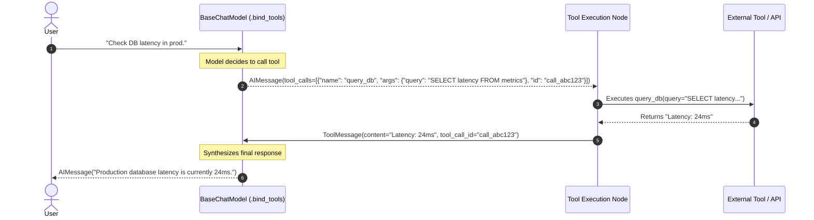

---

### 8.3 The ReAct Reasoning Cycle

The **ReAct** (Reasoning + Acting) loop interleaves chain-of-thought thought generation with environment actions:
1. **Thought**: The model generates explicit reasoning about current state and objectives.
2. **Action**: The model calls a specific external tool with typed arguments.
3. **Observation**: The execution environment runs the tool and returns a `ToolMessage`.
4. **Repeat**: The model assesses the observation and either executes another action or returns the final answer.

---

## 9.0 🕸️ LangGraph: Cyclic Graphs, State Machines & Cognitive Workflows

### 9.1 Core Components: State, Nodes, Edges & Reducers

While linear chains work for simple tasks, robust enterprise agents require loops, recovery paths, and state persistence. **LangGraph** models these applications as deterministic state machines:

- **State (`TypedDict`)**: The shared central schema defining all memory and variables.
- **Reducers (`Annotated[list, add_messages]`)**: Control how node return values update state fields without overwriting history.
- **Nodes**: Standard Python functions `(state: State) -> dict` returning state deltas.
- **Edges**: Deterministic or conditional routing directives connecting nodes.

```python
from typing import Annotated
from typing_extensions import TypedDict
from langchain_core.messages import BaseMessage
from langgraph.graph import StateGraph, START, END
from langgraph.graph.message import add_messages

# 1. State Definition
class PipelineState(TypedDict):
    messages: Annotated[list[BaseMessage], add_messages]
    iteration_count: int
    is_approved: bool

# 2. Node Function
def analyze_node(state: PipelineState):
    return {"iteration_count": state.get("iteration_count", 0) + 1}
```

---

### 9.2 Conditional Edges & Dynamic Cyclic Routing

Conditional edges inspect graph state and route execution dynamically:

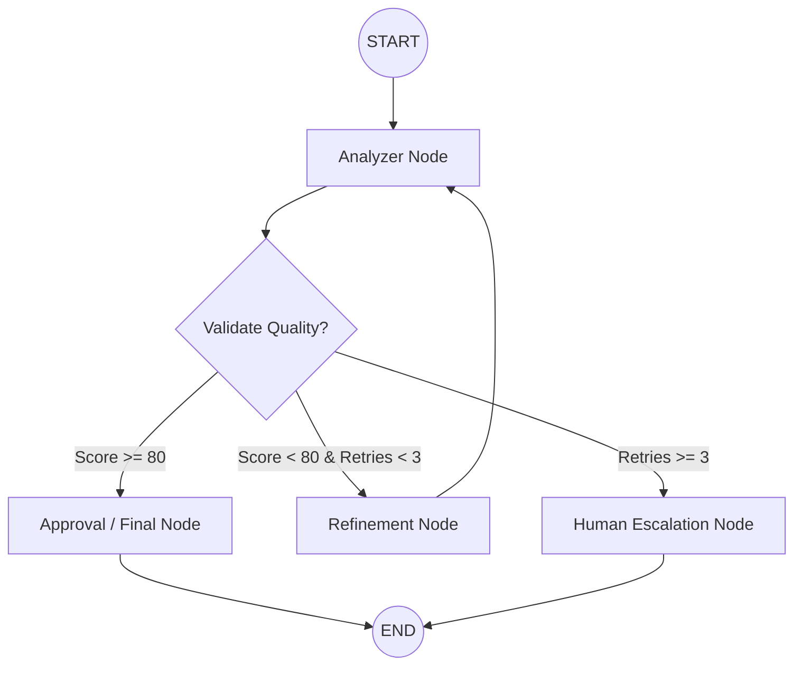

```python
def quality_routing_condition(state: PipelineState) -> str:
    if state.get("is_approved", False):
        return "approved"
    if state.get("iteration_count", 0) >= 3:
        return "escalate"
    return "refine"

# builder.add_conditional_edges(
#     "analyzer",
#     quality_routing_condition,
#     {
#         "approved": "approver_node",
#         "refine": "refiner_node",
#         "escalate": "escalation_node"
#     }
# )
```

---

### 9.3 Human-in-the-Loop (HITL) Checkpoints & State Interruption

High-stakes actions (e.g., executing financial transfers, modifying production infrastructure, sending external emails) must not run autonomously without human verification. LangGraph supports native execution interruption:

```python
# Compile graph with compile-time breakpoints
# app = builder.compile(
#     checkpointer=MemorySaver(),
#     interrupt_before=["execute_wire_transfer_node"]
# )

# Execution proceeds until reaching the breakpoint, where it safely pauses:
# thread_conf = {"configurable": {"thread_id": "tx-88301"}}
# for event in app.stream(initial_input, config=thread_conf):
#     print(event)

# State can be inspected, audited, or edited:
# current_state = app.get_state(thread_conf)
# print(current_state.next) # -> ('execute_wire_transfer_node',)

# Resume execution upon human authorization:
# app.invoke(None, config=thread_conf)
```

---

### 9.4 Multi-Agent Architectures: Supervisor & Swarm Topologies

For complex workflows, monolith agents struggle with prompt clutter and tool confusion. **Multi-Agent Systems** decompose tasks across focused specialist subgraphs coordinated by a supervisor router:

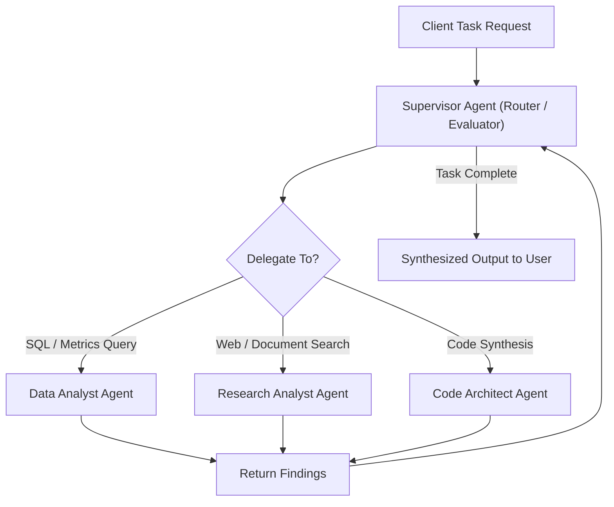

---

## 10.0 🛡️ Model Context Protocol (MCP) & Production Middleware

### 10.1 Decoupled Tool Ecosystems with MCP

The **Model Context Protocol (MCP)**, initiated by Anthropic, standardizes how applications expose data sources, file systems, and tools to LLMs over a secure client-server protocol. Instead of hardcoding bespoke tool integrations inside individual Python applications, MCP servers expose standard interfaces over stdio or HTTP/SSE:

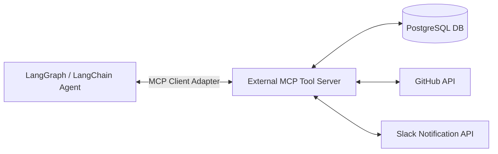

---

### 10.2 Security Middleware: Dynamic PII Redaction & Sanitization

Enterprise production architectures must scrub Personally Identifiable Information (PII) before payloads are transmitted to third-party model providers:

```python
import re
from langchain_core.messages import HumanMessage, BaseMessage

class PIIRedactionMiddleware:
    def __init__(self):
        self.email_pattern = re.compile(r"[a-zA-Z0-9_.+-]+@[a-zA-Z0-9-]+\.[a-zA-Z0-9-.]+")
        self.ssn_pattern = re.compile(r"\b\d{3}-\d{2}-\d{4}\b")

    def sanitize(self, text: str) -> str:
        text = self.email_pattern.sub("[REDACTED_EMAIL]", text)
        text = self.ssn_pattern.sub("[REDACTED_SSN]", text)
        return text

    def process_messages(self, messages: list[BaseMessage]) -> list[BaseMessage]:
        sanitized = []
        for msg in messages:
            if isinstance(msg.content, str):
                msg.content = self.sanitize(msg.content)
            sanitized.append(msg)
        return sanitized
```

---

### 10.3 Pre-Execution and Post-Execution Guardrails

- **Pre-execution guardrails**: Inspect input prompts for prompt injection, jailbreaks, toxicity, and unauthorized scopes before sending them to the LLM.
- **Post-execution guardrails**: Verify that model outputs match expected schemas, contain zero hallucinations against retrieved context, and do not leak internal system prompts or secrets.

---

## 11.0 🔭 Observability, Tracing, Testing & LLM Evals

### 11.1 Full-Stack Tracing with LangSmith

Debugging non-deterministic agent workflows requires full tracing visibility. Configuring three environment variables enables automated, zero-overhead tracing in **LangSmith**:

```bash
export LANGCHAIN_TRACING_V2="true"
export LANGCHAIN_API_KEY="lsv2_pt_..."
export LANGCHAIN_PROJECT="enterprise-customer-agent"
```

LangSmith traces capture:
- Exact inputs and outputs for every node, runnable, and tool.
- Step-by-step latency, Time To First Token (TTFT), and token consumption.
- Exact tool-calling schemas and raw API error stack traces.

---

### 11.2 Deterministic Unit Testing with `GenericFakeChatModel`

To test chains and agents in CI/CD pipelines without incurring API costs or dealing with non-deterministic model outputs, LangChain provides `GenericFakeChatModel`:

```python
import pytest
from langchain_core.language_models.fake_chat_models import GenericFakeChatModel
from langchain_core.messages import AIMessage
from langchain_core.prompts import ChatPromptTemplate
from langchain_core.output_parsers import StrOutputParser

def test_lcel_transformation_pipeline():
    # Setup mock LLM returning predetermined responses
    fake_model = GenericFakeChatModel(messages=iter([
        AIMessage(content="VALIDATED_INFRASTRUCTURE_PLAN")
    ]))
    
    prompt = ChatPromptTemplate.from_template("Verify: {plan}")
    chain = prompt | fake_model | StrOutputParser()
    
    result = chain.invoke({"plan": "Deploy Redis cluster in multi-AZ"})
    assert result == "VALIDATED_INFRASTRUCTURE_PLAN"
```

---

### 11.3 Agent Trajectory & LLM-as-a-Judge Evaluation

Evaluating agent pipelines requires assessing the entire execution trajectory in addition to the final output:
1. **Tool Selection Accuracy**: Did the agent choose the correct tool for the task?
2. **Argument Precision**: Were the extracted tool arguments valid and accurate?
3. **Trajectory Efficiency**: Did the agent get stuck in cyclic loops or execute redundant calls?

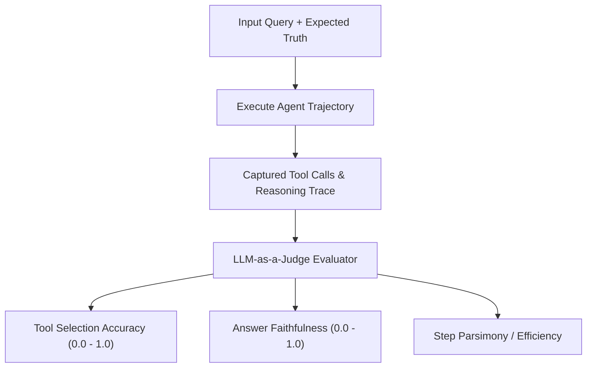

---

## 12.0 ⚖️ Advantages, Limitations & Architecture Trade-offs

| Dimension | Advantages & Strengths | Limitations & Operational Challenges | Architectural Trade-off / Mitigation |
| :--- | :--- | :--- | :--- |
| **LangChain Core & LCEL** | Standardized model abstractions; functional composition; built-in streaming & batching | Learning curve for pipe semantics; debugging deep pipelines can be complex without tracing | Use LangSmith tracing; isolate complex transformations inside tested `RunnableLambda` units. |
| **LangGraph Workflows** | Explicit, cyclic state machine control; persistent checkpointing; native human-in-the-loop support | Increased boilerplate compared to basic scripts; state serialization requires careful schema design | Always use `TypedDict` and `add_messages` reducers; keep state payloads lightweight. |
| **RAG Architectures** | Grounds models on private data; eliminates retraining costs; provides clear source citations | Semantic search failures on keywords; chunk boundary fragmentation; embedding drift | Implement Hybrid Search (BM25 + Dense) paired with Cross-Encoder reranking. |
| **Autonomous ReAct Agents** | Dynamic problem solving; automatically decomposes tasks; integrates with external tools | Risk of infinite loops; non-deterministic latency; compounding reasoning errors | Enforce hard iteration limits (`max_iterations`); use compile-time breakpoint approvals for side-effects. |

---

## 13.0 🏢 Real-World Production Patterns & Use Cases

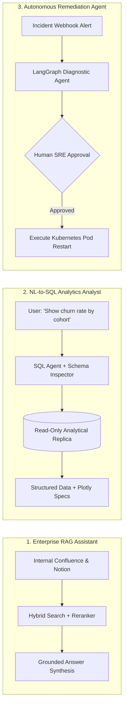

1. **Grounded Legal & Financial Contract Analysis**:
   - Hybrid retrieval across thousands of PDF regulatory filings.
   - Pydantic structured output extraction to flag high-risk liability clauses.
2. **Self-Correcting Natural-Language-to-SQL Engine**:
   - Agent inspects database schemas, writes SQL queries, and catches execution syntax errors.
   - Automatically loops error output back to the model for self-correction before returning results to users.
3. **Autonomous Customer Service Remediation**:
   - Supervisor model identifies refund requests and verifies order data.
   - Execution pauses via LangGraph checkpoints until a customer service lead approves refunds over \$100.

---

## 14.0 ⚠️ Common Pitfalls & Anti-Patterns (And How to Fix Them)

### Anti-Pattern 1: Overwriting State Lists Instead of Using Reducers
- **Mistake**: Defining state as `messages: list` without a reducer. Every node returning a new message completely replaces and wipes the prior conversation history.
- **Fix**: Always wrap state message fields with `Annotated[list[BaseMessage], add_messages]`.

### Anti-Pattern 2: Relying on String Matching for Tool Outputs
- **Mistake**: Using string search or regex parsing on raw model outputs to detect tool calls.
- **Fix**: Use native provider tool binding (`model.bind_tools([tool])`) and check `AIMessage.tool_calls`.

### Anti-Pattern 3: Inadequate Chunk Overlap in RAG
- **Mistake**: Chunking text with zero token overlap. Critical context spanning chunk boundaries is cut in half, degrading embedding quality.
- **Fix**: Set `chunk_overlap` to 10-20% of total `chunk_size` (e.g., size 1000, overlap 150).

### Anti-Pattern 4: Allowing Destructive Tool Side-Effects Autonomously
- **Mistake**: Giving agents direct write, update, or delete access to external APIs without validation.
- **Fix**: Enforce read-only tools by default. Gate destructive operations behind LangGraph `interrupt()` checkpoints.

---

## 15.0 💼 Technical Interview Preparation: Questions & Architectural Scenarios

### Q1: Why did the LangChain ecosystem move from `AgentExecutor` to LangGraph?
> **Answer**: `AgentExecutor` was an opaque, linear while-loop that could not cleanly handle complex real-world workflows: multi-agent coordination, branch parallelization, state time-travel, or dynamic human intervention. LangGraph refactors cognitive workflows into explicit, deterministic state machines where developers control the state schema, nodes, conditional edges, and persistence layer directly.

### Q2: What is the purpose of the `add_messages` reducer in LangGraph?
> **Answer**: The `add_messages` reducer function specifies how new message updates merge into existing state. Instead of replacing the list, it appends incoming messages. It also handles deduplication by updating existing messages if an incoming message shares an identical `id`.

### Q3: How do you address the "Lost in the Middle" problem in RAG architectures?
> **Answer**: Transformers tend to pay closer attention to tokens at the very beginning and very end of long input contexts, often missing information in the middle. Mitigations include:
> 1. Limiting retrieved chunk count $K$ using high-precision Cross-Encoder reranking.
> 2. Re-ordering retrieved chunks to place the highest-scoring documents at the beginning and end of the prompt context.
> 3. Using contextual compression to extract only the most relevant sentences from retrieved chunks.

### Q4: When should you use a Cross-Encoder over a Bi-Encoder?
> **Answer**: Bi-encoders compute query and document embeddings independently, making them ideal for initial candidate retrieval across millions of documents via sub-millisecond vector indexing ($O(1)$ ANN search). Cross-encoders process the query and document simultaneously through full self-attention, capturing deeper semantic relevance at higher computational cost ($O(N)$). Production systems combine both in a two-stage pipeline: retrieve 50 candidates with a Bi-encoder, then rerank down to the top 3-5 with a Cross-encoder.

---

## 16.0 🚀 End-to-End Capstone: Enterprise Financial Research & Compliance Agent

This self-contained, executable script demonstrates an end-to-end multi-agent LangGraph system with structured outputs, typed tools, state checkpointers, and conditional routing:

```python
"""
Enterprise Financial Research & Compliance Agent
A complete, self-contained LangGraph application.
"""
from typing import Annotated, Literal
from typing_extensions import TypedDict
from pydantic import BaseModel, Field

from langchain_core.messages import BaseMessage, HumanMessage, SystemMessage
from langchain_core.tools import tool
from langchain.chat_models import init_chat_model
from langgraph.graph import StateGraph, START, END
from langgraph.graph.message import add_messages
from langgraph.checkpoint.memory import MemorySaver

# --- 1. Typed Tools ---
@tool
def lookup_stock_metric(ticker: str) -> str:
    """Retrieves financial ratios for a given stock ticker."""
    metrics = {
        "NVDA": "P/E Ratio: 55.4, YoY Revenue Growth: 122%, Debt-to-Equity: 0.17",
        "AAPL": "P/E Ratio: 32.1, YoY Revenue Growth: 6%, Debt-to-Equity: 1.45"
    }
    return metrics.get(ticker.upper(), f"No analytical data found for ticker: {ticker}")

# --- 2. Structured Compliance Schema ---
class ComplianceVerdict(BaseModel):
    is_compliant: bool = Field(description="True if analysis contains sufficient risk disclosures.")
    confidence_score: float = Field(description="Score between 0.0 and 1.0.")
    risk_summary: str = Field(description="Summary of identified investment risks.")

# --- 3. State Machine Definition ---
class FinancialAgentState(TypedDict):
    messages: Annotated[list[BaseMessage], add_messages]
    ticker: str
    compliance_passed: bool

# --- 4. Node Implementations ---
model = init_chat_model("gpt-4o-mini", model_provider="openai")
tools = [lookup_stock_metric]
model_with_tools = model.bind_tools(tools)
compliance_model = model.with_structured_output(ComplianceVerdict)

def research_analyst_node(state: FinancialAgentState):
    """Gathers data and produces the initial financial briefing."""
    sys_prompt = SystemMessage(content="You are a senior equity analyst. Query metrics using tools and draft a comprehensive briefing.")
    response = model_with_tools.invoke([sys_prompt] + state["messages"])
    return {"messages": [response]}

def tool_execution_node(state: FinancialAgentState):
    """Executes requested tool calls."""
    last_message = state["messages"][-1]
    tool_outputs = []
    for tool_call in getattr(last_message, "tool_calls", []):
        if tool_call["name"] == "lookup_stock_metric":
            result = lookup_stock_metric.invoke(tool_call["args"])
            from langchain_core.messages import ToolMessage
            tool_outputs.append(ToolMessage(content=str(result), tool_call_id=tool_call["id"]))
    return {"messages": tool_outputs}

def compliance_audit_node(state: FinancialAgentState):
    """Audits briefing for regulatory compliance and risk disclosures."""
    last_analyst_msg = state["messages"][-1].content
    audit_prompt = f"Audit the following analyst briefing for balanced risk disclosures:\n\n{last_analyst_msg}"
    verdict: ComplianceVerdict = compliance_model.invoke(audit_prompt)
    return {"compliance_passed": verdict.is_compliant}

# --- 5. Routing Logic ---
def route_after_analyst(state: FinancialAgentState) -> Literal["tools", "compliance"]:
    last_msg = state["messages"][-1]
    if getattr(last_msg, "tool_calls", None):
        return "tools"
    return "compliance"

def route_after_compliance(state: FinancialAgentState) -> Literal[END, "researcher"]:
    if state.get("compliance_passed", False):
        return END
    return "researcher"

# --- 6. Build & Compile StateGraph ---
builder = StateGraph(FinancialAgentState)
builder.add_node("researcher", research_analyst_node)
builder.add_node("tools", tool_execution_node)
builder.add_node("compliance", compliance_audit_node)

builder.add_edge(START, "researcher")
builder.add_conditional_edges("researcher", route_after_analyst, {"tools": "tools", "compliance": "compliance"})
builder.add_edge("tools", "researcher")
builder.add_conditional_edges("compliance", route_after_compliance, {END: END, "researcher": "researcher"})

app = builder.compile(checkpointer=MemorySaver())

if __name__ == "__main__":
    session_config = {"configurable": {"thread_id": "portfolio-review-001"}}
    input_payload = {"messages": [HumanMessage(content="Analyze NVDA financial health and growth profile.")], "ticker": "NVDA"}
    print("Executing Financial Compliance Agent...")
    # for update in app.stream(input_payload, config=session_config):
    #     print(update)
```

---

## 17.0 ⚡ Quick Revision, Mathematical Formulations, CLI Commands & Roadmap

### 17.1 Mathematical Foundations of Modern LLM Pipelines

# Vector Space Cosine Similarity
$$\text{Cosine Similarity}(u, v) = \frac{u \cdot v}{\|u\|_2 \|v\|_2} = \frac{\sum_{i=1}^d u_i v_i}{\sqrt{\sum_{i=1}^d u_i^2} \sqrt{\sum_{i=1}^d v_i^2}}$$

# Reciprocal Rank Fusion (RRF) for Hybrid Retrieval ($k = 60$)
$$\text{RRF Score}(d \in D) = \sum_{m \in M} \frac{1}{k + r_m(d)}$$

# Available Context Window Budget
$$C_{\text{available}} = C_{\text{window}} - \left( T_{\text{system}} + T_{\text{tools}} + T_{\text{history}} + T_{\text{response\_reserve}} \right)$$

# Discrete State Machine Transition Recurrence
$$S_{t+1} = \mathcal{T}(S_t, A_t, O_t) \quad \text{where } O_t = \text{Execute}(A_t)$$

# Retrieval Precision at K
$$\text{Precision@K} = \frac{|\text{Relevant Documents} \cap \text{Top-K Retrieved}|}{K}$$

# Faithfulness in Grounded Generation
$$\text{Faithfulness} = \frac{|\text{Grounded Claims Identified in Answer Supported by Context}|}{|\text{Total Identifiable Claims Extracted from Answer}|}$$

---

### 17.2 Core Import & Method Reference Cheat Sheet

| Primitive | Python Import Path | Primary Operational Method |
| :--- | :--- | :--- |
| **Model Loader** | `from langchain.chat_models import init_chat_model` | `init_chat_model("gpt-4o", model_provider="openai")` |
| **Messages** | `from langchain_core.messages import HumanMessage, AIMessage, ToolMessage` | `HumanMessage(content="...")` |
| **Structured Output** | Core method on all `BaseChatModel` instances | `model.with_structured_output(PydanticSchema)` |
| **Prompt Template** | `from langchain_core.prompts import ChatPromptTemplate, MessagesPlaceholder` | `ChatPromptTemplate.from_messages([...])` |
| **Runnables** | `from langchain_core.runnables import RunnableParallel, RunnablePassthrough` | `chain = step1 \| step2 \| step3` |
| **StateGraph** | `from langgraph.graph import StateGraph, START, END` | `builder = StateGraph(StateSchema)` |
| **Reducers** | `from langgraph.graph.message import add_messages` | `messages: Annotated[list[BaseMessage], add_messages]` |
| **Checkpointers** | `from langgraph.checkpoint.memory import MemorySaver` | `app = builder.compile(checkpointer=MemorySaver())` |
| **Recursive Splitter** | `from langchain_text_splitters import RecursiveCharacterTextSplitter` | `splitter.split_documents(docs)` |
| **Hybrid Search** | `from langchain.retrievers import EnsembleRetriever` | `EnsembleRetriever(retrievers=[bm25, dense], weights=[0.5, 0.5])` |

---

### 17.3 Essential Terminal & Environment Commands

# Setup Virtual Environment and Dependencies
```bash
python -m venv .venv
source .venv/bin/activate  # On Windows: .venv\Scripts\activate
pip install --upgrade langchain langchain-core langgraph langchain-openai langchain-community chromadb faiss-cpu
```

# Configure Observability Tracing & Keys
```bash
export OPENAI_API_KEY="sk-..."
export ANTHROPIC_API_KEY="sk-ant-..."
export LANGCHAIN_TRACING_V2="true"
export LANGCHAIN_API_KEY="lsv2_pt_..."
export LANGCHAIN_PROJECT="applied-langchain-handbook"
```

---

### 17.4 Visual Engineering Mastery Roadmap

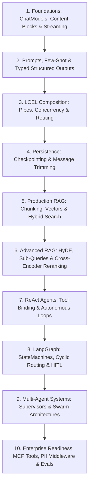
