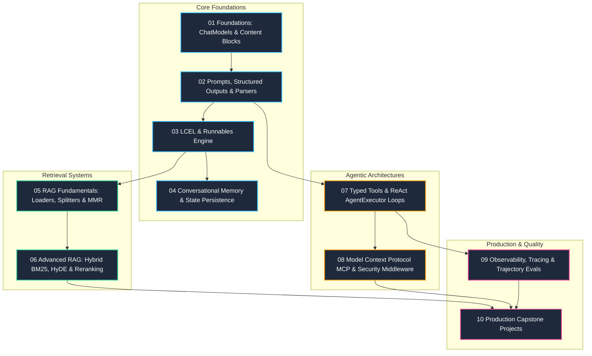

<div align="center">

# ⚡ Applied LangChain Engineering Handbook 🚀

**A structured, production-grade syllabus and reference architecture for building real-world AI applications with LangChain v0.3 / v1.0, LCEL, RAG, and Autonomous Agents.**

[](https://www.python.org/)
[](https://python.langchain.com/)
[](#-under-active-development--roadmap)
[](#-open-source--contributing)
[](./LICENSE)

[📖 Master Handbook](./MASTER_HANDBOOK.md) • [🗺️ Syllabus](#-master-syllabus--learning-path) • [🚀 Quickstart](#-quickstart-guide) • [🤝 Contributing](#-open-source--contributing) • [🍳 What's Cooking](#-under-active-development--roadmap)

---

</div>

## 📣 Announcements & Project Status

> [!IMPORTANT]
> ### 🚧 Actively Under Development — More Content Coming!
> This repository is a living, evolving project under **active daily development**. We are continually adding new modules, end-to-end architectures, production deployment patterns, benchmarks, and real-world capstone projects.
>
> ⭐ **Star and watch this repo** to stay updated as new chapters, recipes, and features drop!

> [!TIP]
> ### 🤝 100% Open Source — Join Us & Contribute!
> **This is a community-first, open-source handbook!** Whether you want to fix a typo, add an advanced RAG pattern, propose a new capstone idea, improve documentation, or share cutting-edge LLM engineering recipes, **your contributions are warmly welcomed and celebrated**. Check out our [Contributing Guide](#-open-source--contributing) to jump right in.

---

## 🌟 Why This Handbook?

Most LangChain tutorials rely on outdated abstractions (`LLMChain`, legacy `RetrievalQA`, deprecated agents) that no longer reflect modern best practices. 

This repository is built from the ground up for **LangChain v0.3 / v1.0**, adhering strictly to:

- **⚡ Modern LCEL First**: Composable, type-safe execution pipelines with stream/batch/async native support.
- **🛡️ Zero-Breakage Mock Fallbacks**: Every single script runs seamlessly out-of-the-box — even without API keys — via deterministic mock model fallbacks (`GenericFakeChatModel`).
- **📦 Clean Separation of Concerns**: From atomic prompts to complex tool-calling agents and Model Context Protocol (MCP) servers.
- **🏭 Production Ready**: Structured schema enforcement with Pydantic v2, token streaming, thread-safe memory persistence, PII redaction middleware, and LangSmith evaluation suites.
- **📚 Companion Deep-Dives**:
  - 📖 **[MASTER_HANDBOOK.md](./MASTER_HANDBOOK.md)**: All-in-one comprehensive field guide and theoretical master notes.
  - 🔍 **[swapnil3104 / RAG-Engineering](https://github.com/swapnil3104/RAG-Engineering)**: Specialized companion repository for high-scale enterprise RAG, chunking benchmarks, and hybrid search.

---

## 🗺️ Master Architecture & Learning Path



---

## 📂 Master Syllabus & Learning Modules

Every module includes clean, runnable Python scripts and an in-depth standalone `README.md` guide:

| Module | Focus Area | Key Concepts Covered | Theory & Notes | Code Recipes |
| :---: | :--- | :--- | :---: | :--- |
| **01** | **Foundations** | Architecture, `init_chat_model`, Multimodal Content Blocks, Token Streaming & Batching | [01-foundations/README.md](./01-foundations/README.md) | [`01_init_chat_model.py`](./01-foundations/01_init_chat_model.py)<br>[`02_messages_and_blocks.py`](./01-foundations/02_messages_and_blocks.py)<br>[`03_streaming_and_batching.py`](./01-foundations/03_streaming_and_batching.py) |
| **02** | **Prompts & Output Parsers** | `ChatPromptTemplate`, `MessagesPlaceholder`, Few-Shot, `.with_structured_output()`, Pydantic v2 | [02-prompts-and-structured-output/README.md](./02-prompts-and-structured-output/README.md) | [`01_prompt_templates.py`](./02-prompts-and-structured-output/01_prompt_templates.py)<br>[`02_few_shot_prompting.py`](./02-prompts-and-structured-output/02_few_shot_prompting.py)<br>[`03_structured_outputs.py`](./02-prompts-and-structured-output/03_structured_outputs.py)<br>[`04_output_parsers.py`](./02-prompts-and-structured-output/04_output_parsers.py) |
| **03** | **LCEL & Runnables** | LangChain Expression Language (LCEL), Piping (`\|`), `RunnableParallel`, Branching, Routing & Fallbacks | [03-lcel-and-runnables/README.md](./03-lcel-and-runnables/README.md) | [`01_sequential_chains.py`](./03-lcel-and-runnables/01_sequential_chains.py)<br>[`02_parallel_execution.py`](./03-lcel-and-runnables/02_parallel_execution.py)<br>[`03_routing_and_fallbacks.py`](./03-lcel-and-runnables/03_routing_and_fallbacks.py) |
| **04** | **Memory & Persistence** | Stateless LLMs, `RunnableWithMessageHistory`, `InMemoryChatMessageHistory`, Context Trimming, Rolling Summarization | [04-memory-and-persistence/README.md](./04-memory-and-persistence/README.md) | [`01_thread_persistence.py`](./04-memory-and-persistence/01_thread_persistence.py)<br>[`02_message_trimming.py`](./04-memory-and-persistence/02_message_trimming.py)<br>[`03_summarization_memory.py`](./04-memory-and-persistence/03_summarization_memory.py) |
| **05** | **RAG Fundamentals** | Document Loaders (Text, CSV, PDF, Web, Lazy), Semantic Chunking, FAISS / Chroma Stores, MMR, LCEL Retrieval Chains | [05-rag-fundamentals/README.md](./05-rag-fundamentals/README.md) | [`01_document_loaders.py`](./05-rag-fundamentals/01_document_loaders.py)<br>[`02_text_splitters.py`](./05-rag-fundamentals/02_text_splitters.py)<br>[`03_embeddings_and_stores.py`](./05-rag-fundamentals/03_embeddings_and_stores.py)<br>[`04_basic_rag_chain.py`](./05-rag-fundamentals/04_basic_rag_chain.py) |
| **06** | **Advanced RAG** | Hybrid Search (Sparse BM25 + Dense Vectors), Query Transformations, HyDE, Cross-Encoder Re-ranking | [06-advanced-rag/README.md](./06-advanced-rag/README.md) | [`01_hybrid_search.py`](./06-advanced-rag/01_hybrid_search.py)<br>[`02_query_transformation.py`](./06-advanced-rag/02_query_transformation.py)<br>[`03_reranking_pipeline.py`](./06-advanced-rag/03_reranking_pipeline.py) |
| **07** | **Tools & Agents** | Typed `@tool` Decorator, Prebuilt Tools (Search/REPL/SQL), ReAct Loops, `create_tool_calling_agent`, `AgentExecutor` | [07-tools-and-agents/README.md](./07-tools-and-agents/README.md) | [`01_custom_tools.py`](./07-tools-and-agents/01_custom_tools.py)<br>[`02_prebuilt_tools.py`](./07-tools-and-agents/02_prebuilt_tools.py)<br>[`03_create_agent_loop.py`](./07-tools-and-agents/03_create_agent_loop.py) |
| **08** | **MCP & Middleware** | Model Context Protocol (MCP) Adapters, Client Stubs, PII Redaction Middleware, Pre/Post Model Guardrails | [08-mcp-and-middleware/README.md](./08-mcp-and-middleware/README.md) | [`01_mcp_server_tools.py`](./08-mcp-and-middleware/01_mcp_server_tools.py)<br>[`02_pii_redaction.py`](./08-mcp-and-middleware/02_pii_redaction.py)<br>[`03_custom_middleware.py`](./08-mcp-and-middleware/03_custom_middleware.py) |
| **09** | **Observability & Evals** | LangSmith Run Tracing, Mock LLM Testing (`GenericFakeChatModel`), Unit Testing Chains, Agent Trajectory Evals | [09-observability-and-evals/README.md](./09-observability-and-evals/README.md) | [`01_langsmith_tracing.py`](./09-observability-and-evals/01_langsmith_tracing.py)<br>[`02_unit_testing_llms.py`](./09-observability-and-evals/02_unit_testing_llms.py)<br>[`03_agent_trajectory_evals.py`](./09-observability-and-evals/03_agent_trajectory_evals.py) |
| **10** | **Capstone Projects** | Full-Stack AI Systems: Streaming FastAPI RAG Assistant, Safe NL-to-SQL Analyst, Multi-Tool MCP Researcher | Capstones Directory | [`01-rag-knowledge-assistant`](./10-capstone-projects/01-rag-knowledge-assistant/)<br>[`02-nl-to-sql-analyst`](./10-capstone-projects/02-nl-to-sql-analyst/)<br>[`03-mcp-research-agent`](./10-capstone-projects/03-mcp-research-agent/) |

---

## 🍳 Under Active Development & Roadmap

We are constantly polishing existing tutorials and implementing cutting-edge patterns. Here is what is currently cooking for upcoming releases:

- [ ] **Multi-Modal Agent Workflows**: Vision + Audio block processing via LCEL.
- [ ] **Local LLM Playbook**: Running DeepSeek-R1, Llama 3, and Qwen locally with LangChain via Ollama and vLLM.
- [ ] **Advanced Guardrails**: Deep integration with NeMo Guardrails and custom regex/embedding safety fences.
- [ ] **Production RAG Evaluation**: Automated ragas and DeepEval integration recipes with LangSmith datasets.
- [ ] **Async Streaming UI Integration**: Next.js & Streamlit frontend blueprints consuming LangChain streaming endpoints.
- [ ] **More Capstones**: Enterprise document search engine with multi-tenant permissions.

> Have an idea for a topic or recipe you'd love to see? [Open a Feature Request](https://github.com/swapnil3104/Applied-Langchain-Handbook/issues)!

---

## 🚀 Quickstart Guide

### 1. Clone the Repository
```bash
git clone https://github.com/swapnil3104/Applied-Langchain-Handbook.git
cd Applied-Langchain-Handbook
```

### 2. Set Up Virtual Environment & Dependencies
```bash
# Create and activate virtual environment
python -m venv .venv
# On Windows:
.venv\Scripts\activate
# On Linux/macOS:
# source .venv/bin/activate

# Install dependencies in editable mode
pip install -e .
```

### 3. Configure Environment Variables
```bash
cp .env.example .env
```
Open `.env` and add your API keys:
```env
OPENAI_API_KEY=your_key_here
# Optional:
LANGSMITH_API_KEY=your_key_here
LANGSMITH_TRACING=true
```
*(No API key? No problem! The scripts automatically switch to internal mock models so you can test and experiment immediately.)*

### 4. Run Any Module
Every script is completely self-contained and runnable:
```bash
# Run chat model initialization & streaming
python 01-foundations/01_init_chat_model.py

# Run RAG hybrid search pipeline
python 06-advanced-rag/01_hybrid_search.py

# Run ReAct agent loop
python 07-tools-and-agents/03_create_agent_loop.py
```

---

## 🤝 Open Source & Contributing

Contributions are what make the open-source community an incredible place to learn, inspire, and create. Any contributions you make are **greatly appreciated**!

### Ways You Can Contribute
- 💡 **Add New Code Recipes**: Have an interesting LangChain pattern, custom tool, or vector store integration? Submit a script!
- 📝 **Improve Documentation & Explanations**: Help refine explanations, fix typos, or add visual diagrams.
- 🐛 **Report or Fix Bugs**: Encountered an issue? Open an issue or submit a patch.
- 🎨 **Expand Capstones**: Add UI clients (Streamlit/FastAPI/Next.js) or expand existing capstone features.
- ⭐ **Share & Star**: Star the repo and share it with fellow developers and learning groups!

### How to Submit a Pull Request

```bash
# 1. Fork the repo and create your branch from main
git checkout -b feature/amazing-langchain-recipe

# 2. Make your edits or add new scripts/notes
# Verify that your script runs cleanly without errors:
python <your_script>.py

# 3. Commit your changes with a meaningful message
git commit -m "feat(rag): add parent-document retriever recipe"

# 4. Push to your forked repository
git push origin feature/amazing-langchain-recipe

# 5. Open a Pull Request on GitHub with a brief description of your addition!
```

---

## 📁 Repository Directory Structure

```text
Applied-Langchain-Handbook/
├── 01-foundations/                  # ChatModels, Multimodal blocks, Streaming
├── 02-prompts-and-structured-output/# Templates, Pydantic outputs, Parsers
├── 03-lcel-and-runnables/           # LCEL syntax, Parallel, Routing, Fallbacks
├── 04-memory-and-persistence/       # Chat history, Trimming, Summarization
├── 05-rag-fundamentals/             # Loaders, Chunking, Embeddings, FAISS/Chroma
├── 06-advanced-rag/                 # Hybrid BM25+Dense, HyDE, Cross-Encoder Rerank
├── 07-tools-and-agents/             # Typed Tools, ReAct loops, AgentExecutor
├── 08-mcp-and-middleware/           # MCP protocol stubs, Guardrails, PII redaction
├── 09-observability-and-evals/      # LangSmith tracing, Unit tests, Trajectory evals
├── 10-capstone-projects/            # Production end-to-end applications
│   ├── 01-rag-knowledge-assistant/
│   ├── 02-nl-to-sql-analyst/
│   └── 03-mcp-research-agent/
├── MASTER_HANDBOOK.md               # Complete consolidated single-file handbook
├── pyproject.toml                   # Project metadata and dependencies
└── README.md                        # Master documentation & syllabus
```

---

## 📜 License & Acknowledgments

- **License**: Released under the [MIT License](./LICENSE). Feel free to learn, remix, and build upon this code.
- **Inspiration**: Crafted with love for AI engineers, learners, and the broader LangChain open-source ecosystem.

<div align="center">

**Enjoying the handbook? Give it a ⭐ to support the project!**

[](https://github.com/swapnil3104/Applied-Langchain-Handbook)

</div>
