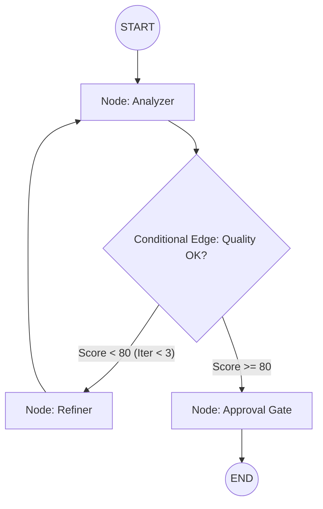
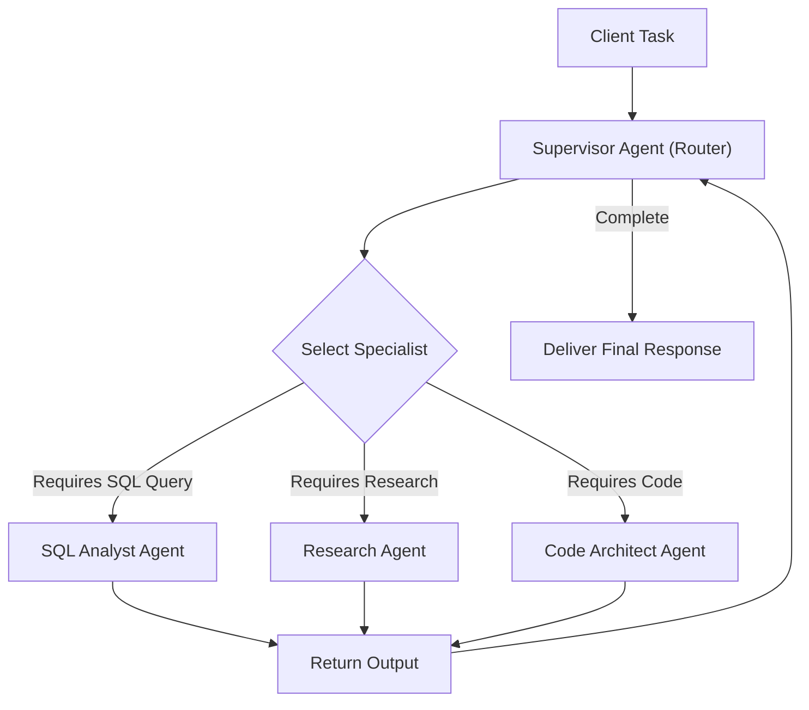
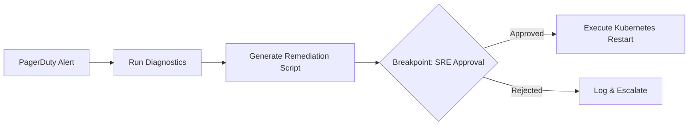
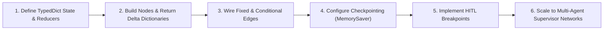

# 📚 Module 08: LangGraph Workflows & Multi-Agent Systems

> A comprehensive, production-grade guide to cyclical cognitive architectures with LangGraph: StateGraph state machines, reducers, dynamic conditional edges, Human-in-the-Loop (HITL) checkpoints, and hierarchical multi-agent supervisor topologies.

---

## 📑 Table of Contents

- [1.0 🏗️ Core Architecture & The StateGraph Paradigm](#10-️-core-architecture--the-stategraph-paradigm)
  - [1.1 Why LangGraph: Beyond Linear DAGs to Cyclical State Machines](#11-why-langgraph-beyond-linear-dags-to-cyclical-state-machines)
  - [1.2 The State Machine Anatomy: State, Nodes, Edges, Reducers](#12-the-state-machine-anatomy-state-nodes-edges-reducers)
  - [1.3 Core Primitives & Terminology](#13-core-primitives--terminology)
- [2.0 🧠 State Schemas & Reducer Mechanics](#20--state-schemas--reducer-mechanics)
  - [2.1 Defining Typed State with `TypedDict`](#21-defining-typed-state-with-typeddict)
  - [2.2 The `add_messages` Reducer & Automatic Deduplication](#22-the-add_messages-reducer--automatic-deduplication)
  - [2.3 Node Contract: Returning Delta Updates](#23-node-contract-returning-delta-updates)
- [3.0 🔀 Control Flow: Fixed & Conditional Edges](#30--control-flow-fixed--conditional-edges)
  - [3.1 Fixed Sequential Edges (`add_edge`)](#31-fixed-sequential-edges-add_edge)
  - [3.2 Dynamic Routing via Conditional Edges (`add_conditional_edges`)](#32-dynamic-routing-via-conditional-edges-add_conditional_edges)
  - [3.3 Cyclical Reasoning & Preventing Infinite Loops](#33-cyclical-reasoning--preventing-infinite-loops)
- [4.0 🛑 Human-in-the-Loop (HITL) & Breakpoints](#40--human-in-the-loop-hitl--breakpoints)
  - [4.1 Compile-Time Breakpoints (`interrupt_before` & `interrupt_after`)](#41-compile-time-breakpoints-interrupt_before--interrupt_after)
  - [4.2 Inspecting, Auditing & Editing State During Halts](#42-inspecting-auditing--editing-state-during-halts)
  - [4.3 Resuming Suspended Executions](#43-resuming-suspended-executions)
- [5.0 👥 Multi-Agent Architectures: Supervisor Pattern](#50--multi-agent-architectures-supervisor-pattern)
  - [5.1 Decomposing Monolith Agents into Specialist Subgraphs](#51-decomposing-monolith-agents-into-specialist-subgraphs)
  - [5.2 The Supervisor Router Pattern](#52-the-supervisor-router-pattern)
  - [5.3 Cross-Agent State Synthesis & Return Gates](#53-cross-agent-state-synthesis--return-gates)
- [6.0 ⚖️ Advantages, Limitations & Architecture Trade-offs](#60-️-advantages-limitations--architecture-trade-offs)
- [7.0 🏢 Real-World Production Patterns](#70--real-world-production-patterns)
- [8.0 ⚠️ Common Pitfalls & Anti-Patterns (And How to Fix Them)](#80-️-common-pitfalls--anti-patterns-and-how-to-fix-them)
- [9.0 💼 Technical Interview Preparation: Questions & Scenarios](#90--technical-interview-preparation-questions--scenarios)
- [10.0 🛠️ Practical Hands-On Implementation Guide](#100-️-practical-hands-on-implementation-guide)
- [11.0 ⚡ Quick Revision, Mathematical Formulations, CLI Commands & Roadmap](#110--quick-revision-mathematical-formulations-cli-commands--roadmap)

---

## 1.0 🏗️ Core Architecture & The StateGraph Paradigm

### 1.1 Why LangGraph: Beyond Linear DAGs to Cyclical State Machines

Standard LCEL chains and workflow tools (like Airflow or standard DAG orchestrators) are strictly Directed Acyclic Graphs: data moves in one forward direction without loops.

Real cognitive tasks require **cyclical graphs**:
- Code generation requires a loop: Write Code $\to$ Run Tests $\to$ Observe Errors $\to$ Refactor Code $\to$ Retest.
- Research agents require a loop: Query Web $\to$ Read Sources $\to$ Formulate Follow-up Search $\to$ Synthesize.

**LangGraph** extends LangChain by modeling workflows as explicit, cyclical state machines with persistent checkpointing.

---

### 1.2 The State Machine Anatomy: State, Nodes, Edges, Reducers



---

### 1.3 Core Primitives & Terminology

- **`StateGraph`**: The builder class that defines nodes, edges, and state schemas.
- **`State`**: A typed schema (usually a `TypedDict`) defining all data flowing through the graph.
- **`Node`**: A standard Python function `(state) -> dict` returning state deltas.
- **`Edge`**: Directs execution from one node to another.
- **`Conditional Edge`**: Directs execution dynamically to target nodes based on evaluating state values.
- **`Reducer`**: A merge function defining how node return values update existing state fields.
- **`START` / `END`**: Virtual boundary nodes representing graph entry and termination points.

---

## 2.0 🧠 State Schemas & Reducer Mechanics

### 2.1 Defining Typed State with `TypedDict`

The graph's central state is defined as a Python `TypedDict`:

```python
from typing import Annotated, List
from typing_extensions import TypedDict
from langchain_core.messages import BaseMessage
from langgraph.graph.message import add_messages

class PipelineState(TypedDict):
    messages: Annotated[List[BaseMessage], add_messages]
    research_summary: str
    iteration_count: int
    is_complete: bool
```

---

### 2.2 The `add_messages` Reducer & Automatic Deduplication

By default, when a node returns a dictionary key (e.g. `{"count": 2}`), it overwrites the existing value. For conversational messages, we want incoming messages to be appended to the list rather than overwriting history.

The `add_messages` reducer handles this automatically:
- **Append**: If an incoming message has a new `id`, it is appended to the message list.
- **Update**: If an incoming message shares an `id` with an existing message, it updates that message in place.

---

### 2.3 Node Contract: Returning Delta Updates

Nodes do not need to return the entire state object. A node only returns a dictionary containing the specific fields it has modified:

```python
def increment_counter_node(state: PipelineState) -> dict:
    # Read current state
    current_count = state.get("iteration_count", 0)
    # Return ONLY the delta update
    return {"iteration_count": current_count + 1}
```

---

## 3.0 🔀 Control Flow: Fixed & Conditional Edges

### 3.1 Fixed Sequential Edges (`add_edge`)

Fixed edges create deterministic execution transitions:

```python
from langgraph.graph import StateGraph, START, END

builder = StateGraph(PipelineState)
builder.add_node("gather_requirements", gather_node)
builder.add_node("generate_spec", spec_node)

# Execution always proceeds from START to gather, then to spec
builder.add_edge(START, "gather_requirements")
builder.add_edge("gather_requirements", "generate_spec")
```

---

### 3.2 Dynamic Routing via Conditional Edges (`add_conditional_edges`)

Conditional edges evaluate state and route to different target nodes based on output conditions:

```python
def check_code_quality(state: PipelineState) -> str:
    if state.get("is_complete", False):
        return "deploy"
    if state.get("iteration_count", 0) >= 3:
        return "escalate"
    return "refactor"

builder.add_conditional_edges(
    "code_evaluator",
    check_code_quality,
    {
        "deploy": "deployment_node",
        "refactor": "refactoring_node",
        "escalate": "human_escalation_node"
    }
)
```

---

### 3.3 Cyclical Reasoning & Preventing Infinite Loops

Cyclic edges allow graphs to loop back to prior nodes for iterative refinement. To prevent runaway execution loops, production graphs must implement:
1. An explicit iteration counter in the state schema.
2. A conditional edge checking whether `iteration_count >= max_iterations`.
3. A circuit breaker route that exits to a human review or fallback node.

---

## 4.0 🛑 Human-in-the-Loop (HITL) & Breakpoints

### 4.1 Compile-Time Breakpoints (`interrupt_before` & `interrupt_after`)

When an agent needs to perform sensitive, high-impact actions (e.g. deleting cloud infrastructure, transferring funds, publishing public announcements), execution can be paused at designated nodes:

```python
from langgraph.checkpoint.memory import MemorySaver

# Graph pauses execution immediately BEFORE running 'execute_wire_transfer'
app = builder.compile(
    checkpointer=MemorySaver(),
    interrupt_before=["execute_wire_transfer"]
)
```

---

### 4.2 Inspecting, Auditing & Editing State During Halts

When an execution pauses at a breakpoint, external applications can inspect and modify graph state before resuming:

```python
config = {"configurable": {"thread_id": "transfer-session-101"}}

# Execute until breakpoint is hit
# for event in app.stream(initial_input, config=config):
#     print(event)

# Inspect current state
# snapshot = app.get_state(config)
# print(snapshot.next)  # ('execute_wire_transfer',)
# print(snapshot.values) # Current state variables

# Optionally edit state values (e.g. human updates transfer amount)
# app.update_state(config, {"approved_amount": 500.00})
```

---

### 4.3 Resuming Suspended Executions

To resume execution after human approval, invoke the graph with `None` as the input payload:

```python
# Resumes from the breakpoint using existing checkpointed state
# app.invoke(None, config=config)
```

---

## 5.0 👥 Multi-Agent Architectures: Supervisor Pattern

### 5.1 Decomposing Monolith Agents into Specialist Subgraphs

As tasks grow in scope, single monolith agents struggle with prompt pollution and tool confusion. **Multi-Agent Architectures** partition responsibility across specialized worker agents:
- **Research Agent**: Focused on web searches, document ingestion, and summarization.
- **SQL Data Analyst**: Focused on database querying and metrics computation.
- **Code Architect**: Focused on writing and testing code.

---

### 5.2 The Supervisor Router Pattern

A central **Supervisor Agent** inspects incoming tasks, selects which specialist agent should act next, and aggregates their outputs:



---

## 6.0 ⚖️ Advantages, Limitations & Architecture Trade-offs

| Dimension | Advantages & Strengths | Limitations & Bottlenecks | Recommended Engineering Mitigation |
| :--- | :--- | :--- | :--- |
| **StateGraph** | Explicit, deterministic control flow; full visibility into every node's state | More verbose boilerplate than simple linear scripts | Use standard templates and clean modular node functions |
| **Checkpointers** | Native persistence per `thread_id`; supports state rollbacks and time travel | Database writes add latency to each node execution step | Use fast persistence backends (PostgreSQL with async connection pools) |
| **HITL Breakpoints** | Eliminates risk of unauthorized automated actions; ensures compliance | Halts asynchronous execution; requires external UI for human approval | Build a dedicated dashboard or Slack bot for approval notifications |
| **Multi-Agent Systems**| Clear separation of concerns; smaller, more reliable specialist prompts | Increased token usage due to inter-agent communication overhead | Use lightweight models (GPT-4o-mini) for routing; save flagship models for workers |

---

## 7.0 🏢 Real-World Production Patterns

### Pattern: Automated Infrastructure Remediation with Human Gate
An alert webhook triggers a diagnostic graph that runs diagnostics and prepares a fix. Execution pauses at a breakpoint until an SRE approves the action:



---

## 8.0 ⚠️ Common Pitfalls & Anti-Patterns (And How to Fix Them)

### Anti-Pattern 1: Mutating State In-Place
- **Mistake**: Direct in-place mutation inside node functions:
  ```python
  def bad_node(state):
      state["messages"].append(AIMessage(content="..."))
      return state
  ```
  This bypasses reducers and breaks checkpoint history tracking.
- **Fix**: Return only the delta dictionary:
  ```python
  def good_node(state):
      return {"messages": [AIMessage(content="...")]}
  ```

### Anti-Pattern 2: Missing Termination Checks in Cyclic Graphs
- **Mistake**: Creating a cyclic edge without an iteration counter or exit condition. If the model fails to produce the expected output, the graph enters an infinite loop, exhausting API quota.
- **Fix**: Always track an `iteration_count` in state and enforce an exit edge when `iteration_count >= MAX_STEPS`.

---

## 9.0 💼 Technical Interview Preparation: Questions & Scenarios

### Q1: What makes LangGraph structurally different from traditional DAG workflow orchestrators like Airflow?
> **Answer**: Traditional DAG orchestrators like Apache Airflow are strictly **acyclic**—they prohibit circular edges and loops. However, agentic cognitive reasoning is fundamentally cyclical: agents generate drafts, evaluate results, observe tool outputs, and loop back to refactor. LangGraph supports cyclical state machines natively with first-class state checkpointing, reducers, and dynamic conditional edges.

### Q2: How does the `add_messages` reducer prevent message duplication in LangGraph?
> **Answer**: `add_messages` inspects the unique `id` attribute of each message. If an incoming message has an `id` that already exists in the state message list, it updates that message in-place rather than appending a duplicate. If the `id` is unique or unset, it is appended to the end of the list.

---

## 10.0 🛠️ Practical Hands-On Implementation Guide

```python
"""
Module 08 - Complete LangGraph Cyclical Workflow Example
"""
from typing import Annotated, Literal
from typing_extensions import TypedDict
from langchain_core.messages import BaseMessage, HumanMessage, AIMessage
from langgraph.graph import StateGraph, START, END
from langgraph.graph.message import add_messages
from langgraph.checkpoint.memory import MemorySaver

# 1. State Schema
class QualityCheckState(TypedDict):
    messages: Annotated[list[BaseMessage], add_messages]
    code: str
    quality_score: int
    iteration: int

# 2. Nodes
def writer_node(state: QualityCheckState) -> dict:
    it = state.get("iteration", 0) + 1
    # Simulate code generation improving on each iteration
    code = f"def handle_request(): return 'SUCCESS_V{it}'"
    return {"code": code, "iteration": it}

def reviewer_node(state: QualityCheckState) -> dict:
    # Score increases with iterations
    score = min(state["iteration"] * 35, 100)
    return {"quality_score": score}

# 3. Conditional Routing
def route_quality(state: QualityCheckState) -> Literal["reviewer", "writer", END]:
    if state.get("quality_score", 0) >= 80:
        return END
    if state.get("iteration", 0) >= 3:
        return END
    return "writer"

# 4. Graph Construction
builder = StateGraph(QualityCheckState)
builder.add_node("writer", writer_node)
builder.add_node("reviewer", reviewer_node)

builder.add_edge(START, "writer")
builder.add_edge("writer", "reviewer")
builder.add_conditional_edges("reviewer", route_quality, {
    "writer": "writer",
    END: END
})

app = builder.compile(checkpointer=MemorySaver())

if __name__ == "__main__":
    config = {"configurable": {"thread_id": "test-review-01"}}
    final_state = app.invoke({"messages": [HumanMessage(content="Write handler")], "iteration": 0}, config=config)
    print(f"Final Iteration: {final_state['iteration']}, Final Score: {final_state['quality_score']}")
```

---

## 11.0 ⚡ Quick Revision, Mathematical Formulations, CLI Commands & Roadmap

### 11.1 Key Formulations in Graph State Machines

# Discrete State Transition Function
$$S_{t+1} = \mathcal{F}(S_t, \Delta_t) \quad \text{where } \Delta_t = \text{NodeFunction}(S_t)$$

# Loop Termination Safety Invariant
$$\text{Condition: } \forall \text{ execution paths, } \exists t \le T_{\text{max}} \text{ such that } \text{Edge}(S_t) \to \text{END}$$

---

### 11.2 Core Method & Import Reference

| Primitive | Python Import Path | Primary Operational Method |
| :--- | :--- | :--- |
| **StateGraph** | `from langgraph.graph import StateGraph, START, END` | `builder = StateGraph(StateDict)` |
| **add_messages** | `from langgraph.graph.message import add_messages` | `Annotated[list[BaseMessage], add_messages]` |
| **add_node** | Method on `StateGraph` | `builder.add_node("name", node_func)` |
| **add_edge** | Method on `StateGraph` | `builder.add_edge("from", "to")` |
| **add_conditional_edges** | Method on `StateGraph` | `builder.add_conditional_edges("from", routing_fn, {...})` |
| **MemorySaver** | `from langgraph.checkpoint.memory import MemorySaver` | `builder.compile(checkpointer=MemorySaver())` |

---

### 11.3 Essential CLI Setup Commands

```bash
pip install langgraph langchain langchain-core langchain-openai
```

---

### 11.4 LangGraph Learning Roadmap


